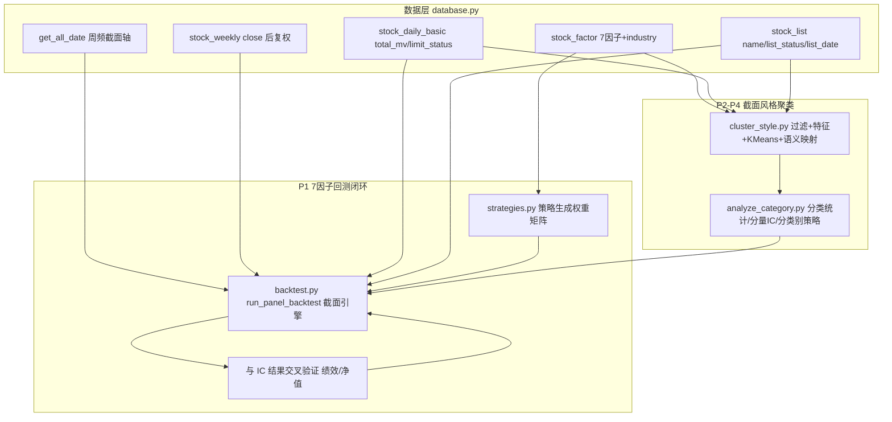

## 产品概述

在已完成 7 因子（规模/估值/波动/反转/盈利/成长/现金）计算与周更的基础上，分两阶段推进：(P1) 先打通 7 因子闭环回测——把空壳的策略模块与回测模块改造成「截面多资产周频」因子策略与回测引擎，并用已有 IC 分析结果交叉验证；(P2-P4) 再新增「截面风格聚类分类」模块，把每只股票在某个交易日截面下的因子向量归入蓝筹/成长/创新/周期/其他五类（首版周期类暂并入其他），并递进产出分类统计、分类别因子有效性、分类别策略回测。

## 核心功能

- 因子策略库：以 7 因子分数生成选股权重，支持单因子分位选股与多因子合成选股，支持 long-only 选 top-N 与 long-short 头尾分组。
- 截面回测引擎：以周频调仓跑多资产组合，按「本周因子、下周交易」滞后一期避免前视，支持剔除 ST/退市/停牌/次新股与可交易性判定，输出净值曲线、年化收益、夏普、最大回撤、换手率与分组收益。
- 回测与 IC 交叉验证：逐因子回测结果的方向需与既有 IC/ICIR 一致，再跑多因子合成，输出绩效表与中文净值图。
- 截面风格聚类：每截面剔除脏样本后，用风格 4 维（规模/估值/盈利/成长）加行业周期标签做 KMeans 聚类，并按簇质心用固定规则映射为蓝筹/成长/创新/其他四类，无法归类的兜底为其他类（周期股首版并入其他，周期标签先算先存）。
- 分类结果稳定性：同一股票跨期不因簇编号漂移而跳类，回测按截面时点（point-in-time）取用分类。
- 分类别研究：输出各类数量与市值/行业/因子分布、聚类质量（轮廓系数）与跨期稳定度；再按类别单独算因子 Rank IC；最后按类别设定不同因子权重做策略并纳入回测，与全局策略对比。

## 边界与约束

- 先完成 P1 回测闭环，聚类为后续阶段；两阶段共用同一套回测引擎。
- 首版不做周期类判定，只计算并保存行业周期标签。
- 不破坏 7 因子现有计算与落库链路，复用现有数据访问接口与输出约定。
- 聚类维度不做波动/反转/现金，这三者保留给后续策略打分。

## 技术栈选择

- 语言与运行环境：Python 3.11，Windows / PowerShell（沿用现有 .env 环境）。
- 数据与计算：pandas、numpy、SQLAlchemy + SQLite（data/raw/stock.db）、matplotlib；全部沿用现有依赖。
- 聚类实现：为不引入新外部依赖，用 numpy 自实现 KMeans（kmeans++ 初始化 + 固定随机种子 + 多次重启 n_init + 最大迭代上限），而非引入 scikit-learn。
- 复用模块：src/database.py（get_all_date、get_daily_basic_by_trade_date、get_weekly_by_trade_date、get_weekly_indicator_by_trade_date、get_fina_indicator_by_ann_date、StockFactor/StockWeekly/StockDailyBasic/StockList）、src/factor.py（WEEKLY_FACTOR_COLS）、src/analyze_factor_ic.py（前向收益与 Rank IC 口径、_setup_cjk_font 中文字体处理）。

## 实现方案

### 阶段 P1：7 因子闭环回测

1. 策略层（strategies.py）：以「生成权重矩阵」为核心抽象，策略与回测引擎解耦。

- 声明 FACTOR_META，集中标注 7 因子方向（均已核对为「分越高越好」，direction=+1），便于引擎统一取用。
- FactorStrategy 基类定义 generate_weights(factor_panel, trade_dates, top_n, mode) 接口，返回「股票 × 日期」权重矩阵。
- SingleFactorStrategy：按单因子分数排序选 top-N 等权；mode='long_only' 选头组，mode='long_short' 头组多、尾组空。
- MultiFactorStrategy：先对入选因子按方向统一并做截面 rank 标准化，再等权或自定义权重合成综合分，选 top-N 或头尾分组。
- 保留原 BaseStrategy 抽象；移除空实现的 MaCross 占位或标注弃用，避免误导。

2. 回测层（backtest.py）：在保留原单标的 run_backtest 的同时，新增截面引擎。

- load_backtest_data(start, end)：读 stock_factor 因子面板、stock_weekly 后复权 close、stock_daily_basic(limit_status/total_mv)、stock_list(name/list_status/list_date)；以 get_all_date() 的周频序列为统一截面轴。
- Universe 过滤：剔除名称含 ST/退、list_status 非上市、上市不足 N 周（次新）、当期无因子或无价格的样本。
- 收益与调仓：对 weekly.close 按 ts_code 分组计算前向一期收益（shift(-1)/close-1）；引擎用 T 期权重、滞后 1 期（T+1 周）收益加权，杜绝前视；可选按 limit_status 处理涨跌停不可成交。
- 组合收益与指标：组合周收益 = 权重 × 个股前向收益；净值曲线、年化收益、夏普（周频用 √52 年化）、最大回撤、换手率；并按分位输出分组收益净值，用于与 IC 结果交叉验证。

3. 验证：逐因子跑回测，其头组-尾组收益方向必须与 output/ic_ir_summary_12w.csv、ic_ir_summary_60w.csv 的 IC 符号一致；再跑多因子合成；输出绩效 CSV（utf-8-sig）与中文净值图。

### 阶段 P2-P4：截面风格聚类分类

1. 聚类核心（新建 src/cluster_style.py）：

- 数据准备：读 stock_factor 的 7 因子 + industry + name，合并 stock_daily_basic 的 total_mv/circ_mv 用于大中小盘校验。
- Universe 过滤：与回测一致的脏样本剔除（ST/退/停牌/次新）。
- 特征构造：STYLE_FACTOR_COLS = ("size","valuation","profit","growth") 四维；对每个截面做 z-score 标准化（因子本已在 [-100,100]，再标准化使四维等权）。另计算并保存「行业周期标签」列（基于 Tushare industry 的周期行业名单映射），首版仅存不用。
- 聚类：每截面独立跑 numpy KMeans（K=4），固定种子；若存在上一截面质心，则以之作为初始化（增量分配）以提升跨期稳定。
- 语义映射（关键）：对每个簇质心按固定规则判定语义（蓝筹=规模高且估值高且盈利高；成长=规模中且成长高且盈利不低；创新=规模低且成长极高且盈利低；其他=兜底），当多簇竞争同一语义时按优先级/亲密度唯一分配，保证标签语义稳定、不随簇编号漂移。
- 规则兜底：距最近质心超过阈值、或有效因子不足、或落入竞争落败的样本统一归「其他」；周期行业样本首版同样归「其他」。
- 输出：各截面「ts_code, trade_date, cluster, style_label, cyclical_tag, distance」CSV（utf-8-sig）。

2. 分类统计与可视化（新建 src/analyze_category.py 或并入）：

- 各类数量占比、市值分位、行业 Top 分布、4 维因子均值雷达/箱线；聚类质量（轮廓系数）；跨期稳定度（相邻截面类标签 Jaccard 或留存率）。
- 复用 analyze_factor_ic.py 的 _setup_cjk_font 中文字体处理，图输出到 output/。

3. 分类别因子有效性：在每个类内单独算 7 因子 Rank IC/ICIR/正率（沿用 12/60 周前向收益口径），输出分类别汇总 CSV，观察同因子在不同风格的差异。
4. 分类别策略：按类别语义设定不同因子权重（蓝筹偏 valuation+profit、成长偏 growth、创新偏 growth+cash、其他按全局），用 FactorStrategy 生成权重后接入 P1 的 run_panel_backtest，与全局单策略对比超额与风险指标。

### 关键决策与理由

- 策略与引擎解耦（策略只产出权重矩阵）：使单因子、多因子、分类别策略共用一套回测，避免重复实现回测逻辑（DRY）。
- 滞后 1 期调仓：因子在 T 期已知，T+1 期交易，杜绝前视，与项目既有前向收益口径一致。
- 语义映射而非簇编号：KMeans 簇编号每期会变，用质心+固定规则映射才能保证「蓝筹/成长/创新/其他」的语义含义跨期稳定。
- 自实现 KMeans：既不破坏项目「零新增依赖」的既有约束，又能完全控制初始化与种子，保证回测可复现。
- 周期类首版并入其他：项目无申万行业与周期指标，强行分周期不可靠，先算标签、后迭代，遵循最小可靠原则。

### 性能与可靠性

- 回测为向量化（groupby + shift + 矩阵乘/权重点积），单次全历史周频回测在分钟级；聚类逐截面进行，样本数千、维度 4，numpy KMeans 单截面开销极小。
- 大对象按需从库读取并显式释放；CSV 分块写出。
- 所有随机过程固定种子，保证同一数据重复运行结果一致。

## 实现注意（Execution Notes）

- 复用而非新造：优先用 get_all_date() 作为统一截面轴，用 get_weekly_by_trade_date 取价格，用 stock_list 的 name/list_status/list_date 做过滤，与 screen_stocks.py 的剔除口径（("ST","退")）保持一致。
- 前视防护：严禁用当期或未来收益进入选股；组合收益必须来自 T 之后一期。
- 年化口径：周频序列夏普用 √52 年化（勿沿用旧骨架的 √252 日频口径）。
- 输出约定：CSV 统一 encoding="utf-8-sig"，图沿用中文字体处理，避免中文乱码。
- 边界与稳定性：因子缺失的股票在聚类/回测中剔除而非填零；聚类结果需处理空簇与标签冲突；跨期稳定性需在实现中显式处理（上一质心初始化 + 语义映射）。
- 向后兼容：保留 backtest.py 原 run_backtest 与 strategies.py 原 BaseStrategy，避免影响其他调用点；主入口 main.py 的接入作为可选，不强制改动。

## 架构设计



## 目录结构

```text
buffeet/
├── src/
│   ├── strategies.py        # [MODIFY] 策略层改造。新增 FACTOR_META（7因子方向）；
│   │                        #   FactorStrategy 基类（generate_weights -> 股票×日期权重矩阵）；
│   │                        #   SingleFactorStrategy（单因子 top-N，long_only/long_short）；
│   │                        #   MultiFactorStrategy（rank 标准化+等权/自定义权重合成选股）；
│   │                        #   CategoryStrategy（分类别因子权重，供 P4 用）。保留 BaseStrategy，弃用空壳 MaCross。
│   ├── backtest.py          # [MODIFY] 新增截面多资产回测。load_backtest_data(start,end)：
│   │                        #   读因子面板/周频close/daily_basic/stock_list，以 get_all_date 为截面轴并做 universe 过滤；
│   │                        #   run_panel_backtest(weights, weekly_returns, cfg)：T期权重×T+1期收益（滞后1期防前视）、
│   │                        #   可选涨跌停不成交、输出净值/年化/夏普(√52)/最大回撤/换手/分组收益。
│   │                        #   保留原单标的 run_backtest。
│   ├── cluster_style.py     # [NEW] 截面聚类核心。universe 过滤（ST/退/停牌/次新）；
│   │                        #   特征=风格4维(size/valuation/profit/growth)+行业周期标签(仅存不用)；
│   │                        #   numpy KMeans(K=4, 固定种子, 上一截面质心初始化)；
│   │                        #   质心→语义映射(蓝筹/成长/创新/其他)+规则兜底；输出各截面分类 CSV。
│   └── analyze_category.py  # [NEW] 分类别研究驱动。分类统计与可视化(数量/市值/行业/因子分布、轮廓系数、跨期稳定度)；
│                            #   分类别因子 Rank IC/ICIR；分类别策略接入 run_panel_backtest 并与全局策略对比。
│                            #   复用 analyze_factor_ic.py 的前向收益口径与中文字体处理。
├── main.py                  # [MODIFY, 可选] 串联「回测 -> 聚类 -> 分类别研究」入口，保持轻量。
└── output/                  # [生成] 回测绩效 CSV/净值 PNG、分类别 CSV/分布 PNG（utf-8-sig）。
```

## 关键代码结构

```python
# strategies.py：策略只产出「股票 × 日期」权重矩阵，与回测引擎解耦
FACTOR_META = {
    "size": +1, "valuation": +1, "volility": +1, "reverse": +1,
    "profit": +1, "growth": +1, "cash": +1,   # +1 = 分越高越好
}

class FactorStrategy:
    def generate_weights(self, factor_panel, trade_dates, top_n,
                         mode="long_only") -> "pd.DataFrame":
        """返回 index=ts_code, columns=trade_date 的目标权重矩阵。"""
        raise NotImplementedError

class SingleFactorStrategy(FactorStrategy):
    def __init__(self, factor: str, direction: int = +1): ...

class MultiFactorStrategy(FactorStrategy):
    def __init__(self, weights: dict[str, float], standardize: bool = True): ...

class CategoryStrategy(FactorStrategy):
    def __init__(self, class_factor_weights: dict[str, dict[str, float]]): ...
```

```python
# backtest.py：截面多资产周频回测（新引擎；单标的 run_backtest 保留）
def load_backtest_data(start: str, end: str) -> dict:
    """返回 {factor_panel, weekly_returns, universe}，统一到 get_all_date() 周频截面轴。"""

def run_panel_backtest(weights, weekly_returns, cfg) -> dict:
    """T期权重 × T+1期个股收益（滞后1期）；返回 equity_curve/annual_return/sharpe/max_drawdown/turnover/per_group_returns。"""
```

```python
# cluster_style.py：语义映射不可依赖簇编号，需固定规则
STYLE_FACTOR_COLS = ("size", "valuation", "profit", "growth")  # 风格4维
CYCLICAL_INDUSTRIES = frozenset({...})  # 行业周期标签名单（首版仅存不用）

def classify_cross_section(factor_df, k: int = 4) -> "pd.DataFrame":
    """单截面：过滤 -> z-score -> KMeans -> 质心语义映射 -> 规则兜底；返回带 style_label 的结果。"""
```

## 验证要点

- P1 方向一致性：逐因子回测头-尾组收益方向与 ic_ir_summary_12w/60w.csv 的 IC 符号一致；多因子合成后风险收益优于单因子基线。
- P1 前视核验：构造极小样例，确认引擎用的是 T+1 期收益；调仓日与因子日严格错开一期。
- P2 分类合理性：各类数量合理、市值/行业/因子分布符合直觉；轮廓系数与跨期 Jaccard 稳定度达标；抽样人工核对若干家公司的归类。
- P3 分类别 IC：同因子在不同类别 IC 差异显著，验证风格分层的价值。
- P4 分类别策略：分类别策略相对全局策略的超额与回撤改善可量化复现。
- 幂等与可复现：固定随机种子，同一数据重复运行结果一致。

## Agent Extensions

### SubAgent

- **code-explorer**
- Purpose：在实现回测引擎与聚类核心前，核实并固化需复用的接口与约定——(1) 数据加载接口 get_all_date / get_weekly_by_trade_date / get_daily_basic_by_trade_date / upsert_stock_factor 的确切签名与返回列；(2) analyze_factor_ic.py 的前向收益口径（groupby(ts_code).close.shift(-h)/s - 1）与 _setup_cjk_font 字体处理；(3) screen_stocks.py 的 ST/退剔除与 CSV utf-8-sig 输出约定；(4) StockFactor.industry 的取值形态与 stock_list 的 list_status/list_date 字段，确认 universe 过滤与行业周期标签的可行实现。
- Expected outcome：产出一份「可复用接口与约定清单」（含文件路径、函数签名、关键字段、既有过滤与输出风格），据此确保 strategies.py/backtest.py/cluster_style.py 的实现严格对齐现有架构、无前视、无重复造轮子，并明确行业周期标签首版仅存不用的落点。