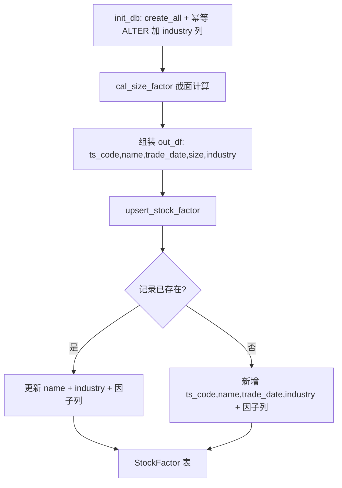

## 用户需求

在 StockFactor 表的 `name` 字段后新增 `industry` 列，并调整规模因子计算函数 `cal_size_factor`，使每个交易日截面在落库规模因子时，同时把每只股票所属行业一并写入 StockFactor。

## 产品概述

StockFactor 因子库表当前仅存 `ts_code/name/trade_date` 主键与标识信息及 10 个因子分数。新增 `industry` 维度列后，无需回查股票列表即可直接从因子库获知个股行业，便于后续按行业分析、筛选与组内比较。规模因子计算流程需顺带把行业随 `size` 分数一起 upsert 入库。

## 核心功能

- StockFactor ORM 在 `name` 之后新增 `industry`（String，可空，非主键）字段。
- `upsert_stock_factor` 在新增与更新两条路径均写入 `industry`（有值才写，缺失不影响）。
- `cal_size_factor` 组装落库 DataFrame 时增加 `industry` 列（来自截面内已生成的 `section["industry"]`）。
- 处理 SQLite 已有表的加列迁移，保证幂等（PRAGMA 检查 + ALTER TABLE ADD COLUMN）。

## 技术栈

- 语言：Python 3（与现有项目一致）
- ORM：SQLAlchemy 2.x（declarative `Mapped`/`mapped_column`）
- 数据库：SQLite（本地 `data/raw/stock.db`）
- 数据访问：复用 `src/database.py` 既有 `StockFactor`、`upsert_stock_factor`、`init_db`

## 实现方案

### 总体策略

采用"ORM 加列 + upsert 透传 + 计算函数增列 + 幂等迁移"四步法，完全复用现有 `upsert_stock_factor` 的 `_has_value` 缺失值判断机制，不引入新模式，保证与现有 10 因子落库逻辑一致。

### 关键决策

1. **industry 字段定位与属性**：在 `name` 之后、`trade_date` 主键之前插入 `industry: Mapped[str | None] = mapped_column(String(50), nullable=True, comment="所属行业")`。不纳入联合主键（避免影响现有 `ts_code+trade_date` 唯一约束），可空以兼容行业缺失股票。
2. **industry 不进入 `_FACTOR_FIELDS`**：该元组仅含 10 个分数列，industry 是元数据维度列，写入逻辑单独处理（与 `name` 同等待遇），保持 `_FACTOR_FIELDS` 语义纯净。
3. **upsert 双路径透传**：更新分支在 `db.name = row["name"]` 后增加 `if "industry" in row and _has_value(row["industry"]): db.industry = row["industry"]`；新增分支 kwargs 同样条件加入 `"industry": row["industry"]`。`required_cols` 维持 `{ts_code, trade_date, name}` 不变（industry 可选）。
4. **cal_size_factor 增列**：3.7 段 `out_df` 字典增加 `"industry": section["industry"]`。`section["industry"]` 已由 `stock_info` 映射生成（industry 为 None 时归为"未知"），无需额外计算。
5. **SQLite 迁移幂等**：`init_db()` 中 `create_all` 之后，用 `PRAGMA table_info(stock_factor)` 检查列，不存在则 `ALTER TABLE stock_factor ADD COLUMN industry VARCHAR(50)`。使用 SQLAlchemy `text` 执行原生 SQL（若 `database.py` 未导入则补 `from sqlalchemy import text`）。

### 性能与可靠性

- ALTER 仅在列缺失时执行，重复运行 `init_db` 安全幂等，无性能负担。
- `industry` 写入复用 `_has_value`，缺失时不报错、不覆盖为 None。
- 不改变现有因子计算与批量 upsert 的分批逻辑，无新增热点。

## 实现注意事项

- `database.py` 顶部 import 需确认含 `text`；当前第 13 行 `from sqlalchemy import create_engine, String, Float, Boolean, Text, Integer, DateTime, UniqueConstraint`，**不含 `text`**，需补充 `text`（或改用 engine 原生连接执行 PRAGMA）。
- 迁移代码放在 `init_db()` 内 `create_all` 之后，确保首次建表与新加列都覆盖。
- 不改动 `cal_all_factors` 骨架、其他 `cal_*_factor` 占位函数、测试入口结构。

## 架构设计



## 目录结构

```
src/
├── database.py   # [MODIFY]
│   - 顶部 import 补充 text（SQLAlchemy）
│   - StockFactor ORM：name 后新增 industry 字段（String(50), 可空）
│   - upsert_stock_factor：更新/新增两分支均按 _has_value 写入 industry
│   - init_db：create_all 后幂等 ALTER TABLE 加 industry 列
└── factor.py     # [MODIFY]
    - cal_size_factor 3.7 段：out_df 增加 industry 列（section[industry]）
```

## 关键代码结构

```python
# database.py - StockFactor ORM（name 与 trade_date 之间）
industry: Mapped[str | None] = mapped_column(
    String(50), nullable=True, comment="所属行业"
)

# database.py - init_db 幂等迁移
with engine.begin() as conn:
    cols = [r[1] for r in conn.execute(text("PRAGMA table_info(stock_factor)")).fetchall()]
    if "industry" not in cols:
        conn.execute(text("ALTER TABLE stock_factor ADD COLUMN industry VARCHAR(50)"))
```