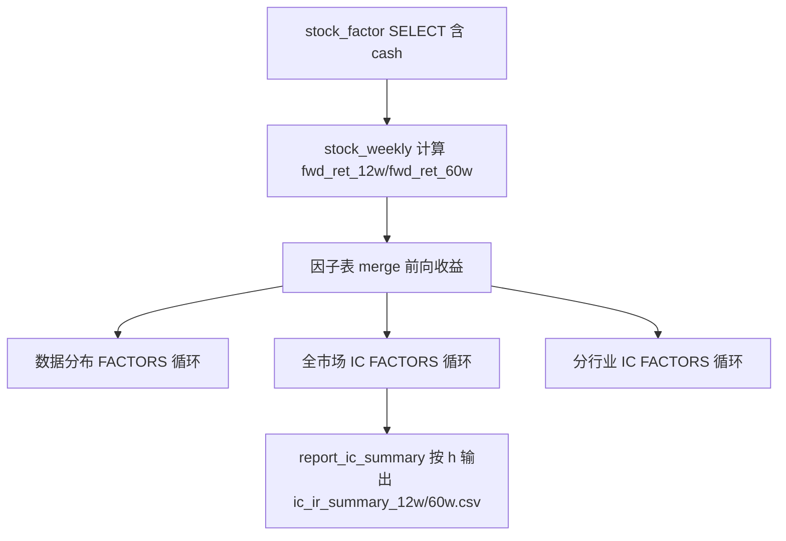

## 用户需求

调整 src/analyze_factor_ic.py，使现金因子（cash）纳入因子有效性分析，并修正 IR 汇总 CSV 输出，使得 12 周与 60 周两档前向窗口的结果分别落盘，不再互相覆盖。

## 核心功能

- 在因子分析脚本中加入现金因子 cash：使其在数据分布、全市场 Rank IC、分行业 IC、IR 汇总四个环节与现有六因子统一参与（cash 列已存在于 stock_factor 表，无需改库或改因子计算）。
- 将原先固定输出的 ic_ir_summary.csv 拆分为按前向窗口命名的两个文件：ic_ir_summary_12w.csv 与 ic_ir_summary_60w.csv，分别保存 12 周、60 周的 IC/IR 汇总结果（原逻辑因文件名固定导致 12w 被 60w 覆盖，最终只保留 60w）。

## 技术栈

- Python 3 + pandas + numpy + matplotlib（沿用现有工程，无新增依赖）
- 复用现有辅助函数：_rank_ic、ic_series、report_ic、ic_by_industry、report_ic_summary
- 数据来源：sqlite 表 stock_factor（cash 列已存在）、stock_weekly（前向收益）

## 实现方案

### 总体策略

仅修改分析脚本 src/analyze_factor_ic.py，遵循“因子清单 + SQL 列 + 统一循环”的现有架构：

1. 在 FACTORS 列表追加现金因子，并在读取 SQL 的 SELECT 列中加入 cash；由于数据分布（行233-263）、全市场 IC（行266-275）、分行业 IC（行278-290）均基于 FACTORS 自动循环，增加 cash 后会自动纳入四项分析。
2. 修改 report_ic_summary，使其接收前向窗口参数 h，并将 CSV 文件名改为 ic_ir_summary_{h}w.csv；调用处（行275）传入当前 h，从而得到 12w 与 60w 两份互不覆盖的汇总文件。

### 关键技术决策

1. **现金因子复用单列口径**：cash 与 profit/growth 同为 [-100,100] 整数，落库列名为 cash，分布分桶逻辑（bins/labels，行247-249）按 [-100,100] 区间直接复用，无需改动。
2. **最小侵入式新增因子**：仅追加 FACTORS 行与 SQL 列，避免为 cash 写独立分支，保证后续再加因子时只改一处清单。
3. **CSV 按窗口参数化命名**：report_ic_summary 增加 h 形参，文件名由固定 ic_ir_summary.csv 改为 f"ic_ir_summary_{h}w.csv"。两档窗口（12、60）各生成一份，彻底解决覆盖问题；旧的固定文件不再生成，避免误导。
4. **不改动因子计算与数据库**：cash 列由 cal_cash_factor 已 upsert 入库，脚本只读取，控制爆炸半径。

### 性能与可靠性

- 仅增加一列读取与一个因子的逐截面 IC 计算，复杂度 O(截面数 × 股票数) 与现有同量级，无新增瓶颈。
- report_ic_summary 内部仅增加文件名拼接，保持 IR=IC均值/标准差 等统计逻辑不变。
- 现有 MIN_CS / MIN_CS_I 阈值沿用，保证截面样本量要求一致。

## 实现注意事项

- FACTORS（行77-85）追加 ("cash", "现金")。
- SQL SELECT（行213-215）列清单在 growth 与 industry 之间追加 cash，保持所有 SELECT 列与 factor 列一一对应。
- report_ic_summary（行177-205）增加形参 h（默认 None 以兼容），csv_path 改为 os.path.join(OUT_DIR, f"ic_ir_summary_{h}w.csv")；调用处（行275）report_ic_summary(ic_map, label=..., h=h) 传入 h。
- 顶部 docstring（行4）因子列举补充“现金”，与实际 FACTORS 对齐。
- 不再生成固定 ic_ir_summary.csv；旧文件可保留在 output 目录，但脚本后续不再写该名。

## 架构设计

数据流保持不变，仅扩展 FACTORS 与 SQL 列：



## 目录结构

```
src/
└── analyze_factor_ic.py   # [MODIFY]
    ├── FACTORS（行77-85）：追加 ("cash","现金")
    ├── SQL SELECT（行213-215）：列清单追加 cash
    ├── report_ic_summary（行177-205）：增加 h 形参，CSV 名改为 ic_ir_summary_{h}w.csv
    ├── main 调用（行275）：传入 h
    └── 顶部 docstring（行4）：因子列举补充“现金”
```

## 关键代码结构

```python
def report_ic_summary(ic_map, label="全因子 IR 汇总", h=None):
    # ... 统计逻辑不变 ...
    csv_path = os.path.join(OUT_DIR, f"ic_ir_summary_{h}w.csv")
    res.to_csv(csv_path, index=False, encoding="utf-8-sig")
    print(f"[已保存] {csv_path}")
```