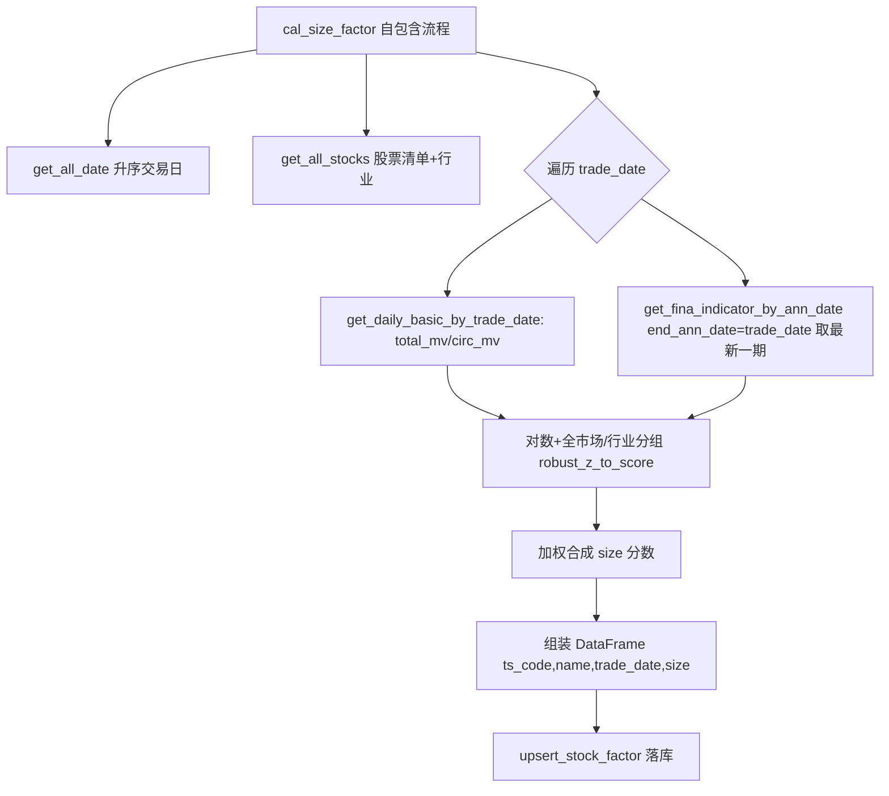

## 用户需求

完成任务10：在 factor.py 中实现规模因子（size）的完整计算与落库逻辑。

## 产品概述

规模因子是衡量股票体量大小的复合指标，由总市值、流通市值、总资产、总收入四类底数经对数变换、截面稳健标准化（robust_z_to_score，映射至[-100,100]）后按权重加权得到，逐交易日截面计算并写入 StockFactor 表。

## 核心功能

- 获取全部交易日序列并升序排序。
- 获取全部股票清单（代码、名称、行业）。
- 逐交易日截面循环：
- 查询该日 StockDailyBasic 的 total_mv、circ_mv。
- 查询该日之前最新一期的 stock_fina_indicator 的 total_assets、total_revenue（按 ann_date 维度，取每只股票 ann_date 最接近且不超过 trade_date 的最新一期）。
- 总市值、总收入取以10为底对数后全市场稳健标准化；流通市值、总资产取对数后按行业分组稳健标准化。
- 加权合成规模因子（权重：总市值4、流通市值2、总资产2、总收入2），缺项按有效权重归一。
- 将结果以字符串形式写入 StockFactor 表的 size 列。
- 调整 cal_all_factors，不再以单截面形式调用尚未实现的 cal_*_factor，改为标注跳过的骨架。
- 在 factor.py 新增测试入口，验证 cal_size_factor 真实运行。

## 技术栈

- 语言：Python 3（与现有项目一致）
- 数据处理：pandas + numpy
- 数据访问：复用 src/database.py 现有 ORM 查询函数（get_all_date / get_all_stocks / get_daily_basic_by_trade_date / get_fina_indicator_by_ann_date / upsert_stock_factor）
- 归一化：复用 factor.py 现有 robust_z_to_score

## 实现方案

### 总体策略

将 cal_size_factor 重构为自包含流程函数：内部获取交易日、股票清单，遍历每个 trade_date 做截面计算，最后批量 upsert 至 StockFactor。这与用户决策 q-2 一致，也符合各因子后续各自独立落库的整体架构方向。

### 关键决策

1. **股票清单**：按 q-0 用 database.get_all_stocks() 取 StockList 对象，构建 {ts_code: (name, industry)} 映射；industry 为 None 时归入统一分组（如 "未知"），保证 groupby 不会因 NaN 失效。
2. **财务底数匹配**：按 q-1，stock_fina_indicator 无 trade_date，用 get_fina_indicator_by_ann_date(end_ann_date=trade_date) 拉取所有 ann_date ≤ trade_date 的财务记录，按 ts_code 分组取 ann_date 最大一行（最新一期），与当日截面左连接。避免占位字段大量空值；若该股票仍无财务数据，则总资产/总收入分项记 NaN，加权时按有效权重缩放。
3. **对数变换**：使用 np.log10（底数10）。市值/资产/收入均为正数，空值保持 NaN 不参与。
4. **行业分组归一化**：流通市值、总资产按 industry 分组，组内调用 robust_z_to_score；组间独立映射至 [-100,100]，避免行业规模差异互相掩盖。
5. **加权合成**：size = (4*s_total_mv + 2*s_circ_mv + 2*s_total_assets + 2*s_total_revenue)；当部分分项全 NaN 时，按实际参与权重之和归一（有效权重/总有效权重 * 100 区间保持），防止除零。
6. **落库格式**：StockFactor.size 为 String(50)，需将数值格式化为字符串（如 round(x,2) 后 str）；upsert_stock_factor 已按 _FACTOR_FIELDS 写入且对 _has_value 做判断，DataFrame 仅需含 ts_code/name/trade_date/size。

### 性能与可靠性

- 遍历 trade_date 为 O(N)（N 为交易日数），每次循环两次数据库查询 + 内存计算，开销可控；避免在循环内对全表做无谓拉取。
- 财务数据按 end_ann_date 一次性拉取当日及之前全部记录并内存分组取最新，避免逐股票查询（N+1 风险）。
- 缺失值处理：robust_z_to_score 已保留 NaN；加权阶段显式处理全 NaN 分项，保证不抛异常。
- 落库使用现有 upsert_stock_factor 分批写入，复用既有去重/更新逻辑。

### 对 cal_all_factors 的修改

现有 cal_all_factors 调用 10 个 cal_*factor(df) 组装 13 列；其余 9 个因子函数体仍为 `...`（返回 None），直接调用会污染 DataFrame。按 q-2，移除对 cal*_factor 的单截面调用，改为保留 13 列骨架、各因子列标注"由各自流程函数独立计算落库"，函数返回空结构或仅打印提示，避免运行时报错。cal_size_factor 不再被其调用。

## 实现注意事项

- factor.py 顶部 import 需新增 get_all_stocks（其余 StockFactor / upsert_stock_factor / get_all_date 已导入）。
- 行业分组时务必将 industry 的 NaN 替换为占位字符串，否则 groupby 会丢弃。
- 测试入口保留原 **main** 的打桩逻辑作为"测试0"参考，新增"测试1"调用真实 cal_size_factor() 并打印各交易日写入条数摘要；若数据量大，可先用前若干 trade_date 验证。
- 不要改动 database.py 的任何查询函数签名，仅消费既有接口。

## 架构设计



## 目录结构

```
src/
└── factor.py   # [MODIFY]
    - 顶部 import 新增 get_all_stocks
    - 重写 cal_size_factor()：改为无参自包含流程函数，遍历交易日、查四类底数、对数变换、行业分组稳健标准化、加权合成、调用 upsert_stock_factor 落库
    - 修改 cal_all_factors()：移除对 10 个 cal_*_factor 的单截面调用，改为标注跳过的 13 列骨架，避免运行时因占位函数返回 None 报错
    - 新增 __main__ 下"测试1"：调用真实 cal_size_factor 并打印结果摘要；原打桩逻辑保留为"测试0"
```

## 关键代码结构

```python
def cal_size_factor() -> None:
    """
    规模因子自包含计算流程：遍历交易日截面，查四类底数，
    对数变换 + 稳健标准化（行业分组）+ 加权合成，落库 StockFactor.size。
    """

def cal_all_factors(df: pd.DataFrame) -> pd.DataFrame:
    """
    因子聚合入口（骨架版）：各因子由各自流程函数独立落库，
    此处仅保留 13 列占位结构，不再以单截面形式调用 cal_*_factor。
    """
```