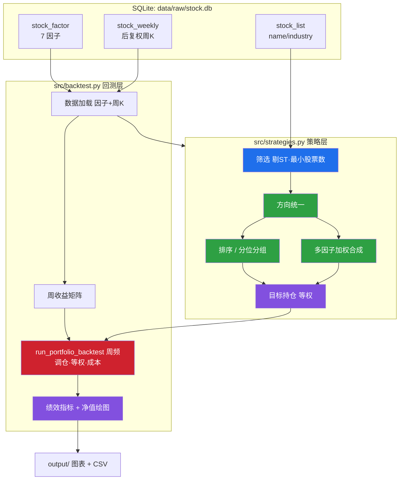

## 需求概述

放弃 MD&A/供需/护城河因子方案（暂缓），直接基于 `stock_factor` 表中**已落库的 7 个因子**（size、valuation、volility、reverse、profit、growth、cash）开展因子分组分析与策略回测。用户明确要求：**分组、筛选、排序逻辑写在 `src/strategies.py`，回测逻辑写在 `src/backtest.py`**。

## 核心功能

- **单因子分位分组**：每个因子按周频截面做分位分组（默认 5 组），输出各组净值曲线与绩效，用于因子体检（收益单调性）。
- **筛选**：股票池过滤，主口径为**剔除 ST/\*ST**（按名称含 ST），并保留每截面最少股票数保护。
- **排序**：因子截面排序，支持方向（越大越好/越小越好）。
- **多因子加权合成选股**：7 因子按方向统一后加权成综合分，选 TopN 或 TopPct 构建组合。
- **周频组合回测**：周频调仓、组内等权，复用 `config.py` 的成本参数（佣金 COMMISSION_RATE、滑点 SLIPPAGE），输出净值曲线、换手率与绩效指标（年化收益、年化波动、夏普、最大回撤、Calmar、胜率）。
- **结果输出**：净值曲线图（中文）与绩效 CSV 落到 `output/` 目录。

## 技术栈

- 语言/运行环境：Python 3.11（现有 `.env` 环境），Windows / PowerShell。
- 计算与绘图：pandas、numpy、matplotlib（沿用现有依赖，**无需新增**）。
- 数据访问：沿用现有 `data/raw/stock.db`，读取范式复用 `src/analyze_factor_ic.py` 的 `sqlite3 + pd.read_sql` 直读方式。
- 参数来源：`config.py`（成本、初始资金已存在，新增少量回测/因子参数）。
- 中文绘图：复用 `src/analyze_factor_ic.py` 的 `_setup_cjk_font()` 字体设置范式。

## 实现方案

采用**"纯函数策略层 + 组合回测引擎层"**的分层设计，两层解耦、可独立测试：

1. **strategies.py（策略层，纯 DataFrame 变换，无 DB 副作用）**：`筛选 → 方向统一 → 排序 → 分位分组 / 多因子合成 → 选股 → 目标持仓`。全部为可组合的纯函数，便于单测与复用；保留现有 `BaseStrategy` 与 `MaCrossStrategy`（向后兼容）。
2. **backtest.py（回测层）**：`数据加载 → 收益矩阵 → 组合回测 → 绩效指标 → 绘图输出`。保留现有单标的 `run_backtest` 不动（控制影响面），新增截面多资产组合引擎 `run_portfolio_backtest`。

### 关键决策与理由

- **周频调仓 + 后复权收益**：复用 `stock_weekly` 的后复权 `close`，与 `analyze_factor_ic` 的周频前向收益口径完全一致，避免两套收益体系。
- **严格 point-in-time（防未来函数）**：在周频调仓日 t 用 t 日因子值选股，收益记为 t→t+1 周收益（即因子与 `r_{t+1}` 对齐），这是本方案正确性的核心。
- **因子方向显式化**：因子值已归一化到 [-100,100]，但"越大越好/越小越好"的方向未在表内标注。方案在 `config.py` 维护 `FACTOR_DIRECTION` 方向表（默认由 `output/ic_ir_summary_*.csv` 的 IC 符号自动标定，读不到则用经验默认 + 手工覆盖），避免方向不一致导致选股反向。
- **缺项按有效权重归一**：多因子合成沿用 `factor.py` 的加权逻辑（缺项按有效权重归一），保持与因子计算口径一致。
- **成本近似**：`cost = turnover × (COMMISSION_RATE + SLIPPAGE)`，按调仓换手率单边计提，参数直接取自 config。

### 性能考量

- 收益与权重用 **pivot 成 (周 × 股票) 矩阵 + numpy 向量化**计算组合净值，避免逐股票循环；全市场约 5000 只 × 数百周，内存与耗时可控。
- 分组按 `trade_date` 用 `groupby + 分位排名` 一次性完成，避免逐日重复构造。
- 回测结果全部落 `output/`，便于复现与横向对比。

## 架构设计



## 目录结构

```
buffeet/
├── config.py                 # [MODIFY] 新增回测与因子参数：FACTOR_DIRECTION(方向表)、FACTOR_WEIGHTS(合成权重)、BACKTEST_N_GROUPS(默认5)、BACKTEST_TOP_N / BACKTEST_TOP_PCT(二选一选股口径)、MIN_STOCKS_PER_DATE(每截面最少股票数)、BACKTEST_OUT_DIR(默认 output/backtest)。复用已有 INITIAL_CAPITAL / COMMISSION_RATE / SLIPPAGE / OUTPUT_DIR，不改变其取值。
├── src/
│   ├── strategies.py         # [MODIFY] 策略层（用户指定位置）。在保留 BaseStrategy / MaCrossStrategy 的基础上新增：
│   │                         #   - exclude_st(df)：剔除名称含 ST/*ST；
│   │                         #   - filter_universe(df, *, exclude_st=True, min_stocks)：股票池过滤 + 每截面最少股票数保护；
│   │                         #   - apply_direction(df, direction)：按方向表把"越小越好"的因子取反，统一为越大越好；
│   │                         #   - rank_factor(df, factor)：按 trade_date 截面排序（pct rank）；
│   │                         #   - assign_groups(df, factor, n_groups)：分位分组标签（1..N，基于 rank 处理并列，NaN 剔除）；
│   │                         #   - composite_score(df, *, weights, direction)：多因子加权合成（缺项按有效权重归一）；
│   │                         #   - select_top(df, score_col, *, top_n=None, top_pct=None)：TopN/TopPct 选股；
│   │                         #   - build_equal_weight_holdings(...)：生成调仓日 × 股票 的等权目标持仓矩阵；
│   │                         #   - FactorGroupStrategy / MultiFactorStrategy(BaseStrategy)：封装上述流程，暴露 build_holdings()。
│   └── backtest.py           # [MODIFY] 回测层（用户指定位置）。保留现有 run_backtest 不动（向后兼容），新增：
│                             #   - load_factor_panel(db_path, start, end)：读 stock_factor（7 因子 + name + industry）；
│                             #   - load_weekly_close(db_path, start, end)：读 stock_weekly 后复权 close；
│                             #   - to_return_matrix(weekly_df)：转 (周 × 股票) 周收益矩阵；
│                             #   - run_portfolio_backtest(weights_df, ret_df, *, initial_capital, commission, slippage)：周频调仓、权重×t→t+1 收益、换手成本计提、输出净值与换手序列（严格无未来函数）；
│                             #   - performance_metrics(returns, freq=52)：年化收益/年化波动/夏普/最大回撤/Calmar/胜率；
│                             #   - plot_group_equity / plot_equity_curve：中文净值曲线（复用 _setup_cjk_font）；
│                             #   - `__main__` 演示入口：单因子分组回测 + 多因子合成回测，结果落 output/。
├── main.py                   # [MODIFY][可选] 接线"加载数据 → 策略 → 回测 → 输出"，替换现有空 TODO。
└── output/                   # [已存在] 回测图表与绩效 CSV 输出目录（默认子目录 backtest/）。
```

## 关键接口（接口级签名，示意）

```python
# strategies.py
def assign_groups(df: pd.DataFrame, factor: str, n_groups: int = 5) -> pd.Series: ...
    # 返回与原索引对齐的组标签(1..n_groups)，基于 trade_date 截面 rank 分组
def composite_score(df: pd.DataFrame, *, weights: dict, direction: dict) -> pd.Series: ...
    # 方向统一后加权，缺项按有效权重归一，返回 [-100,100]
def build_equal_weight_holdings(df, *, date_col, code_col, score_col, top_n, ...) -> pd.DataFrame: ...
    # 返回 index=调仓日, columns=ts_code, values=权重(等权) 的目标持仓矩阵

# backtest.py
def run_portfolio_backtest(weights_df, ret_df, *, initial_capital, commission, slippage) -> dict: ...
    # 组合净值 = cumprod(1 + sum(w_t * r_{t->t+1})) - 成本；返回净值/换手/收益序列等
def performance_metrics(returns: pd.Series, *, freq: int = 52) -> dict: ...
```

## 实施要点（防止返工）

- **防未来函数**：调仓日 t 的权重只能乘 t→t+1 的收益，禁止用同日或滞后收益；实现后需抽样核对一条持仓的收益对齐。
- **分组稳定性**：用 rank 分位而非 `qcut` 直接切，避免因子值大量并列导致组内样本失衡；每组不足最小股票数则跳过该日该组。
- **停牌/缺失收益**：持有的股票当期无周收益（停牌/退市）时按 0 收益处理，不猜测补值；该处理需在文档与代码注释中明确。
- **ST 过滤口径**：`name` 含 "ST" 即剔除（覆盖 \*ST），并顺带剔除名称含 "退" 的标的，作为稳健保护。
- **向后兼容**：`BaseStrategy`、`MaCrossStrategy`、`run_backtest` 均保留，仅新增，不影响现有调用。
- **结果可复现**：所有回测入参（起止日、组数、TopN、方向表、成本）打印并落 CSV，便于复现与横向对比。