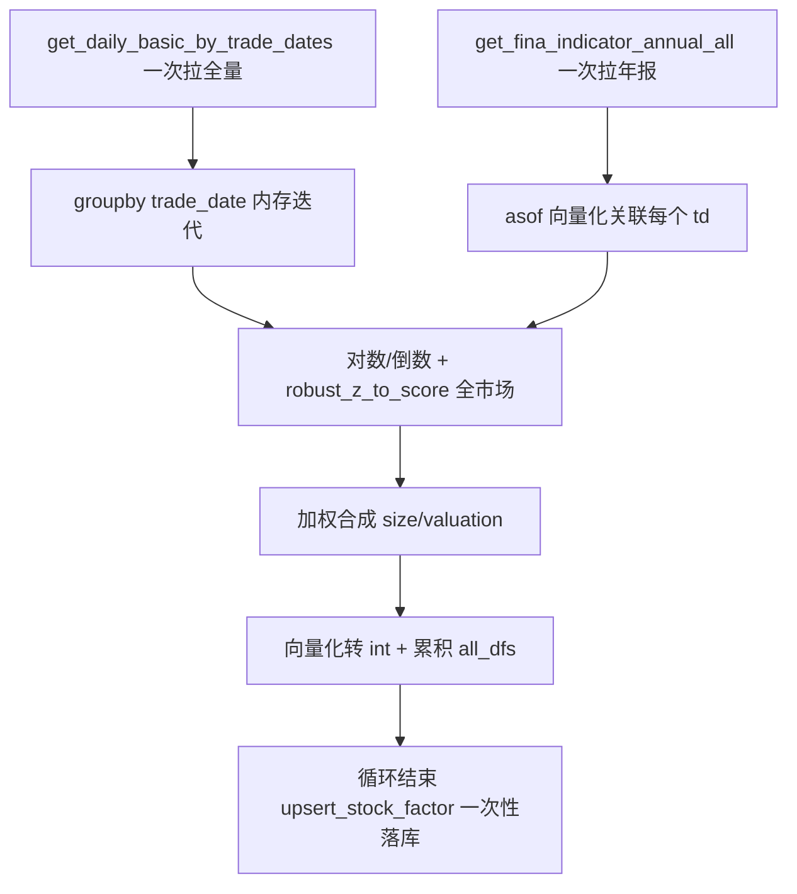

## 用户需求

规模因子（cal_size_factor）与估值因子（cal_valuation_factor）计算速度慢，需系统性提升运算效率。对已分析的 A~F 六类优化方案制定可落地的项目计划，并在不引入新依赖、不改变因子数值语义的前提下实施，使整体提速一个数量级。

## 核心优化点

- 消除"每个交易日一次数据库往返"的循环查询瓶颈（方案 A、C）。
- 去除单次查询内的 count+read_sql 双执行冗余（方案 B）。
- 合并分散的 upsert 写事务（方案 F）。
- 向量化替代逐行 apply 转 int、去除冗余深拷贝（方案 D、E）。
- 优化后计算结果数值必须与现有逻辑完全一致，仅提速。

## 核心功能

- 批量拉取 daily_basic（一次 SQL 覆盖全部交易日），内存按 trade_date 分组迭代。
- 财务年报一次性拉取并按 asof 语义（ann_date ≤ td 且 end_date 最大）向量化关联，替代每日查库。
- 循环外累积结果、一次性 upsert 落库。
- 落库 int 转换与中间拷贝改为向量化/最小拷贝。

## 技术栈

- 语言：Python 3（与现有项目一致）
- 数据处理：pandas + numpy
- 数据访问：复用 src/database.py 现有接口（新增批量查询函数，不引入 DuckDB/Polars 等新依赖）
- 归一化：复用 factor.py 现有 robust_z_to_score

## 实现方案

### 总体策略

采用"批量取数 + 内存迭代 + 合并写库 + 向量化收尾"四层优化，完全复用现有归一化与加权逻辑，仅重构取数/落库/收尾的数据流，保证因子数值不变。

### 关键决策

1. **方案 A（P0 核心）**：在 database.py 新增 `get_daily_basic_by_trade_dates(trade_dates: list, fields: list | None = None)`，内部用 `StockDailyBasic.trade_date.in_(trade_dates)` 一次 SQL 拉全量（通过 fields 限定列减少内存：规模因子仅 total_mv/circ_mv，估值因子仅 dv_ttm/pe_ttm/pb/ps_ttm）。两因子改为先一次性拉取全部截面，再 `all_df.groupby("trade_date", sort=False)` 内存迭代，DB 往返由约 2500 次降为 1 次。
2. **方案 B（P0）**：修改 `get_daily_basic_by_trade_date` 第 2581 行，移除 `q.count() > 0` 前置判断，直接 `df = pd.read_sql(q.statement, session.bind)`；空查询由 pandas 返回空 DataFrame。`_empty_df` 保留为异常兜底。每次查询省一半 SQL。
3. **方案 C（P1，规模因子）**：新增 `get_fina_indicator_annual_all()` 一次拉取所有 `end_date` 以 "1231" 结尾的年报（含 ts_code/end_date/ann_date/total_assets/total_revenue）。规模因子财务段改为：构建 `ts_code -> 按 ann_date 排序的报告期列表` 映射，对每个 td 用 asof 语义取 `ann_date <= td` 且 `end_date` 最大的年报，向量化 merge（而非每天查库）。财务查询由约 2500 次降为 1 次，且语义更正确（覆盖更早年报，符合"取 ≤ td 最新一期"）。
4. **方案 F（P1）**：两因子循环内将每日 `out_df` 追加至 `all_dfs` 列表，循环结束后 `upsert_stock_factor(pd.concat(all_dfs, ignore_index=True))` 一次性写入（该函数已支持整表 + chunk=5000 分批 + 自动 dedup）。写事务由约 2500 次降为 1 次。
5. **方案 D（P2）**：落库转 int 改为向量化：`arr = np.floor(section["size"].to_numpy()); out_df["size"] = pd.Series(arr, index=section.index).where(section["size"].notna()).astype("object")` 后整体 `astype(int)`（先 mask 避免 NaN 变哨兵值）。替代逐行 apply。
6. **方案 E（P2）**：移除 `mv_df = mv_df[mask].copy()` 中冗余 `.copy()`（isin 过滤已返回新对象），保留后续确实有链式赋值处的 copy 以消除 SettingWithCopyWarning。

### 性能与可靠性

- 批量查询约 2500 天 × 2000 股 ≈ 500 万行，base anaconda3 环境内存充足；用 fields 限定列进一步降内存。
- asof 关联用预先排序 + merge_asof 或 groupby+transform，避免逐股票 Python 循环。
- 合并 upsert 单次 concat 内存可控（约数十 MB），chunk=5000 分批写不阻塞。
- 数值一致性：优化仅改数据流，归一化（robust_z_to_score）、对数变换、倒数处理、加权（有效权重归一）、向下取整均不变，结果应与优化前逐交易日一致。
- 边界：某股票在 td 前无年报时该分项 NaN，加权按有效权重归一（现有逻辑已支持），不抛异常。

### 实现注意事项

- 不改动 `upsert_stock_factor` 签名与 StockFactor ORM（industry 透传、valuation/size 列均已具备）。
- 不改动 `cal_all_factors` 骨架、其他 cal_*_factor 占位、FACTOR_REGISTRY。
- 保留 `__main__` 测试1（规模）、测试2（估值）入口不变；新增临时小批量脚本做数值一致性 + 计时对比验证后清理。
- 方案 C 的 asof 需小心"ann_date 为空"或"无匹配年报"的边界，按现有有效权重归一兜底。

## 架构设计



## 目录结构

```
src/
├── database.py   # [MODIFY]
│   - 新增 get_daily_basic_by_trade_dates(trade_dates, fields)
│   - 修改 get_daily_basic_by_trade_date：去 count 双执行（方案 B）
│   - 新增 get_fina_indicator_annual_all()（方案 C）
└── factor.py     # [MODIFY]
    - cal_size_factor：批量取 daily_basic + 财务 asof 缓存 + 累积 upsert + 向量化转 int + 去冗余 copy
    - cal_valuation_factor：批量取 daily_basic + 累积 upsert + 向量化转 int + 去冗余 copy
```

## 关键代码结构

```python
# database.py
def get_daily_basic_by_trade_dates(trade_dates: list[str], fields: list[str] | None = None) -> pd.DataFrame:
    """一次 SQL 拉取多交易日 daily_basic 截面（trade_date IN (...)）。"""

def get_fina_indicator_annual_all() -> pd.DataFrame:
    """一次拉取所有 end_date 以 1231 结尾的年报（total_assets/total_revenue）。"""
```