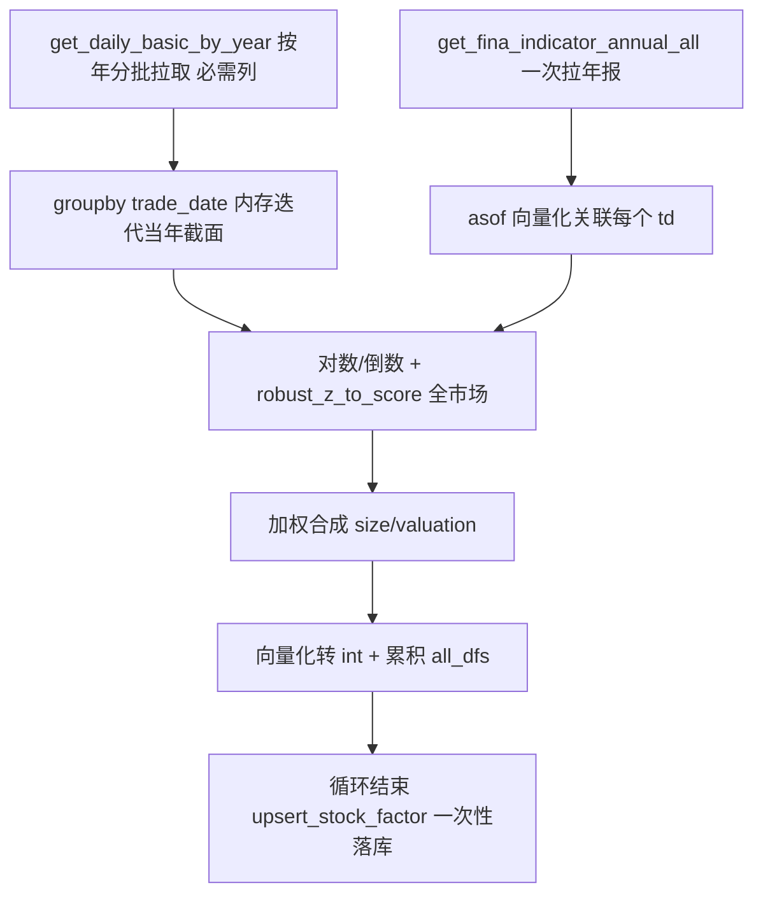

## 用户需求

规模因子（cal_size_factor）与估值因子（cal_valuation_factor）计算速度慢，需系统性提升运算效率。在上一版性能优化计划基础上，用户明确要求将方案 A 从"一次性拉取全部交易日 daily_basic"调整为"必需列 + 按年读取"，以规避单次大量取数导致的内存不足风险。其余优化方案（B/C/D/E/F）维持不变。要求不引入新依赖、不改变因子数值语义，整体提速至少一个数量级。

## 核心优化点

- 方案 A（调整）：按年分批读取 daily_basic，每年一次 SQL，仅拉取必需列（规模因子 total_mv/circ_mv；估值因子 dv_ttm/pe_ttm/pb/ps_ttm），内存峰值控制在单年量级（约 200~350MB）。
- 方案 B：去除单次查询内 count + read_sql 双执行冗余。
- 方案 C：财务年报一次性拉取并按 asof 语义向量化关联，替代每日查库。
- 方案 D/E/F：向量化转 int、去除冗余深拷贝、合并 upsert 落库。
- 优化后计算结果数值必须与现有逻辑完全一致，仅提速。

## 核心功能

- 按年批量拉取 daily_basic（每年一次 SQL，限定必需列），内存内按 trade_date 分组迭代当年截面。
- 财务年报一次性拉取并按 asof 语义（ann_date ≤ td 且 end_date 最大）向量化关联。
- 循环内累积结果，年末或循环结束后一次性 upsert 落库。
- 落库 int 转换与中间拷贝改为向量化/最小拷贝。

## 技术栈

- 语言：Python 3（与现有项目一致）
- 数据处理：pandas + numpy
- 数据访问：复用 src/database.py 现有接口（新增按年批量查询、年报全量查询函数，不引入 DuckDB/Polars 等新依赖）
- 归一化：复用 factor.py 现有 robust_z_to_score（对称版）

## 实现方案

### 总体策略

采用"按年批量取数 + 内存迭代 + 财务 asof 缓存 + 合并写库 + 向量化收尾"五层优化，完全复用现有归一化与加权逻辑，仅重构取数/落库/收尾的数据流，保证因子数值不变。在原计划基础上，方案 A 改为按年分块，以"DB 往返 2500→约 10~14 次"换取"内存峰值 6~8GB→约 350MB"的安全折中。

### 关键决策

1. **方案 A（P0 核心，调整后）**：在 database.py 新增 `get_daily_basic_by_year(years: list[str], fields: list[str] | None = None)`，内部用 `StockDailyBasic.trade_date.like(f"{year}%")` 或 `in_(该年交易日列表)` 每年一次 SQL 拉取该年截面，仅 select fields 限定列以降内存。两因子改为：

- 先 `years = sorted({td[:4] for td in trade_dates})` 得到年份列表；
- 外层按年循环：每年 `year_df = get_daily_basic_by_year([year], fields)`，再 `year_df.groupby("trade_date", sort=False)` 内存迭代当年所有截面；
- 处理完当年即释放 year_df，再读下一年。DB 往返由约 2500 次降为约 10~14 次，内存峰值约 350MB（单年 240 交易日 × 4500 股 × 4~6 列）。

2. **方案 B（P0）**：修改 `get_daily_basic_by_trade_date`（约第 2581 行），移除 `q.count() > 0` 前置判断，直接 `df = pd.read_sql(q.statement, session.bind)`；空查询由 pandas 返回空 DataFrame，`_empty_df` 保留为异常兜底。每次查询省一半 SQL。
3. **方案 C（P1，规模因子）**：新增 `get_fina_indicator_annual_all()` 一次拉取所有 `end_date` 以 "1231" 结尾的年报（含 ts_code/end_date/ann_date/total_assets/total_revenue，仅数万行、几十 MB，安全）。规模因子财务段改为：构建 `ts_code -> 按 ann_date 排序的报告期列表` 映射，对每个 td 用 asof 语义取 `ann_date <= td` 且 `end_date` 最大的年报，向量化 merge。财务查询由约 2500 次降为 1 次，且语义更正确（覆盖更早年报，符合"取 ≤ td 最新一期"）。
4. **方案 F（P1）**：两因子循环内将每日 `out_df` 追加至 `all_dfs` 列表，循环结束后 `upsert_stock_factor(pd.concat(all_dfs, ignore_index=True))` 一次性写入（该函数已支持整表 + chunk=5000 分批 + 自动 dedup）。写事务由约 2500 次降为 1 次。
5. **方案 D（P2）**：落库转 int 改为向量化：`arr = np.floor(section["size"].to_numpy()); out_df["size"] = pd.Series(arr, index=section.index).where(section["size"].notna()).astype("object")` 后整体 `astype(int)`（先 mask 避免 NaN 变哨兵值）。替代逐行 apply。
6. **方案 E（P2）**：移除 `mv_df = mv_df[mask].copy()` 中冗余 `.copy()`（isin 过滤已返回新对象），仅保留确有链式赋值处的 copy 以消除 SettingWithCopyWarning。

### 性能与可靠性

- 按年读取：每年约 108 万行 × 4~6 列 ≈ 200~350MB，处理完即释放，峰值远低于全量一次性；年数约 10~14 次 SQL 仍远少于 2500 次。
- 财务年报仅数万行，一次全拉内存占用可忽略。
- asof 关联用预先排序 + merge_asof 或 groupby+transform，避免逐股票 Python 循环。
- 合并 upsert 单次 concat 内存可控（约数十 MB），chunk=5000 分批写不阻塞。
- 数值一致性：归一化（robust_z_to_score）、对数变换、倒数处理、加权（有效权重归一）、向下取整均不变，结果与优化前逐交易日一致。
- 边界：某股票在 td 前无年报时该分项 NaN，加权按有效权重归一（现有逻辑已支持），不抛异常；某年无交易日数据时 year_df 为空，groupby 跳过。

### 实现注意事项

- 不改动 `upsert_stock_factor` 签名与 StockFactor ORM（industry 透传、valuation/size 列均已具备）。
- 不改动 `cal_all_factors` 骨架、其他 cal_*_factor 占位、FACTOR_REGISTRY。
- 保留 `__main__` 测试1（规模）、测试2（估值）入口不变；新增临时小批量脚本做数值一致性 + 计时对比验证后清理。
- 方案 C 的 asof 需小心"ann_date 为空"或"无匹配年报"边界，按现有有效权重归一兜底。

## 架构设计



## 目录结构

```
src/
├── database.py   # [MODIFY]
│   - 新增 get_daily_basic_by_year(years, fields)：按年批量拉取 daily_basic 必需列（方案 A 调整后）
│   - 修改 get_daily_basic_by_trade_date：去 count 双执行（方案 B）
│   - 新增 get_fina_indicator_annual_all()：年报全拉（方案 C）
└── factor.py     # [MODIFY]
    - cal_size_factor：按年取 daily_basic + 财务 asof 缓存 + 累积 upsert + 向量化转 int + 去冗余 copy（A+C+D+E+F）
    - cal_valuation_factor：按年取 daily_basic + 累积 upsert + 向量化转 int + 去冗余 copy（A+D+E+F）
```

## 关键代码结构

```python
# database.py
def get_daily_basic_by_year(years: list[str], fields: list[str] | None = None) -> pd.DataFrame:
    """按年批量拉取 daily_basic（trade_date LIKE 'YYYY%'），仅 select fields 限定列以降低内存。"""

def get_fina_indicator_annual_all() -> pd.DataFrame:
    """一次拉取所有 end_date 以 1231 结尾的年报（total_assets/total_revenue 等必需列）。"""
```