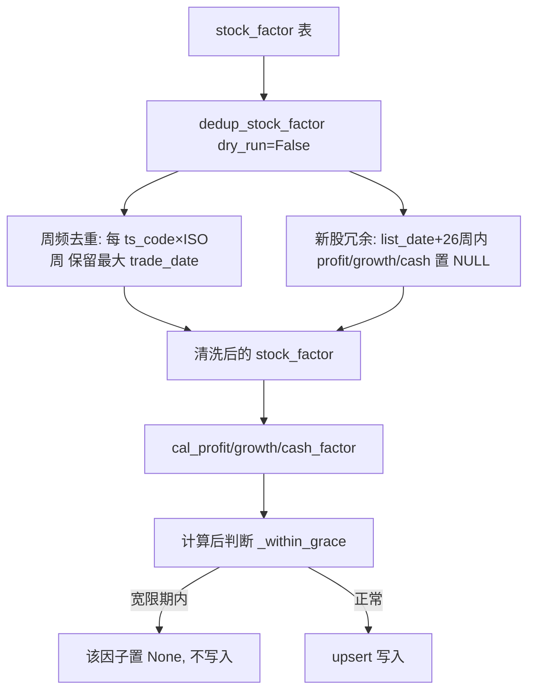

## 产品概述

针对 `stock_factor` 因子库表，提供一套去重与数据清洗机制，消除两类数据质量问题：(1) 同一自然周内重复出现的截面（冗余周数据）；(2) 新股上市后由存量（回填）报表带来的不可靠盈利/成长/现金因子值。

## 核心功能

- **周频去重**：按 `(ts_code, 自然周)` 仅保留最大的 `trade_date`（当周最后交易日），整行删除其余重复截面。
- **新股冗余清洗**：对上市日 `list_date` 起 26 周内的股票，将其 `profit`/`growth`/`cash` 三列置为 NULL（保留 `size`/`valuation`/`volility`/`reverse` 等其他因子，行不删）。
- **计算内防护**：在 `cal_profit_factor`/`cal_growth_factor`/`cal_cash_factor` 三因子计算中同步套用 26 周宽限期规则，使重算时不再写回新股冗余值。
- **安全执行**：清洗函数默认 `dry_run=True`，仅统计并预览待删除/置空行数；显式传 `dry_run=False` 才落库，避免误删。

## 技术栈

- 语言/运行时：Python 3（Buffett 虚拟环境），复用现有 `pandas` + SQLAlchemy ORM。
- 数据访问：复用 `database.py` 的 `get_session()`、`StockFactor`、`StockBasic` 模型，不引入新依赖、不改 schema。
- 周频分组：复用 `database._iso_week_key`（或因子模块内本地等价实现），按 ISO 周 `(year, week)` 分桶。
- 时间比较：使用 `datetime` + `timedelta(weeks=26)` 计算上市宽限期。

## 实现方案

整体策略：在 `factor.py` 内新增统一清洗函数 `dedup_stock_factor(dry_run=True)`，同时承担"周频去重（整行 DELETE）"与"新股冗余置空（UPDATE 三列）"两步；并在三个因子计算函数落库前，对处于宽限期的股票跳过对应因子写入，保证重算幂等、不恢复冗余值。

关键技术决策：

- **为何合并到一处函数**：用户明确要求"在 factor.py 增加清洗函数、不新建脚本文件"，且周频去重与新股清洗都作用于同一张 `stock_factor`，合并后职责单一、可重复运行、dry-run 安全。
- **置空而非整行删除**：用户已选仅置空三列，保留其他因子；下游 `analyze_factor_ic` 对 NaN 自动按有效样本跳过，语义一致且无信息损失。
- **计算内防护是为根因**：仅清洗历史表不够，重跑三因子会用旧逻辑重新写回新股值；因此在计算内判断宽限期并置 None（被 `out_df[col].notna()` 过滤），与清洗语义一致。
- **dry_run 默认安全**：所有破坏性操作（DELETE/UPDATE + commit）仅在 `dry_run=False` 时执行，降低误删风险。
- **幂等性**：周频去重按周桶取最大日期，重复执行不产生新删除；置空仅 UPDATE 当前非 NULL 的行，重复执行无副作用。

## 实现要点

- 复用 `get_session()` 上下文管理器；周频去重用 `session.query(StockFactor).filter(...).delete()` 批量整行删除；新股置空用 `session.query(StockFactor).filter(...).update({...})` 批量置 NULL。
- 性能：清洗函数会遍历全表 `(ts_code, trade_date)` 构造保留集合，行数规模约百万级，内存可接受；避免一次性 `pd.read_sql` 整表大 DataFrame，采用逐行/分组聚合。
- 日志：复用 `print` 打印待处理计数（遵循现有 cal_*_factor 的 `print(f"[...] ...")` 风格），不输出大载荷、不记敏感信息。
- 迁移：移除 `database.py` 中已被取代的 `dedup_stock_factor_weekly`，并删除此前临时脚本 `src/_dedup_run.py`，避免重复入口与误用。

## 架构设计



## 目录结构

```
src/
├── factor.py       # [MODIFY] 1) 顶部新增 NEW_LISTING_GRACE_WEEKS 与 _within_grace 辅助函数；
│                   #          2) cal_profit_factor/cal_growth_factor/cal_cash_factor 落库前套用宽限期跳过；
│                   #          3) 新增 dedup_stock_factor(dry_run=True) 清洗函数（周频去重+新股置空）。
└── database.py     # [MODIFY] 移除已被取代的 dedup_stock_factor_weekly 函数（保留 _iso_week_key 供复用）。
src/_dedup_run.py   # [DELETE] 清理此前临时诊断/清理脚本。
```

## 关键代码结构

```python
# factor.py 顶部常量与辅助
NEW_LISTING_GRACE_WEEKS: int = 26

def _within_grace(ts_code: str, td: str, list_dates: dict) -> bool:
    """判断 trade_date 是否落在 ts_code 上市日起 26 周宽限期内（list_date 缺失返回 False）。"""

def dedup_stock_factor(dry_run: bool = True) -> tuple[int, int]:
    """
    清洗 stock_factor：返回 (删除的重复周行数, 置空的新股因子行数)。
    步骤A 周频去重（整行 DELETE）；步骤B 新股26周内 profit/growth/cash 置 NULL（UPDATE）。
    dry_run=True 仅统计预览、不落库。
    """
```