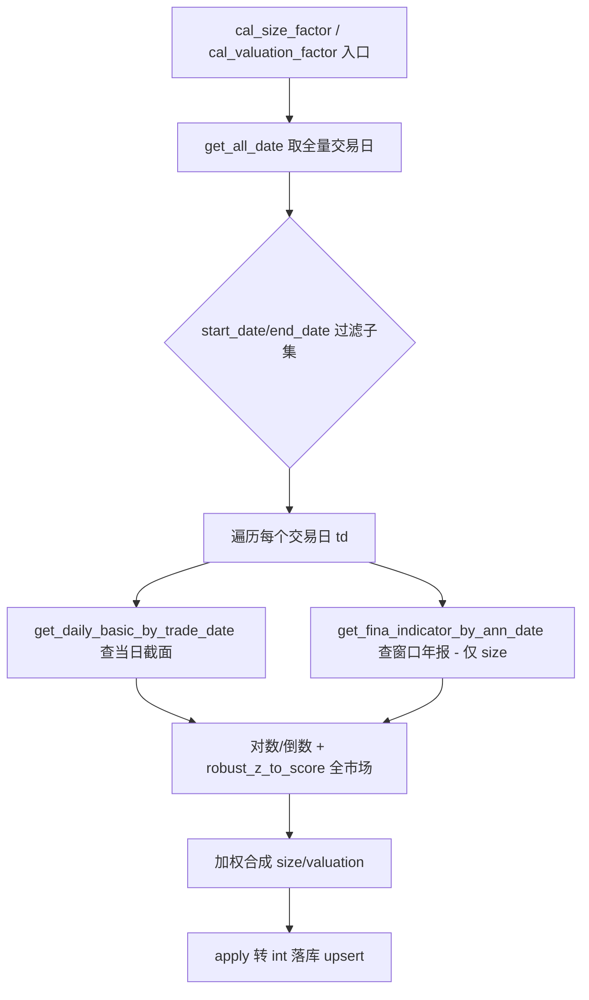

## 用户需求

将 factor_perf_opt_v3 性能优化后的代码回滚到优化前的「逐交易日循环」版本，并给两个已实现因子计算函数增加 start_date / end_date 参数，以支持按指定日期范围（如每周）增量计算。

## 核心功能

- 完全还原 database.py 与 factor.py 到优化前状态：删除优化新增的按年批量查询、年报全拉函数、asof 辅助函数，恢复逐交易日查库的 count 双执行。
- cal_size_factor / cal_valuation_factor 恢复为逐交易日循环逻辑（每日查库、窗口取年报、对数/倒数变换、全市场稳健标准化、加权合成、apply 转 int、逐日 upsert）。
- 两个函数新增 start_date=None、end_date=None 参数；在获取交易日序列后按该范围过滤，默认 None 时行为等同全量（保持旧版语义），传参时仅计算指定范围（如某周）实现增量。
- 其余占位骨架函数（cal_volatility_factor 等）保持 ... 不变。
- **main** 测试入口保留可用；完成后可用小批量（指定一周）验证增量写入，验证后清理临时脚本。

## 技术栈

- 语言：Python 3（与现有项目一致）
- 数据处理：pandas + numpy
- 数据访问：复用 src/database.py 现有接口（get_daily_basic_by_trade_date、get_fina_indicator_by_ann_date、upsert_stock_factor、get_all_date、get_all_stocks）
- 归一化：复用 factor.py 现有 robust_z_to_score（对称版，不改动）

## 实现方案

### 总体策略

手动回滚（无 git）：删除优化引入的函数与改动，将原逐交易日循环逻辑完整还原，并在两个流程函数入口增加日期范围参数，使全量语义不变、增量可通过参数触发。

### 关键决策

1. **database.py 回滚（方案 A/B/C 撤销）**

- 删除 `get_daily_basic_by_year(years, fields)`（方案 A 新增，约第 2617 行起整段）。
- 删除 `get_fina_indicator_annual_all()`（方案 C 新增，约第 2553 行起整段）。
- 恢复 `get_daily_basic_by_trade_date` 的 count 双执行：改回 `df = pd.read_sql(q.statement, session.bind) if q.count() > 0 else _empty_df(StockDailyBasic)`（撤销方案 B 的直接 read_sql）。
- 保留 `_empty_df` 辅助（旧版即使用）。

2. **factor.py 回滚（方案 A/C/D/E/F 撤销）**

- 删除 `_asof_annual(...)` 辅助函数（方案 C 加速核心，约第 92 行起整段）。
- import 改回：`from database import (StockFactor, upsert_stock_factor, get_all_date, get_all_stocks, get_daily_basic_by_trade_date, get_fina_indicator_by_ann_date)`，移除 `get_daily_basic_by_year`、`get_fina_indicator_annual_all`。
- `cal_size_factor(start_date=None, end_date=None)`：还原为旧版逐交易日循环（get_daily_basic_by_trade_date + get_fina_indicator_by_ann_date，窗口取年报 end_date 1231、groupby ts_code tail(1)，对数 log10，robust_z_to_score 四项，加权 4:2:2:2，apply 转 int，逐日 upsert）。
- `cal_valuation_factor(start_date=None, end_date=None)`：还原为旧版逐交易日循环（get_daily_basic_by_trade_date，倒数变换 pe/pb/ps，robust_z_to_score 四项，加权 3:3:2:2，apply 转 int，逐日 upsert）。

3. **新增 start_date / end_date 参数（增量支持）**

- 两函数签名均加 `start_date: str | None = None, end_date: str | None = None`。
- 在 `trade_date = get_all_date()` 后增加过滤：
`trade_date = [t for t in trade_date if (start_date is None or t >= start_date) and (end_date is None or t <= end_date)]`
- 默认全为 None 时等价于旧版全量；传入某周首尾日期即增量计算该周。
- 不改变归一化、加权、取整、落库语义，数值与旧版全量一致。

### 性能与可靠性

- 回滚后恢复每日一次 SQL（规模因子每日还会查财务），与优化前一致；用户明确接受此换取增量便利性。
- 增量模式仅处理指定范围交易日，upsert 仍按 (ts_code, trade_date) 主键去重，不会误改范围外历史数据。
- 边界：start_date/end_date 为空或非法时退化为全量；某日无数据 continue，不抛异常。
- 因无 git，回滚为手工改码，执行后通过小批量（指定一周）脚本核对增量写入正确，验证后清理。

### 实现注意事项

- 不改动 `upsert_stock_factor` 签名、StockFactor ORM、cal_all_factors 骨架、FACTOR_REGISTRY。
- 不改动其余 `cal_*_factor` 占位函数（仍为 ...）。
- **main** 测试入口保持：测试1 调 cal_size_factor()、测试2 调 cal_valuation_factor()（无参=全量）。
- 回滚代码尽量与历史旧版逐字一致，避免引入新差异。

## 架构设计



## 目录结构

```
src/
├── database.py   # [MODIFY]
│   - 删除 get_fina_indicator_annual_all()（方案 C 新增）
│   - 删除 get_daily_basic_by_year(years, fields)（方案 A 新增）
│   - 恢复 get_daily_basic_by_trade_date 的 q.count() 双执行（撤销方案 B）
└── factor.py     # [MODIFY]
    - 删除 _asof_annual(...) 辅助函数
    - import 改回 get_daily_basic_by_trade_date / get_fina_indicator_by_ann_date
    - cal_size_factor(start_date, end_date)：还原逐交易日循环 + 日期范围过滤
    - cal_valuation_factor(start_date, end_date)：还原逐交易日循环 + 日期范围过滤
```

## 关键代码结构

```python
# factor.py（回滚后签名）
def cal_size_factor(start_date: str | None = None, end_date: str | None = None) -> None:
    """规模因子：逐交易日计算并落库；start_date/end_date 限定计算范围（增量）。"""

def cal_valuation_factor(start_date: str | None = None, end_date: str | None = None) -> None:
    """估值因子：逐交易日计算并落库；start_date/end_date 限定计算范围（增量）。"""
```