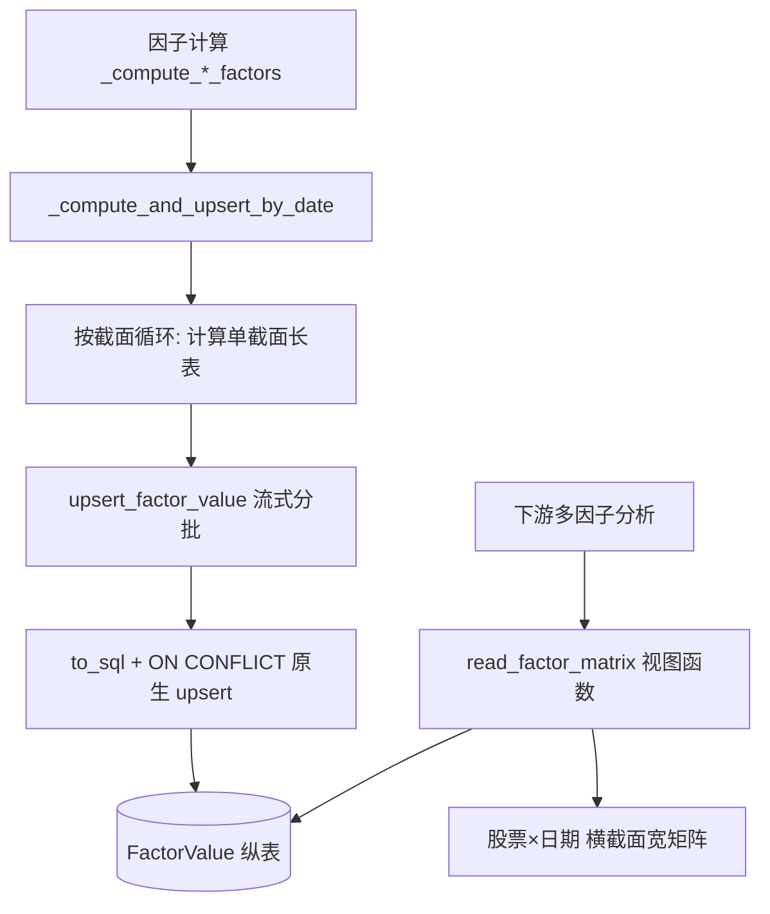

## 用户需求

保留 FactorValue 纵表存储形态（不改动表结构），通过重写入库路径解决因子计算时内存爆炸与极慢的问题，并新增一个视图函数用于将纵表按需求 pivot 为「股票×日期」的横截面矩阵，支持多因子结合分析。

## 产品概述

当前 factor.py 运行因子计算会卡死电脑。诊断确认瓶颈不在纵表本身，而在 `upsert_factor_value` 每次入库前把整张因子值表拉回内存、并用 `iterrows` 逐行写库；同时 `_compute_and_upsert_by_date` 会先把所有截面的长表 concat 成一个超大 DataFrame。需重写这两处，使峰值内存恒定可控、写库速度提升 1~2 个数量级。下游需把纵表因子值拼成股票×日期的宽矩阵做多因子分析，因此新增横截面视图函数。

## 核心功能

- 重写 `upsert_factor_value`：用 SQLite 原生 `INSERT ... ON CONFLICT DO UPDATE` 批量 upsert，借助 `df.to_sql(chunksize=...)` 流式分批写库，移除「全表 query().all() 拉内存」与「逐行 iterrows」。
- 重构 `_compute_and_upsert_by_date`：按截面（factor_date）逐批计算并即时 upsert，不再拼接全量 merged DataFrame，内存中仅存活单个截面长表。
- 新增横截面视图函数 `read_factor_matrix`：给定因子 code 列表与日期/股票范围，从 FactorValue 纵表查询后 pivot 出 `ts_code × factor_date` 矩阵（每因子一列），返回便于多因子结合的宽表 DataFrame。
- 保留 `FactorLibrary` 与 `FactorValue` 表结构、唯一约束与下游读取逻辑不变。

## 技术栈

- 语言：Python 3.12（Anaconda）
- ORM/DB：SQLAlchemy 2.0 + SQLite（现有栈，保持一致）
- 数据处理：pandas（现有栈）
- 数据库规模：5000+ 股票 × 2012 至今 × 30+ 因子，纵表约数千万行

## 实现方案

### 总体策略

保留纵表，消除两类内存/性能炸弹：①`upsert_factor_value` 的全表拉回 + 逐行 ORM 写库；②`_compute_and_upsert_by_date` 的全量 concat。改用「原生 ON CONFLICT 批量 upsert + 按截面流式入库」,+ 新增 pivot 视图函数。

### 关键技术决策

1. **原生 upsert（消除瓶颈 1）**

- 用 `pandas.DataFrame.to_sql(..., if_exists="append", chunksize=CHUNK, method=upsert_method)`，在自定义 `upsert_method` 中拼 `INSERT INTO factor_value (...) VALUES (...) ON CONFLICT(ts_code, factor_date, factor_code) DO UPDATE SET factor_value=excluded.factor_value, factor_name=excluded.factor_name, updated_time=excluded.updated_time`。
- 「已存在与否」交由数据库唯一约束判定，彻底移除 `session.query(...).all()` 整表拉回与 `iterrows` 逐行 + 每行回查。峰值内存仅取决于 `chunksize`（如 5000 行），与存量无关。
- `created_time` 用 `COALESCE(excluded.created_time, CURRENT_TIMESTAMP)` 或写入前对新增行填 `now`、冲突时保持原值（通过 SQL 表达式 `created_time=excluded.created_time` 会因冲突被覆盖，需用 `factor_value.created_time` 保留；采用 `DO UPDATE SET ... created_time = factor_value.created_time` 保留首次创建时间）。
- 仍保留传入 DataFrame 的 `drop_duplicates(子集=唯一键)` 与「factor_value 为空跳过」防御逻辑（低成本、高价值）。

2. **按截面流式入库（消除瓶颈 2）**

- `_compute_and_upsert_by_date` 改为：for date_val in dates 循环内，计算该截面所有因子长表 → `pd.concat(section_parts)` → 立即 `upsert_factor_value(section_long)` → 累加计数。循环结束即完成，不再拼 `merged`。
- 内存中同时存活的仅为一个截面长表（≈ 股票数×因子数，几十万行级），峰值内存降低 1~2 个数量级。

3. **横截面视图函数（下游多因子分析）**

- 新增 `read_factor_matrix(factor_codes, start_date=None, end_date=None, ts_codes=None)`：用 SQL 带过滤查询 `FactorValue`（仅目标 factor_code），`pd.read_sql_query` 取回后 `pivot(index="ts_code", columns="factor_date", values="factor_value")`，返回宽表；可选再对因子做 `pivot(index="ts_code", columns="factor_code")` 另一种宽表形态。提供参数控制返回「股票×日期（每因子一个表/或按日期平铺）」还是「股票×因子（按最新截面）」。默认返回 `ts_code × factor_date` 每因子一列的复合宽表（MultiIndex columns 或分字典），便于多因子 concat 分析。
- 该函数纯读取、不改变存储，复用现有 `get_session` 与 `FactorValue` ORM。

### 性能与可靠性

- upsert 复杂度：每批 O(批大小)，数据库端冲突判定 O(log N) 索引查找，无全表扫描；总写库从 O(N) 回查降为 O(N/batch) 批写。
- 内存：峰值从 O(股票×截面×因子) 降为 O(chunksize)，恒定。
- 向后兼容：`upsert_factor_value` 入参/返回 `(新增, 更新)` 语义保持（新增=本批插入行数近似、更新=冲突更新行数近似，可通过 `total_changes` 或返回写库行数统计）；`_compute_and_upsert_by_date` 返回 dict 结构不变；`FactorValue` 表与唯一约束不变。

## 实现要点（防回归）

- 复用现有 `_has_value` 辅助与 `get_session()`，不新引入日志/配置。
- `to_sql` 表名用 `FactorValue.__tablename__`，字段名对齐 ORM 属性（ts_code, factor_date, factor_code, factor_name, factor_value, created_time, updated_time）。
- `chunksize` 设为模块级常量（如 5000），便于调优。
- 视图函数对空结果返回空 DataFrame 并打印警告，与现有「无数据跳过」风格一致。
- 不改 `seed_factor_library`、四个 `_compute_*_factors` 的分发逻辑、归一化函数。

## 架构设计

修改集中在两个现有文件，新增一个视图函数（放在 factor.py 内复用其 normalize/long 约定，或 database.py 内贴近 ORM；采用放在 database.py 以便纯数据访问与 factor.py 解耦）。



## 目录结构

```
c:/Users/yuri_sun/CodeBuddy/buffeet/
├── src/
│   ├── database.py   # [MODIFY] 重写 upsert_factor_value（原生 ON CONFLICT 批量 upsert + chunksize 流式写库，移除全表拉回与 iterrows）；新增 read_factor_matrix 视图函数（纵表 pivot 为股票×日期宽矩阵）。
│   └── factor.py     # [MODIFY] 重构 _compute_and_upsert_by_date：由「全量 concat 后一次性 upsert」改为「按截面即时 upsert 并累加计数」；其余函数与返回结构不变。
```

## 关键代码结构

```python
# database.py 新增/重写签名（仅接口级）
def upsert_factor_value(df: pd.DataFrame, chunksize: int = 5000) -> tuple[int, int]:
    """批量 upsert 因子值；返回 (新增近似, 更新近似)。使用原生 ON CONFLICT。"""

def read_factor_matrix(
    factor_codes: list[str],
    start_date: str | None = None,
    end_date: str | None = None,
    ts_codes: list[str] | None = None,
    pivot_on: str = "date",   # "date" -> ts_code×factor_date(每因子一列); "factor" -> ts_code×factor_code(最新截面)
) -> pd.DataFrame:
    """从 FactorValue 纵表读取并 pivot 为横截面宽矩阵，供多因子分析。"""
```