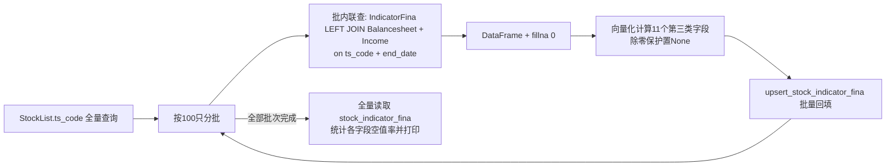

## 用户需求

在 `src/data_fetch.py` 中新建 `fetch_stock_indicator_fina_backfill()` 函数，对 `fetch_stock_indicator_fina()` 预留的第三类字段进行补充计算并回填数据库。

## 产品概述

基于已入库的资产负债表（StockBalancesheet）与利润表（StockIncome）数据，通过多表联查为财务指标表（StockIndicatorFina）批量计算并回填 11 个资产结构类衍生指标，最终输出全表空值率统计报告。

## 核心功能

- 查询 StockList 全量 ts_code，统计全市场股票数量，按每批 100 只分批处理
- 每批次内利用 SQLAlchemy ORM 将 StockIndicatorFina 按 (ts_code, end_date) 联查 StockBalancesheet 与 StockIncome，结果转为 DataFrame 并 fillna(0)（所有 NaN/Null 置 0）
- 按既定公式计算 11 个第三类字段：
- total_assets、total_revenue 直接取用
- int_to_assets = interestdebt / total_assets * 100
- gw_to_assets = goodwill / total_assets * 100
- oth_to_assets = oth_receiv / total_assets * 100
- fin_assets_ratio = (money_cap + trad_asset + lt_eqt_invest + invest_real_estate) / total_assets * 100
- op_assets_ratio = (notes_receiv + accounts_receiv + prepayment + oth_receiv + inventories + contract_assets + oth_cur_assets) / total_assets * 100
- pd_assets_ratio = (fix_assets + cip + lt_rec + oil_and_gas_assets + produc_bio_assets + intan_assets + r_and_d + goodwill) / total_assets * 100
- capacity_ratio = (fix_assets + cip) / total_revenue * 100
- rdexp_ratio = rd_exp / total_revenue * 100
- daa_to_pdassets = daa / (fix_assets + cip + lt_rec + oil_and_gas_assets + produc_bio_assets + intan_assets) * 100（原文分母末尾 "+r" 为笔误，直接忽略）
- 每批次计算完成后调用 `upsert_stock_indicator_fina()` 将结果写入数据库（仅更新第三类字段，不覆盖已有字段）
- 全部批次完成后，全量查询 StockIndicatorFina 表，统计并打印所有字段的空值率

## 视觉效果（控制台输出）

沿用现有函数的打印风格：`"=" * 50` 标题分隔、批次进度提示（如 `[批次 i/n]`）、每批写入结果、末尾汇总与空值率统计表格式输出。

## 技术栈

- Python 3 + SQLAlchemy 2.x ORM（DeclarativeBase / Mapped 风格，项目现有）
- pandas（DataFrame 处理与向量化计算，项目现有）
- SQLite（`data/` 下 .db 文件，经 `get_session()` 上下文管理器访问，项目现有）
- 不引入任何新依赖

## 实现方案

### 总体策略

新函数为纯数据库内计算回填任务（不调用 Tushare 接口，无需延时），整体结构参照 `fetch_stock_indicator_fina()`（src/data_fetch.py 第 363-509 行）的既有模式：取全量 ts_code → 分批循环 → 批内处理 → 调 upsert → 汇总打印。

### 关键技术决策

1. **联查方式**：以 StockIndicatorFina 为主表，按 `(ts_code, end_date)` 两列 LEFT OUTER JOIN StockBalancesheet 与 StockIncome（三表 end_date 均为 String(20) 联合主键，可直接等值连接）。使用 `session.query(...)` 显式选取具名列（`.label()` 消歧），批内以 `StockIndicatorFina.ts_code.in_(batch_codes)` 过滤，一次查询取回整批股票所有报告期数据，避免逐股 N+1 查询。
2. **列名冲突处理**：`total_revenue`（StockIndicatorFina 与 StockIncome 均有）、`rd_exp`（StockIndicatorFina 与 StockIncome 均有）、`total_assets`（StockIndicatorFina 与 StockBalancesheet 均有）需用 label 显式区分来源：

- `total_assets` 取 StockBalancesheet.total_assets
- `total_revenue` 取 StockIncome.total_revenue
- `rd_exp`、`daa`、`interestdebt` 直接取 StockIndicatorFina 自身字段（已由 fina_indicator 接口入库），不使用 StockIncome / StockBalancesheet 中的同名列

3. **fillna 与除零保护**：按用户要求对联查 DataFrame 整体 `fillna(0)`。由于 `_has_value()`（database.py 第 1049 行）会将 `inf` 视为有效值写库，必须在计算阶段对分母为 0 的比率做保护：分母为 0 时该比率置为 `None`（NaN），由 `_has_value` 自动跳过不写库。实现上用 pandas 向量化 + `df['x'].where(denominator != 0)` 或 `np.where` 模式，禁止逐行 Python 循环计算。
4. **部分字段 upsert**：复用 `upsert_stock_indicator_fina(df)`（database.py 第 1670 行）。该函数仅当 `df_col in row and _has_value(row[df_col])` 时才 setattr，因此向其传入仅含 `ts_code`、`end_date` + 11 个计算字段的 DataFrame 即可实现"只更新第三类字段、不动 T1/T2 字段"的部分更新语义，无需修改 database.py。
5. **空值率统计**：全部批次完成后，用 `pd.read_sql`（复用 `get_engine()`）全量读取 stock_indicator_fina 表，按 `df.isna().mean() * 100` 计算各字段空值率并逐列打印（保留两位小数），同时打印总行数。

### 性能与可靠性

- 复杂度：单次全量回填约 5000+ 只股票 × 每股数十个报告期，分 50+ 批；每批 1 次 SELECT（IN 100 个代码）+ 1 次批量 upsert，避免 N+1。
- upsert 内部逐行 UPDATE 是既有模式的已知开销，本次不改动（控制影响面）；批大小 100 与既有约定一致，便于观察调试。
- 联查为 LEFT JOIN，无匹配的资产负债表/利润表行经 fillna(0) 后分母为 0，由除零保护自动跳过写入，不产生脏数据。

## 实施要点（防回归）

- 仅在 data_fetch.py 新增一个函数，不修改既有函数与 database.py；`upsert_stock_indicator_fina` 已在第 14 行导入，无需新增该导入
- 打印风格与既有函数一致（`"=" * 50` 标题、批次进度、汇总行），异常按批捕获打印后继续下一批，保证单批失败不中断全量任务
- 函数签名建议 `fetch_stock_indicator_fina_backfill(batch_size: int = 100) -> pd.DataFrame`，返回本次计算结果汇总 DataFrame，与既有函数返回约定一致
- 新函数插入位置：紧跟 `fetch_stock_indicator_fina` 之后（约第 510 行）

## 目录结构

```
buffeet/
└── src/
    └── data_fetch.py   # [MODIFY] 新增 fetch_stock_indicator_fina_backfill() 函数：
                        #   1) 全量 ts_code 分批（每批100只）
                        #   2) 批内三表 ORM 联查 -> DataFrame -> fillna(0)
                        #   3) 向量化计算 11 个第三类字段（含除零保护，rd_exp/daa/interestdebt 取 StockIndicatorFina 自身字段）
                        #   4) 每批调用 upsert_stock_indicator_fina 回填
                        #   5) 收尾全量统计 StockIndicatorFina 各字段空值率并打印
```

## 关键数据流

