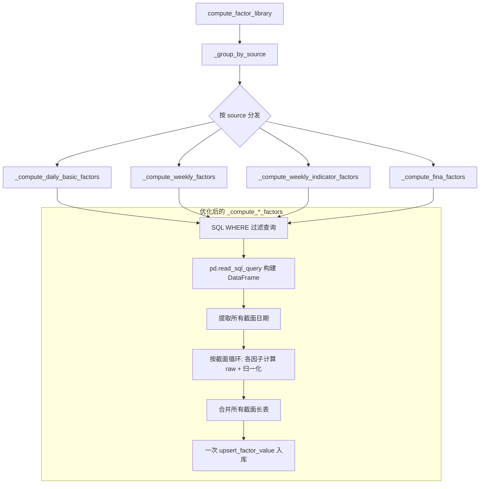

## 用户需求

优化 `compute_factor_library()` 函数的运行性能。当前函数在计算因子时全量加载数据库表，没有使用日期/股票过滤参数，且每个因子单独入库导致大量事务开销。需要改为按截面分批计算、合并批量入库的方式。

## 核心改动

1. 四个 `_compute_*_factors` 函数增加 SQL 层面的日期/股票 WHERE 过滤
2. 将"每个因子单独 upsert"改为"同一截面所有因子合并后一次 upsert"
3. 修复 `upsert_factor_value` 中的列名 bug（`f_name`/`f_value` → `factor_name`/`factor_value`）
4. 保持归一化逻辑 `normalize_by_date` 的兼容性

## 技术方案

### 1. 总体策略

将原来"全量加载 → 逐个因子计算 → 逐个 upsert"的模式改为：

```
SQL WHERE 过滤 → 加载仅需要的行 → 提取所有截面日期 → 按截面循环:
  对每个截面: 所有因子计算 raw 值 → 归一化 → 合并长表 → 一次 upsert
```

**关键优化点：**

| 优化项 | 原来 | 优化后 |
| --- | --- | --- |
| SQL 查询 | `.all()` 全量 | `.filter(...)` 日期/股票过滤 |
| DataFrame 构建 | ORM 逐行 getattr 循环 | `pd.read_sql_query()` 直接读取 |
| 归一化 | 全量 groupby | 按截面分批（每批内 groupby 开销相同） |
| 入库 | 每个因子一次 upsert | 所有因子合并一次 upsert |
| 列名 | `f_name`/`f_value` bug | 修正为 `factor_name`/`factor_value` |


### 2. 新增辅助函数

在 `factor.py` 中新增一个通用的"按截面分批计算并合并入库"函数：

```python
def _compute_and_upsert_by_date(
    df: pd.DataFrame,
    factors: list[tuple],
    calc_map: dict,
    normalize_method: str = "rank",
) -> dict:
    """
    按截面（factor_date）分批计算所有因子，合并后批量 upsert。

    步骤:
      1. 获取所有截面日期（sorted unique factor_date）
      2. 对每个截面:
         a. 取出该截面的子 DataFrame
         b. 对每个因子调用 _calc_{code} 得到 raw
         c. 截面归一化（同截面内 rank）
         d. 转为长表并收集
      3. 将所有截面的长表合并为一个大 DataFrame
      4. 一次 upsert_factor_value 入库

    这替代了原来"每个因子单独 normalize + upsert"的低效模式。
    """
```

此函数可以复用四个 `_compute_*_factors` 中相同的循环逻辑，减少代码重复。

### 3. SQL 过滤实现

利用 SQLAlchemy 的 `filter` 方法：

```python
query = session.query(Model)
if start_date:
    query = query.filter(Model.trade_date >= start_date)
if end_date:
    query = query.filter(Model.trade_date <= end_date)
if ts_codes:
    query = query.filter(Model.ts_code.in_(ts_codes))
```

对于 `StockFinaIndicator`，日期字段是 `end_date` 而非 `trade_date`。

### 4. DataFrame 构建优化

使用 `pd.read_sql_query()` 直接通过 SQL 构建 DataFrame，避免 Python 逐行循环：

```python
from sqlalchemy import select
stmt = select(*[getattr(Model, f) for f in query_fields])
if filters:
    stmt = stmt.where(...)
df = pd.read_sql_query(stmt, session.bind)
```

### 5. bug 修复

`database.py` 第 2084-2085 行：

- `row.get("f_name")` → `row.get("factor_name")`
- `row["f_value"]` → `row["factor_value"]`

### 6. 性能预期

- SQL 过滤：日频表按日期范围可减少 50%-90% 数据加载量
- 合并 upsert：从 30 次事务降为 1-4 次事务（按数据源）
- DataFrame 构建：`pd.read_sql_query` 比逐行 getattr 快 5-10 倍

### 7. 架构设计



## 目录结构

```
src/
├── factor.py          # [MODIFY] 四个 _compute_*_factors 函数增加过滤、分批合并入库
├── database.py        # [MODIFY] upsert_factor_value 修复列名 bug
```

## 关键代码结构

### 新增辅助函数签名

```python
def _build_filtered_df(
    session, Model, base_date_field: str, query_fields: list[str],
    start_date: str | None, end_date: str | None, ts_codes: list[str] | None,
) -> pd.DataFrame:
    """带过滤的 DataFrame 构建，使用 pd.read_sql_query 避免 Python 循环"""
    ...

def _compute_and_upsert_by_date(
    df: pd.DataFrame,
    factors: list[tuple],
    calc_map: dict,
    normalize_method: str = "rank",
) -> dict:
    """按截面分批计算所有因子、合并后批量 upsert"""
    ...
```

### 修改后的 *compute**_factors 核心流程

```python
def _compute_daily_basic_factors(factors, start_date, end_date, ts_codes, dry_run):
    # 1. 带过滤查询
    with get_session() as session:
        df = _build_filtered_df(session, StockDailyBasic, "trade_date",
                                query_fields, start_date, end_date, ts_codes)
    # 2. 按截面分批计算 + 合并入库
    return _compute_and_upsert_by_date(df, factors, calc_map)
```

四个 `_compute_*_factors` 函数都将简化为类似的模式，大幅减少重复代码。