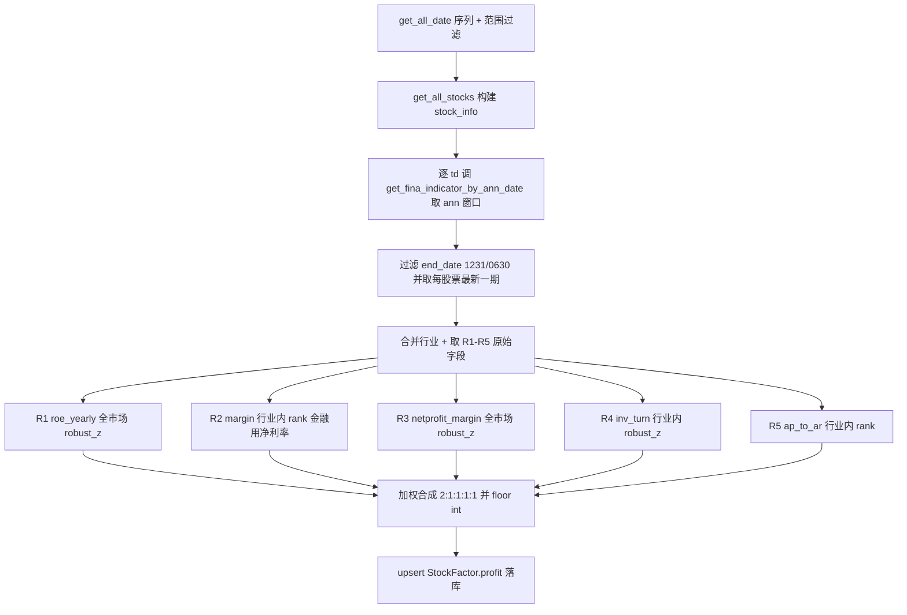

## 用户需求

完成任务14：在 `src/factor.py` 中完成 `cal_profit_factor` 盈利因子的计算逻辑（取数、计算、归一化、合成、落库），整体流程参照已有的规模因子（`cal_size_factor`）与估值因子（`cal_valuation_factor`）。

## 核心特性

- 函数输入 `start_date` / `end_date`，调用 `get_all_date()` 生成交易日序列 `trade_date` 并按范围过滤。
- 调用 `get_all_stocks()` 获取全部股票代码、名称、行业，构建 `stock_info` 字典。
- 取数：对每只股票在 `[td 前一年, td]` 的 `ann_date` 窗口内查询 `StockFinaIndicator`，仅保留年报（1231）与中报（0630），按 `ts_code` 取 `end_date` 最大（最新一期）记录；所需字段为 `roe_yearly / grossprofit_margin / netprofit_margin / inv_turn / ap_to_ar`。
- 逐 `td` 截面五子项加权合成盈利因子并落库 `StockFactor.profit`（向下取整为 int）：
- R1 `roe_yearly`：全市场 `robust_z_to_score`，正向（越大越好），权重 2；
- R2 行业内毛利率 `grossprofit_margin`（行业内分组比 `rank_to_score`，alpha=0.05），银保证等金融行业改用净利率 `netprofit_margin` 替代，权重 1；
- R3 全市场净利率 `netprofit_margin`：`robust_z_to_score`，权重 1；
- R4 行业内总资产周转率 `inv_turn`（行业内分组比 `robust_z_to_score`，alpha=0.05），权重 1；
- R5 行业内经营杠杆强度 `ap_to_ar`（行业内分组比 `rank_to_score`，alpha=0.05），权重 1。
- 方向统一为"越大越好"，不做符号翻转；缺项按有效权重归一。

## 技术栈

- 现有项目：Python + pandas + numpy + SQLAlchemy ORM，沿用 `factor.py` 的 `robust_z_to_score` / `rank_to_score` 归一化范式与既有逐交易日截面合成循环。
- 无新增依赖、无新增表/类/模块；`StockFactor.profit` 列与 `get_fina_indicator_by_ann_date` 取数函数均已存在，可直接复用。

## 实现方案

采用与 `cal_size_factor` 完全对齐的"自包含逐交易日流程"：取数 → 截面合并 → 子项归一化 → 加权合成 → 落库。因 `r1..r5` 均为当周截面分布相关，无法脱离当周预计算，故保留循环内逐截面计算，diff 最小、blast radius 可控。

- **关键决策 1（签名对齐）**：将占位签名 `cal_profit_factor(df: pd.DataFrame) -> pd.Series` 改为 `cal_profit_factor(start_date=None, end_date=None) -> None`，与 `cal_size_factor` / `cal_valuation_factor` 一致；该函数为 TODO 占位且无任何调用方，改动零风险。
- **关键决策 2（报告期口径）**：依用户硬性约束"只用年报、中报，不用一季报、三季报"，过滤 `end_date` 末四位为 `1231` 或 `0630`，再按 `ts_code` 取 `end_date` 最大一期（剔除 0331/0930）。原文"年报数据（即YYYY1231）"视为对年度情形的举例，不限定仅年报。（假设 A，待用户确认）
- **关键决策 3（金融识别）**：模块级常量 `PROFIT_FINANCE_KEYWORDS = ("银行","证券","保险","多元金融","金融","信托","期货")`，`is_finance = any(k in industry for k in 关键字)`；命中则该行 R2 的 margin 由 `grossprofit_margin` 切换为 `netprofit_margin`，再行业内 `rank_to_score`。（假设 B，待用户确认）
- **关键决策 4（分组口径）**：R1/R3 全市场标准化；R2/R4/R5 为"行业内分组比"，用 `section.groupby("industry")[col].transform(...)` 实现行业内比较，与规模因子中流通市值/营业利润的组内 `rank_to_score` 范式一致。
- **关键决策 5（合成范式）**：沿用 `cal_size_factor` 的 `numerator/denom` 加权框架（权重和 6，缺项按有效权重归一），结果 `np.floor` 后转 python `int` 落库，避免 ORM 类型不匹配。

## 实现要点

- 取数：逐 `td` 调 `get_fina_indicator_by_ann_date(start_ann_date=td-1年, end_ann_date=td, fields=[...])`，与规模因子完全一致；字段缺失时兜底置 NaN。
- 分数为 pandas `Series`（非 numpy ndarray），合成时用 `section[sc].notna()` 判有效即可，不存在反转因子的 ndarray 兼容坑。
- 无未来函数：财务数据以 `ann_date <= td` 且取历史最新一期为界，不涉及未来披露。
- 落库 `out_df` 列固定为 `ts_code / name / industry / trade_date / profit`，空则 `continue`；复用 `upsert_stock_factor`。

## 架构设计

数据流与既有因子对齐，单函数内部扩展，不新增模块：



## 目录结构

```
src/
└── factor.py   # [MODIFY] cal_profit_factor
                #  - 改签名为 (start_date=None, end_date=None)->None，补充 docstring 描述五子项与权重；
                #  - 模块级新增 PROFIT_FINANCE_KEYWORDS 常量；
                #  - 实现 1-3 节：trade_date 范围过滤 / stock_info / 逐 td 财务底数取数(含1231+0630过滤取最新)；
                #  - 实现 4 节：R1/R3 全市场标准化、R2 金融切换 margin 后行业内 rank、R4 行业内 robust_z、
                #    R5 行业内 rank；加权合成(2:1:1:1:1)、floor(int)、组装 out_df、upsert_stock_factor、print 进度；
                #  - __main__ 新增"测试5"调用入口，并更新顶部测试说明注释。
```

## 关键代码结构

```python
# 模块级常量
PROFIT_FINANCE_KEYWORDS = ("银行", "证券", "保险", "多元金融", "金融", "信托", "期货")

def cal_profit_factor(start_date: str | None = None, end_date: str | None = None) -> None:
    """逐交易日截面计算盈利因子并落库到 StockFactor.profit ..."""

# 子项权重（总和 6，缺项按有效权重归一）
PROFIT_WEIGHTS = {
    "roe_yearly": 2,       # R1 全市场 robust_z_to_score
    "margin": 1,           # R2 行业内 rank_to_score（金融用 netprofit_margin）
    "netprofit_margin": 1, # R3 全市场 robust_z_to_score
    "inv_turn": 1,         # R4 行业内 robust_z_to_score
    "ap_to_ar": 1,         # R5 行业内 rank_to_score
}
```