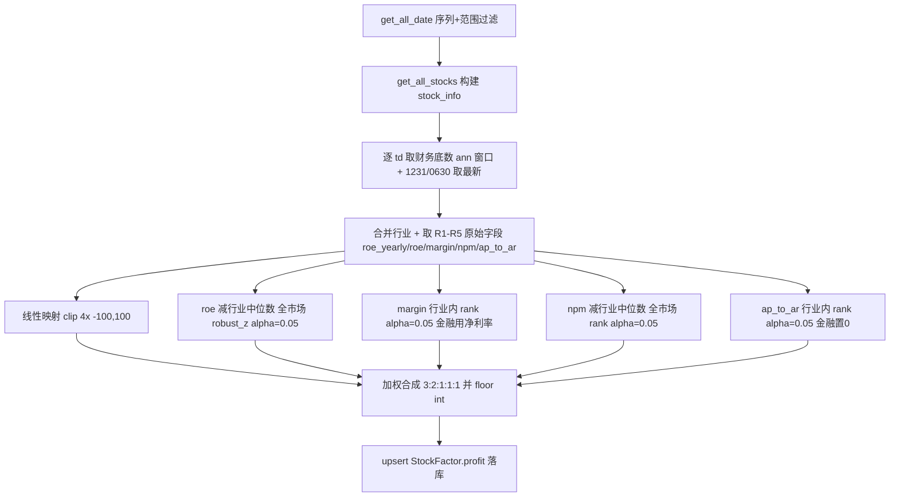

## 用户需求

调整 `cal_profit_factor` 盈利因子的子项口径，由当前 R1-R6（权重和 10）改为 R1-R5（权重和 8），并移除 `inv_turn` 子项。

## 核心特性

- R1 `roe_yearly`：将原始值直接由区间 [-25, 25] 线性映射至 [-100, 100] 分（score = clip(4 × roe_yearly, -100, 100)），权重 3。
- R2 `roe`：正向越大越好，先减去所属行业中位数（截面内 `groupby("industry").transform("median")`），再做全市场 `robust_z_to_score(alpha=0.05)`，权重 2。
- R3 `grossprofit_margin`：行业内分组比（`groupby("industry")` 内 `rank_to_score(alpha=0.05)`）；银保证等金融行业改用 `netprofit_margin` 替代毛利率，权重 1。
- R4 `netprofit_margin`：正向越大越好，先减去所属行业中位数，再做全市场 `rank_to_score(alpha=0.05)`，权重 1。
- R5 `ap_to_ar`：行业内分组比（`groupby("industry")` 内 `rank_to_score(alpha=0.05)`），权重 1；金融行业该子项数值默认输出 0（作为中性有效贡献，非 NaN 缺项）。
- 加权合成沿用现有 `numerator/denom` 框架（缺项按有效权重归一），结果向下取整为 int 落库 `StockFactor.profit`（单列不变）。

## 技术栈

沿用现有项目 Python + pandas + numpy + SQLAlchemy ORM 与 `factor.py` 既有归一化范式（`robust_z_to_score` / `rank_to_score`）。无新增依赖、无新增表/类/模块、不改 ORM。`StockFactor.profit` 列、`get_fina_indicator_by_ann_date` 取数函数、`PROFIT_FINANCE_KEYWORDS` 常量均已存在。

## 实现方案

采用最小侵入式改造，仅重写 `cal_profit_factor` 内部子项口径与权重，复用既有逐交易日截面取数、合成、落库骨架（与 `cal_size_factor` / 现行实现对齐）。

- **关键决策 1（R1 线性映射）**：需求"[-25,25] 直接映射至 [-100,100]"，斜率 = (100-(-100))/(25-(-25)) = 4、截距 = 0，故 `r1_score = np.clip(section["roe_yearly"] * 4.0, -100.0, 100.0)`。超出区间的值按边界 clip，避免越界。不调用 `robust_z_to_score`。
- **关键决策 2（行业中位数中性化）**：R2/R4 由现行"减行业均值"改为"减行业中位数"，即 `centered = x - section.groupby("industry")[x].transform("median")`；pandas `median` 自动忽略 NaN，行业中位数仅由有效值计算，中性化后仍 NaN 的行保持 NaN 进入合成缺项逻辑。R2 中性化后做**全市场**（不对 industry 分组）`robust_z_to_score`；R4 中性化后做**全市场** `rank_to_score`。
- **关键决策 3（R4 口径由 robust_z 改为 rank_to_score）**：依需求 R4 显式使用 `rank_to_score`（非 `robust_z_to_score`），全市场截面排名百分比映射。
- **关键决策 4（R3/R5 保持行业内分组比）**：R3（毛利率 / 金融用净利率）与 R5（`ap_to_ar`）仍是"行业内分组比"，用 `groupby("industry")[...].transform(lambda s: rank_to_score(s, alpha=0.05))`；R3 金融行业切换净利率逻辑不变。
- **关键决策 5（R5 金融默认 0）**：计算完行业内 `ap_to_ar` 排名后，对金融行业行用 `np.where(is_finance, 0.0, r5_score)` 置 0，作为有效中性贡献（计入权重分母、分子贡献 0），区别于 NaN 缺项。
- **关键决策 6（移除 inv_turn）**：`fina_fields`、兜底列检查、权重表、`score_cols` 映射均删除 `inv_turn`；子项恢复为 R1-R5，权重 `{roe_yearly:3, roe:2, margin:1, netprofit_margin:1, ap_to_ar:1}`（和 8），`score_cols` 映射 `r1_score..r5_score`。

## 实现注意

- 中性化 `transform("median")` 对含 NaN 行：pandas `median` 自动忽略 NaN，行业中位数仅由有效值计算；中性化后该股票仍为 NaN，`robust_z_to_score` / `rank_to_score` 保留 NaN，合成按缺项处理，避免误填 0。
- 分数为 pandas `Series`，合成用 `section[sc].notna()` 判有效；R5 金融行显式置 0（数值有效），其余缺项仍为 NaN。
- 无未来函数：财务以 `ann_date <= td` 且取历史最新一期年报/中报为界，中性化仅用当周截面行业中位数，不使用未来信息。
- 仅修改 `cal_profit_factor` 内部与 docstring；`__main__` 测试5 调用、`PROFIT_FINANCE_KEYWORDS` 不变。

## 架构设计

单函数内部子项口径调整，数据流与既有因子完全一致，不新增模块：



## 目录结构

```
src/
└── factor.py   # [MODIFY] cal_profit_factor
                #  - fina_fields / 兜底列 删除 "inv_turn"；
                #  - weights 改为 {roe_yearly:3, roe:2, margin:1, netprofit_margin:1, ap_to_ar:1}（和8）；
                #  - R1 改为线性映射 clip(4*roe_yearly,-100,100)；
                #  - R2 roe 改减行业中位数(transform median) 后全市场 robust_z(alpha=0.05)；
                #  - R3 margin 行业内 rank(alpha=0.05) 金融用净利率（不变）；
                #  - R4 npm 改为减行业中位数 后全市场 rank_to_score(alpha=0.05)；
                #  - R5 ap_to_ar 行业内 rank(alpha=0.05)，金融行置 0；
                #  - score_cols 重排 r1..r5；docstring 同步 R1-R5 与权重/中性化说明。
```

## 关键代码结构

```python
# R1 线性映射（[-25,25] -> [-100,100]）
section["r1_score"] = np.clip(section["roe_yearly"] * 4.0, -100.0, 100.0)

# 行业中位数中性化（R2 / R4 复用）
def _subtract_industry_median(x: pd.Series, industry: pd.Series) -> pd.Series:
    return x - x.groupby(industry).transform("median")

# 六子项权重（总和 8，缺项按有效权重归一）
PROFIT_WEIGHTS = {
    "roe_yearly": 3,        # R1 线性映射
    "roe": 2,               # R2 减行业中位数 全市场 robust_z alpha=0.05
    "margin": 1,            # R3 行业内 rank alpha=0.05（金融用 netprofit_margin）
    "netprofit_margin": 1,  # R4 减行业中位数 全市场 rank alpha=0.05
    "ap_to_ar": 1,          # R5 行业内 rank alpha=0.05（金融置 0）
}
```