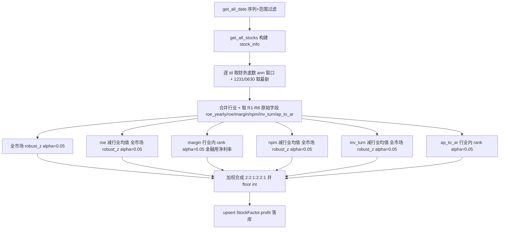

## 用户需求

调整已实现的 `cal_profit_factor` 盈利因子子项口径，由现有 5 子项（R1-R5）改为 6 子项（R1-R6），并引入"行业中性化"（减行业均值后再全市场比较）。全部子项方向均为"越大越好"，无符号翻转。

## 核心特性

- R1 `roe_yearly`：全市场 `robust_z_to_score`（alpha=0.05），权重 2。
- R2 `roe`：减行业均值（行业中性化）后全市场 `robust_z_to_score`（alpha=0.05），权重 2（新增子项）。
- R3 `grossprofit_margin`：行业内分组比 `rank_to_score`（alpha=0.05），银保证等金融行业改用 `netprofit_margin` 替代毛利率，权重 1。
- R4 `netprofit_margin`：减行业均值（行业中性化）后全市场 `robust_z_to_score`（alpha=0.05），权重 2。
- R5 `inv_turn`：减行业均值（行业中性化）后全市场 `robust_z_to_score`（alpha=0.05），权重 2。
- R6 `ap_to_ar`：行业内分组比 `rank_to_score`（alpha=0.05），权重 1。
- 权重合计 10（2:2:1:2:2:1），缺项按有效权重归一；结果向下取整为 int 落库 `StockFactor.profit`（单列不变）。

## 技术栈

沿用现有项目 Python + pandas + numpy + SQLAlchemy ORM 与 `factor.py` 既有归一化范式（`robust_z_to_score` / `rank_to_score`）。无新增依赖、无新增表/类/模块、不改 ORM。`StockFactor.profit` 列与 `get_fina_indicator_by_ann_date` 取数函数均已存在。

## 实现方案

采用最小侵入式改造，重写 `cal_profit_factor` 内部子项计算与权重，复用既有逐交易日截面取数、合成、落库骨架（与 `cal_size_factor` 对齐）。

- **关键决策 1（行业中性化范式复用）**：直接套用 `cal_valuation_factor`（factor.py:411-414）已验证的三步法 `centered = raw - groupby("industry")[raw].transform("mean")` → `robust_z_to_score(centered, alpha=0.05)`。R2(roe)、R4(netprofit_margin)、R5(inv_turn) 均用此范式消去行业系统性水平，仅保留行业内相对偏离后的全市场比较；方向均为正向（不翻转）。
- **关键决策 2（新增 roe 取数）**：`fina_fields` 追加 `"roe"`（StockFinaIndicator.roe 已存在，database.py:741），其余字段不变。
- **关键决策 3（权重与 score 重排）**：`weights` 改为 `{roe_yearly:2, roe:2, margin:1, netprofit_margin:2, inv_turn:2, ap_to_ar:1}`（总和 10）。子项编号 R1-R6 对应 score 列 `r1_score..r6_score`，`score_cols` 映射同步更新，沿用 `numerator/denom` 加权框架（缺项按有效权重归一）。
- **关键决策 4（R3/R6 保持行业内分组比）**：R3（原 R2 margin）与 R6（原 R5 ap_to_ar）仍为"行业内分组比"（`groupby("industry").transform(rank_to_score, alpha=0.05)`），R3 金融行业切换净利率逻辑不变；不参与中性化。
- **R1 alpha 显式化**：由默认 0.01 改为显式 `alpha=0.05`，与其他子项一致。

## 实现注意

- 中性化 `transform("mean")` 对含 NaN 的行：pandas `mean` 自动忽略 NaN，行业均值仅由有效值计算；中性化后该股票仍为 NaN，最终 `robust_z_to_score` 保留 NaN，合成环节按缺项处理，避免误填 0。
- 分数为 pandas `Series`，合成用 `section[sc].notna()` 判有效，不存在 ndarray 兼容坑（不同于反转因子）。
- 无未来函数：财务以 `ann_date <= td` 且取历史最新一期年报/中报为界，中性化仅用当周截面数据。
- 仅修改 `cal_profit_factor` 内部与 docstring；`PROFIT_FINANCE_KEYWORDS` 常量、`__main__` 测试5 调用不变。

## 架构设计

单函数内部子项口径调整，数据流与既有因子完全一致，不新增模块：



## 目录结构

```
src/
└── factor.py   # [MODIFY] cal_profit_factor
                #  - fina_fields 追加 "roe"；
                #  - weights 改为 {roe_yearly:2, roe:2, margin:1, netprofit_margin:2, inv_turn:2, ap_to_ar:1}；
                #  - R1 显式 alpha=0.05；R2 新增 roe 中性化；R3 沿用 margin 行业内 rank；
                #    R4 npm 改为中性化+alpha=0.05+权重2；R5 inv_turn 改为中性化+权重2；R6 ap_to_ar 行业内 rank；
                #  - score_cols 映射 r1..r6；docstring 同步 R1-R6 与权重/中性化说明。
```

## 关键代码结构

```python
# 行业中性化范式（复用 cal_valuation_factor）
def _neutralize(series: pd.Series, industry: pd.Series) -> pd.Series:
    return series - series.groupby(industry).transform("mean")

# 子项权重（总和 10，缺项按有效权重归一）
PROFIT_WEIGHTS = {
    "roe_yearly": 2,       # R1 全市场 robust_z alpha=0.05
    "roe": 2,              # R2 行业中性化后 全市场 robust_z alpha=0.05
    "margin": 1,           # R3 行业内 rank alpha=0.05（金融用 netprofit_margin）
    "netprofit_margin": 2, # R4 行业中性化后 全市场 robust_z alpha=0.05
    "inv_turn": 2,         # R5 行业中性化后 全市场 robust_z alpha=0.05
    "ap_to_ar": 1,         # R6 行业内 rank alpha=0.05
}
```