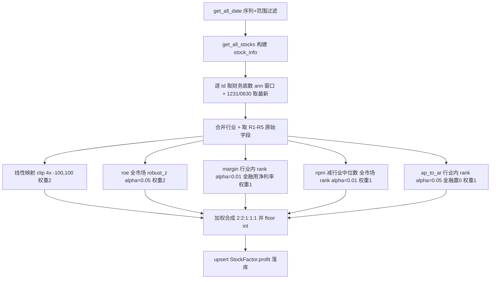

## 用户需求

微调 `cal_profit_factor` 盈利因子的子项口径，由当前 R1-R5（权重和 8）调整为 R1-R5（权重和 7）。仅调整权重、R2 中性化方式、R3/R4 的 alpha 参数，不新增/移除子项，不改变取数与落库流程。

## 核心特性

- R1 `roe_yearly`：`[-25,25]` 线性映射至 `[-100,100]`（`clip(4*x)`），权重由 3 下调为 2。
- R2 `roe`：取消行业中位数中性化，直接对 `roe` 做全市场 `robust_z_to_score(alpha=0.05)`，权重 2。
- R3 `grossprofit_margin`：行业内 `rank_to_score`，银保证等金融行业用 `netprofit_margin` 替代毛利率，`alpha` 由 0.05 下调为 0.01，权重 1。
- R4 `netprofit_margin`：减行业中位数后全市场 `rank_to_score`，`alpha` 由 0.05 下调为 0.01，权重 1。
- R5 `ap_to_ar`：行业内 `rank_to_score(alpha=0.05)`，金融行业行默认输出 0，权重 1（不变）。
- 加权合成沿用 `numerator/denom` 框架（缺项按有效权重归一），结果向下取整为 int 落库 `StockFactor.profit`（单列不变）。新权重和 = 2+2+1+1+1 = 7。

## 技术栈

沿用现有项目 Python + pandas + numpy 与 `factor.py` 既有归一化范式（`robust_z_to_score` / `rank_to_score`）。无新增依赖、无新增表/类/模块、不改 ORM。`StockFactor.profit` 列、`get_fina_indicator_by_ann_date` 取数函数、`PROFIT_FINANCE_KEYWORDS` 常量均已存在。

## 实现方案

采用最小侵入式改造，仅改动 `cal_profit_factor` 内部权重与三处子项参数，复用既有逐交易日截面取数、合成、落库骨架。

- **关键决策 1（R1 权重下调）**：`weights` 字典 `"roe_yearly": 3` 改为 `2`，注释同步。R1 的 `np.clip(section["roe_yearly"] * 4.0, -100.0, 100.0)` 计算逻辑不变（斜率 = 200/50 = 4，截距 = 0，区间外 clip 防越界）。
- **关键决策 2（R2 去除行业中性化）**：删除 `roe_centered = section["roe"] - section.groupby("industry")["roe"].transform("median")` 这一行，将 `section["r2_score"] = robust_z_to_score(roe_centered, alpha=0.05)` 改为 `section["r2_score"] = robust_z_to_score(section["roe"], alpha=0.05)`。"全市场比较"即对整列（跨行业）做稳健 z 标准化，不再按行业中位数去偏。
- **关键决策 3（R3/R4 alpha 调整）**：R3 行业内 `rank_to_score(s, alpha=0.05)` 改为 `alpha=0.01`；R4 `rank_to_score(npm_centered, alpha=0.05)` 改为 `alpha=0.01`。R4 的"减行业中位数"（`npm_centered`）逻辑保留，仅 alpha 变化。
- **关键决策 4（R5 不变）**：金融行业行 `np.where(is_finance, 0.0, r5_score)` 置 0 逻辑与 `alpha=0.05` 保持不变。
- **关键决策 5（合成无需改动）**：`score_cols` 映射（`r1..r5`）基名未变，`numerator/denom` 加权框架按 `weights` 自动适配新权重，权重和变为 7，缺项归一逻辑不受影响。

## 实现注意

- `robust_z_to_score` 内部已按中位数/MAD 稳健标准化（factor.py:66），R2 去掉行业中位数后即为纯全市场口径，与 R1 线性映射、`rank_to_score` 保持同向（越大越好，不翻转）。
- 分数为 pandas `Series`，合成用 `section[sc].notna()` 判有效；R5 金融行显式置 0（有效中性贡献），其余缺项仍为 NaN。
- 无未来函数：财务以 `ann_date <= td` 且取历史最新一期年报/中报为界，中性化仅用当周截面行业中位数。
- 仅修改 `cal_profit_factor` 内部与 docstring；`__main__` 测试5 调用、`PROFIT_FINANCE_KEYWORDS`、`fina_fields`、兜底列不变。

## 架构设计

单函数内部子项参数微调，数据流与既有因子完全一致，不新增模块（同上一版结构，仅 R2 去中性化、R3/R4 alpha 变更）：



## 目录结构

```
src/
└── factor.py   # [MODIFY] cal_profit_factor
                #  - weights: roe_yearly 3->2（权重和 7）；
                #  - R2 删除 roe_centered 行业中位数行，改为对 roe 直接
                #    robust_z_to_score(alpha=0.05)；
                #  - R3 rank_to_score alpha 0.05->0.01；
                #  - R4 rank_to_score alpha 0.05->0.01（npm_centered 保留）；
                #  - R5 不变；
                #  - docstring 同步权重和 7、R2 去中性化、R3/R4 alpha=0.01。
```

## 关键代码结构

```python
# 子项权重（总和 7，缺项按有效权重归一）
weights = {
    "roe_yearly": 2,       # R1 线性映射 [-25,25]->[-100,100]
    "roe": 2,              # R2 全市场 robust_z_to_score(alpha=0.05)
    "margin": 1,           # R3 行业内 rank_to_score(alpha=0.01，金融用 netprofit_margin)
    "netprofit_margin": 1, # R4 减行业中位数后 全市场 rank_to_score(alpha=0.01)
    "ap_to_ar": 1,         # R5 行业内 rank_to_score(alpha=0.05，金融置 0)

```