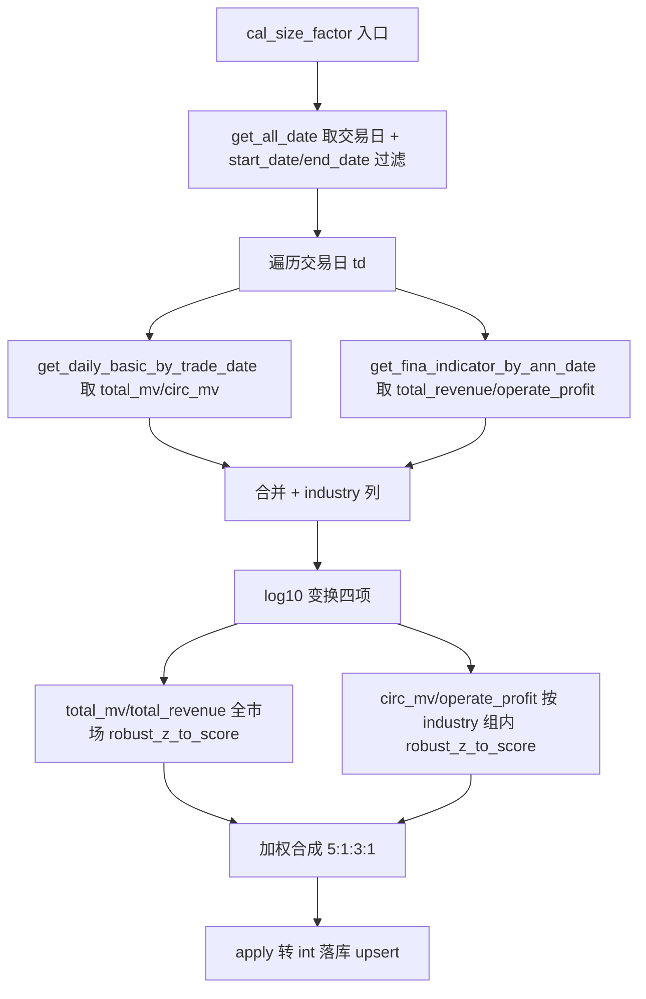

## 用户需求

调整 `cal_size_factor` 函数：彻底移除 `total_assets`（总资产）相关的取数、对数变换、组内标准化与加权合成代码，并将组内标准化（按行业分组比较）的项目由「流通市值 + 总资产」改为「流通市值 + 营业利润」。

## 核心功能

- 删除 `total_assets` 在财务兜底列、空兜底 DataFrame、merge 列、对数变换循环、组内标准化、加权映射中的所有残留代码。
- 财务截面仅保留 `total_revenue`（总收入）与 `operate_profit`（营业利润）。
- 四项分项：`total_mv`、`circ_mv`、`total_revenue`、`operate_profit`。
- 标准化方式：`total_mv` 与 `total_revenue` 全市场统一 `robust_z_to_score`；`circ_mv` 与 `operate_profit` 取 log10 后按 `industry` 分组组内 `robust_z_to_score`。
- 权重沿用当前文件实际值：`total_mv:5 / circ_mv:1 / total_revenue:3 / operate_profit:1`（权重和 10，缺项按有效权重归一）。
- 同步从 `FACTOR_REGISTRY` 移除总资产注册项，保持注册表与计算逻辑一致。
- 更新 `cal_size_factor` 文档字符串（四项分项、权重 5:1:3:1、`circ_mv`/`operate_profit` 组内标准化说明）。
- `database.py` 无需改动（operate_profit 字段已存在且被默认返回）；`robust_z_to_score`、`upsert_stock_factor`、ORM、其他因子函数均不改动。

## 技术栈

- 语言：Python 3（与现有项目一致）
- 数据处理：pandas + numpy
- 数据访问：复用 `src/database.py` 现有 `get_daily_basic_by_trade_date`、`get_fina_indicator_by_ann_date`（operate_profit 已包含于返回列，无需改 database.py）
- 归一化：复用 `factor.py` 现有 `robust_z_to_score`（单序列，不改动其实现）

## 实现方案

### 总体策略

仅修改 `src/factor.py` 的 `cal_size_factor` 与其文档、`FACTOR_REGISTRY` 注册项。将分项由 5 项（含 total_assets 残留）调整为 4 项（total_mv / circ_mv / total_revenue / operate_profit），权重 5:1:3:1；对 `circ_mv_log`、`operate_profit_log` 增加「按 industry 分组后组内 robust_z_to_score」步骤，其余两项保持全市场标准化，最后统一加权合成。

### 关键决策

1. **database.py 无需改动**：`StockFinaIndicator.operate_profit` 已定义（728 行），`get_fina_indicator_by_ann_date` 默认返回全部列，operate_profit 自动包含。
2. **组内标准化实现**：`robust_z_to_score` 仅接受单序列。对 `circ_mv_log`、`operate_profit_log` 使用 `section.groupby("industry")[col + "_log"].transform(lambda s: robust_z_to_score(s))` 得到行业内比较的分数；`transform` 保证返回与原索引对齐的 Series，缺失组不报错。`total_mv_log`、`total_revenue_log` 仍直接 `robust_z_to_score(section[col + "_log"])`（全市场）。
3. **兜底与空 DataFrame 列调整**：fina_df 兜底列集合改为 `("total_revenue", "operate_profit", "end_date")`；空兜底 DataFrame columns 改为 `["ts_code", "total_revenue", "operate_profit"]`，避免 merge 时 KeyError。
4. **权重与 total_w**：`weights = {total_mv:5, circ_mv:1, total_revenue:3, operate_profit:1}`，`total_w = 10`；复用现有加权合成循环（score_cols 映射新四项），缺项按有效权重归一逻辑不变。
5. **FACTOR_REGISTRY**：移除 `("总资产", "total_assets", "规模", "stock_fina_indicator")`，保留 `("营业利润", "operate_profit", "规模", "stock_fina_indicator")` 与既有 `total_mv / circ_mv / total_revenue` 项，保持注册表与计算逻辑一致。

### 性能与可靠性

- 组内 transform 在每个交易日截面执行两次 groupby，截面规模（全市场数千只）开销可忽略，不改变整体 O(n) 逐日循环复杂度。
- 边界：某行业样本不足时 `robust_z_to_score` 内部 mad==0 或分位数为 NaN 会返回 0 序列，安全；缺失值保持 NaN，加权时按有效权重跳过。
- 不影响增量（start_date/end_date）语义，落库仍按 (ts_code, trade_date) 主键 upsert。

### 实现注意事项

- 不改 `robust_z_to_score` 签名与实现。
- 不改 `upsert_stock_factor`、`StockFactor` ORM、`cal_valuation_factor` 及其他占位函数。
- 仅删除 `cal_size_factor` 内 `total_assets` 残留列名/兜底列/对数循环/标准化步骤/加权映射，并修正 docstring；以及 `FACTOR_REGISTRY` 删除总资产一行。
- 保持代码风格与现有版本一致（逐交易日循环、print 日志）。

## 架构设计



## 目录结构

```
src/
└── factor.py   # [MODIFY]
    - FACTOR_REGISTRY：移除总资产注册项（行 103 附近），保留营业利润项
    - cal_size_factor docstring：更新四项分项与权重 5:1:3:1、组内标准化说明
    - cal_size_factor 3.2：fina_df 兜底列改为 total_revenue/operate_profit/end_date；空兜底 columns 改为 ts_code/total_revenue/operate_profit
    - cal_size_factor 3.3：merge 使用 fina_df[["ts_code","total_revenue","operate_profit"]]
    - cal_size_factor 3.4：对数循环列改为 total_mv/circ_mv/total_revenue/operate_profit
    - cal_size_factor 3.5：total_mv/total_revenue 全市场标准化；circ_mv/operate_profit 按 industry 组内标准化
    - cal_size_factor 3.6：weights 沿用 5:1:3:1，score_cols 映射新四项（移除 total_assets_score）
```