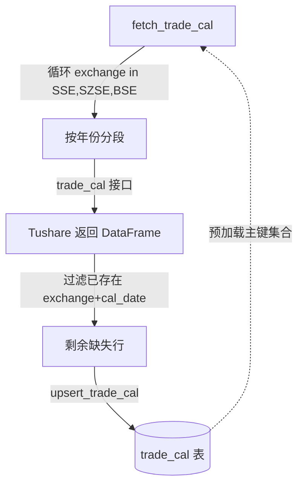

## 用户需求

通过 Tushare 的 trade_cal 接口获取上交所(SSE)、深交所(SZSE)、北交所(BSE)三大交易所的交易日历数据，并落库存储，供后续回测选股判断交易日使用。

## 核心功能

- 在 database.py 新增 TradeCal ORM 表，表名 trade_cal，复合主键为 (exchange, cal_date)，字段含 exchange（交易所代码）、cal_date（日历日期）、is_open（是否交易 0/1）、pretrade_date（上一交易日），日期字段统一 YYYYMMDD 字符串。
- 新增 upsert_trade_cal(df) 函数，复用现有 upsert 的「先查已存在主键集合 → 逐行合并 → 批量写入」模式，主键为 (exchange, cal_date)。
- 在 data_fetch.py 新增 fetch_trade_cal(...) 函数，无请求时延、无分批写入，按 exchange + 自然年份分段请求 Tushare，支持断点续传（已存在的 (exchange, cal_date) 跳过不重抓），覆盖全部三家交易所。

## 技术栈

- 语言：Python 3
- ORM：SQLAlchemy 2.0 Declarative Base（与现有 database.py 完全一致）
- 数据源：Tushare Pro `trade_cal` 接口（`ts.pro_api().trade_cal(exchange=, start_date=, end_date=)`）
- 存储：SQLite（DATABASE_URL 来自 config.py），沿用现有引擎与会话管理

## 实现方案

### 整体策略

完全复用现有项目的两段式结构（database.py 定义 ORM + upsert；data_fetch.py 定义 fetch + 调用 upsert），不引入新架构。TradeCal 表作为独立维度表（非股票维度），复合主键 (exchange, cal_date)，upsert 逻辑与现有 `upsert_stock_weekly` 等复合主键表高度同构，仅字段名与类型不同。fetch_trade_cal 按「交易所 × 年份」双重循环请求，因 trade_cal 单次可返回整年日历且数据量极小（每年约 250 行 × 3 交易所），无需时延与分批，直接一次性 upsert。

### 关键技术决策

1. **复合主键 (exchange, cal_date)**：交易日历真实唯一约束，同一交易所同一天只有一条记录，与用户澄清结论一致；复用现有复合主键 upsert 的 `existing = {(code, date) for ...}` 查询 + 逐行 setattr 模式。
2. **断点续传粒度 exchange + 年份**：预加载 DB 中已有 (exchange, cal_date) 集合，请求某交易所某年日历后，本地过滤掉已存在的行再 upsert；支持缺失年份补抓与增量更新，符合用户选择。
3. **无时延 / 无分批**：交易日历请求频率极低、数据量小（3 交易所 × 年份 ≤ 数百行/年），不需要 time.sleep 也不需 BATCH 缓冲，直接 concat 后单次 upsert，与用户明确要求一致；同时保留 skip_existing 开关以便强制全量重抓。
4. **字段类型全 String**：exchange/cal_date/is_open/pretrade_date 均按项目 YYYYMMDD 字符串约定存为 String，is_open 虽为 0/1 但 Tushare 返回为字符串，保持一致避免类型转换。

### 性能与可靠性

- 查询已存在主键使用单条 `session.query(TradeCal.exchange, TradeCal.cal_date).all()` 一次性加载到内存集合，避免逐行查库（与现有模式一致，数据量级极小无内存压力）。
- Tushare trade_cal 接口单次返回整年，无分页超限风险；按年分段仅为续传粒度，不增加请求数负担。
- 防御性去重：`df.drop_duplicates(subset=["exchange","cal_date"])`，防止接口返回重复行导致 IntegrityError（对齐现有 upsert 做法）。
- 年份范围：从起始年（默认 1990）到当前年，每交易所循环请求；可从 config 或函数参数配置起始年。

## 实现注意事项

- TradeCal 类需放在 database.py 现有 ORM 类之后、upsert 函数之前，保持文件结构一致；同时在文件顶部 import 行或 data_fetch.py 导入处补充 `TradeCal, upsert_trade_cal` 的引用。
- fetch_trade_cal 需在 data_fetch.py 顶部 import 中新增 `TradeCal, upsert_trade_cal`，并在 `__main__` 自测区块（已注释区）可补充调用示例，但保持不主动执行。
- 严格对齐现有 upsert 风格：使用 `_has_value` 跳过空值、`created_time`/`updated_time` 时间戳、`print` 写入统计。
- 不修改任何现有表/函数，仅新增，避免回归。

## 架构设计



数据流：fetch_trade_cal 预查询 DB 已有主键 → 逐交易所逐年份请求 → 本地去重+跳过已存在 → 单次 upsert_trade_cal 写入。

## 目录结构

```
src/
├── database.py   # [MODIFY] 新增 TradeCal ORM 类（复合主键 exchange+cal_date，字段 exchange/cal_date/is_open/pretrade_date 均为 String，含 created_time/updated_time）与 upsert_trade_cal(df) 函数（复用现有复合主键 upsert 模式）。
└── data_fetch.py # [MODIFY] 顶部 import 新增 TradeCal, upsert_trade_cal；新增 fetch_trade_cal(exchanges=('SSE','SZSE','BSE'), start_year=1990, skip_existing=True)，按 exchange+年份分段请求 trade_cal 接口，无时延无分批，断点续传后调用 upsert_trade_cal 写入；__main__ 自测区补充调用示例（注释态）。
```

## 关键代码结构

```python
class TradeCal(Base):
    __tablename__ = "trade_cal"
    exchange: Mapped[str] = mapped_column(String(10), primary_key=True, comment="交易所 SSE/SZSE/BSE")
    cal_date: Mapped[str] = mapped_column(String(20), primary_key=True, comment="日历日期 YYYYMMDD")
    is_open: Mapped[str | None] = mapped_column(String(4), comment="是否交易 0休市 1交易")
    pretrade_date: Mapped[str | None] = mapped_column(String(20), comment="上一交易日 YYYYMMDD")
    created_time: Mapped[datetime | None] = mapped_column(DateTime)
    updated_time: Mapped[datetime | None] = mapped_column(DateTime)
```