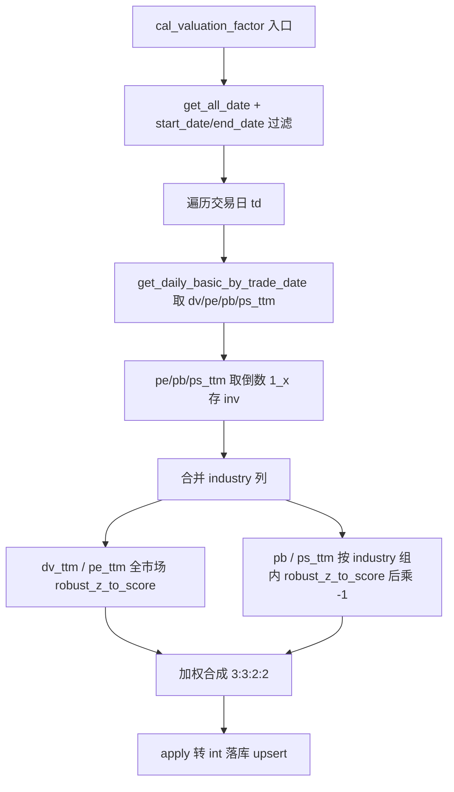

## 用户需求

修改估值因子计算函数 `cal_valuation_factor`，调整 pb 与 ps_ttm 两项的标准化与方向逻辑，其余保持现状。

## 核心功能

- pb、ps_ttm 由“全市场统一截面比较”改为“按行业分组、行业内比较”后再做稳健标准化。
- pb、ps_ttm 保留现有取倒数（1/x）预处理，组内 robust_z_to_score 归一化至 -100~100 后，再乘 -1 进行反向（结果：高 PB/PS 高分，偏成长方向）。
- dv_ttm、pe_ttm 维持现状：均全市场统一标准化、不反向；pe_ttm 仍取倒数。
- 最终仍将 dv_ttm、pe_ttm、pb、ps_ttm 四项按权重 dv_ttm:3 / pe_ttm:3 / pb:2 / ps_ttm:2 加权合成（权重和 10，缺项按有效权重归一），向下取整落库。
- 仅修改 src/factor.py，database.py 无需改动；robust_z_to_score、落库逻辑、其余因子函数不变。

## 技术栈

- 语言：Python 3（与现有项目一致）
- 数据处理：pandas + numpy
- 数据访问：复用 src/database.py 现有 get_daily_basic_by_trade_date（已返回 pb、ps_ttm 等列）
- 归一化：复用 factor.py 现有 robust_z_to_score（单序列，不改动其实现）

## 实现方案

### 总体策略

仅修改 src/factor.py 的 cal_valuation_factor：将其 3.3 标准化步骤中 pb、ps_ttm 两项由全市场 robust_z_to_score 改为“按行业分组组内 robust_z_to_score 后乘 -1 反向”，dv_ttm 与 pe_ttm 保持不变；更新文档字符串；权重与加权合成逻辑不变。

### 关键决策

1. **database.py 无需改动**：get_daily_basic_by_trade_date 已返回 pb、ps_ttm、pe_ttm、dv_ttm 全部列。
2. **组内标准化 + 反向实现**：robust_z_to_score 仅接受单序列。对 pb_inv、ps_ttm_inv 使用
`val_df.groupby("industry")[col + "_inv"].transform(lambda s: robust_z_to_score(s))`
得到行业内比较分数，再整体乘 -1 反向：
`val_df["pb_score"] = -val_df.groupby("industry")["pb_inv"].transform(lambda s: robust_z_to_score(s))`
`val_df["ps_ttm_score"] = -val_df.groupby("industry")["ps_ttm_inv"].transform(lambda s: robust_z_to_score(s))`
transform 保证返回与原索引对齐的 Series，缺失行业组不报错。乘 -1 为线性操作，在 transform 结果上直接取负即可。
3. **dv_ttm / pe_ttm 维持现状**：
`val_df["dv_ttm_score"] = robust_z_to_score(val_df["dv_ttm"].astype(float))`（全市场）
`val_df["pe_ttm_score"] = robust_z_to_score(val_df["pe_ttm_inv"])`（全市场，pe 仍取倒数）
4. **倒数变换（3.2）不变**：inv_cols=("pe_ttm","pb","ps_ttm") 仍计算 1/x 存 col+"_inv"；pb_inv、ps_ttm_inv 继续作为组内标准化输入。
5. **权重与加权合成（3.4）不变**：weights={dv_ttm:3, pe_ttm:3, pb:2, ps_ttm:2}，score_cols 四项映射不变，缺项按有效权重归一逻辑不变。
6. **文档字符串更新**：说明 pb/ps_ttm 改为按行业组内标准化且乘 -1 反向；dv_ttm/pe_ttm 维持全市场；权重 3:3:2:2。

### 性能与可靠性

- 组内 transform 每个交易日截面执行两次 groupby，全市场数千只股票开销可忽略，不改变整体 O(n) 逐日循环复杂度。
- 边界：某行业样本不足时 robust_z_to_score 内部 mad==0 或分位数为 NaN 返回 0 序列，安全；缺失值保持 NaN，加权时按有效权重跳过。
- 不影响增量（start_date/end_date）语义，落库仍按 (ts_code, trade_date) 主键 upsert。

### 实现注意事项

- 不改 robust_z_to_score 签名与实现。
- 不改 upsert_stock_factor、StockFactor ORM、cal_size_factor 及其他占位函数。
- 仅修正 cal_valuation_factor 的 3.3 标准化步骤与 docstring；database.py 不动。
- 保持代码风格与现有版本一致（逐交易日循环、print 日志）。

## 架构设计



## 目录结构

```
src/
└── factor.py   # [MODIFY]
    - cal_valuation_factor docstring：说明 pb/ps_ttm 组内标准化+反向，dv/pe 全市场，权重 3:3:2:2
    - cal_valuation_factor 3.3：pb_score / ps_ttm_score 改按 industry 组内 robust_z_to_score 后乘 -1；dv_ttm_score / pe_ttm_score 维持全市场
    - cal_valuation_factor 3.2 / 3.4 / weights：保持不变
```

## 关键代码结构

```python
# factor.py（cal_valuation_factor 3.3 标准化步骤修改后）
# dv_ttm / pe_ttm：全市场统一标准化（不变）
val_df["dv_ttm_score"] = robust_z_to_score(val_df["dv_ttm"].astype(float))
val_df["pe_ttm_score"] = robust_z_to_score(val_df["pe_ttm_inv"])
# pb / ps_ttm：按行业分组组内标准化后乘 -1 反向
val_df["pb_score"] = -val_df.groupby("industry")["pb_inv"].transform(
    lambda s: robust_z_to_score(s)
)
val_df["ps_ttm_score"] = -val_df.groupby("industry")["ps_ttm_inv"].transform(
    lambda s: robust_z_to_score(s)
)
```

## Agent Extensions

无（本任务仅涉及 src/factor.py 局部修改，用户上下文未提供适用的 Skill / MCP / SubAgent / Integration，故不引用任何扩展）。