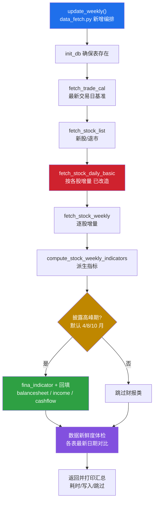

## 产品概述

为已有量化分析项目补齐「每周动态更新」能力：在存量数据截止 2026-07 的基础上，新增一个可重复运行的每周更新入口，把**因子计算所必需的原始数据**增量补齐到最新，为后续因子重算提供干净、新鲜的数据底座。本阶段只更新原始数据，不重算因子。

## 核心功能

- **一键周更入口**：在 `src/data_fetch.py` 新增一个每周更新编排函数，并在该文件的 `if __name__ == "__main__"` 中调用，运行后即完成全链路增量更新。
- **按依赖顺序增量更新必要原始数据**：

1. 交易日历 `trade_cal`（全量覆盖，作为最新交易日基准）；
2. 股票清单 `stock_list`（捕捉新股上市/退市）；
3. 每日指标 `stock_daily_basic`（**改造为按各股已存最大交易日增量取数**，是提速重点）；
4. 周K行情 `stock_weekly`（沿用原生逐股增量）；
5. 周K技术指标 `stock_weekly_indicator`（派生表，仅补缺失周）；
6. 财报类（财务指标 `stock_fina_indicator` 及其占位字段回填、资产负债表、利润表、现金流量表）。

- **有条件轮询财报**：仅当处于**财报披露高峰期（默认 4、8、10 月）**时才轮询财报类数据，其余周跳过，显著省时；并提供参数强制包含或强制跳过。
- **数据新鲜度体检**：更新结束后打印各表最新日期与最新交易日对比，一眼看出哪张表落后。
- **首轮自动回补**：首次运行自动把 2026-07 至今约 2.5 个月的历史补齐，之后每周运行即为轻量增量。

## 边界与约束

- 只更新原始数据，不触发因子重算。
- 所有 `upsert_*` 幂等，函数可重复运行、可中断续跑。
- 不改动 `main.py`，不新建独立脚本，改动集中在 `data_fetch.py` 与 `config.py`。
- 因子截面日期由 `trade_cal`、`stock_daily_basic`、`stock_weekly_indicator` 三者交集决定，故这三张表必须每周更新，否则因子日期不会前进。

## 技术栈

- 语言与运行环境：Python 3.11（现有 `.env`），Windows / PowerShell。
- 数据源与 ORM：Tushare（`ts.pro_bar`、`_pro.daily_basic`、`_pro.trade_cal`、`_pro.fina_indicator`、`_pro.balancesheet/income/cashflow`）、SQLAlchemy + SQLite（`data/raw/stock.db`）。
- 依赖：pandas、numpy、sqlalchemy、tushare 均已安装，**无需新增依赖**。

## 实现方案

采用「**编排函数 + 已有增量 fetch 复用 + 单点改造 daily_basic**」的最小侵入式方案，全部改动落在 `src/data_fetch.py` 与 `config.py`。

### 关键决策

1. **不做因子重算**：用户在需求澄清中明确「仅更新原始数据」，故 `update_weekly` 只编排既有 `fetch_*` / `compute_stock_weekly_indicators`，不调用任何 `cal_*_factor`。

2. **daily_basic 走「按股增量」**（用户明确选择「增量窗口全历史」）：

- 现有实现在函数开头用固定 `start_date`（默认 20120101）对**所有股票**统一生成窗口，逐股请求全历史、再本地去重，是整条链路最慢的一环。
- 改为把窗口生成**移入逐股循环**：`query_start = max(existing_days)`（无历史的新股回退到 `start_date`），并新增「已追平最新交易日则整支跳过」的短路优化，与 `fetch_stock_weekly` 的增量范式完全对齐。
- 保留 `start_date`、`skip_existing` 形参语义，**向后兼容**（`skip_existing=False` 时仍从 `start_date` 全量）。

3. **财报类按披露高峰条件轮询**（用户选择「披露高峰期才轮询」）：

- 新增私有判定 `_is_disclosure_peak(d)`：默认月份 ∈ (4, 8, 10)（对应年报/一季报、半年报、三季报披露窗口），月份集合放进 `config.py` 便于调整。
- `update_weekly(include_reports=None)` 中 `None` 表示按月份自动判定，`True/False` 可强制包含/跳过。

4. **新增「最新开市日」基准辅助**：新增 `_latest_open_trade_date(upto)`，从 `TradeCal` 取 `is_open='1'` 且 `<= today` 的最大 `cal_date`，用于 daily_basic 的「追平跳过」判断。

- **不复用 `get_all_date()`**：它取 `trade_cal ∩ daily_basic ∩ weekly_indicator` 三表交集，在数据尚未更新前无法反映最新交易日，用于追平判断会形成死循环依赖。

5. **失败不中断 + 结果汇总**：每个步骤独立 `try/except`，单步失败只记录并继续（各表相互独立，不构成硬依赖），结束时返回并打印结构化汇总（每步耗时、写入量、跳过量）。

### 性能与可靠性

- daily_basic 由「每次全市场全历史」降为「每股仅增量窗口」，每周数据量从约数百万行级降到约万行级，接口请求量下降一个量级。
- 财报类在非高峰月直接跳过，避免每周约 5000 支的无谓逐股请求。
- `stock_weekly_indicator` 采用一次性加载全量周K后 `groupby` 计算（现状即如此），全市场约百万行级可接受。
- 全部 `upsert_*` 为「查主键 → 合并 → 写入」的幂等实现，天然支持中断续跑与重复执行。

## 架构设计



依赖关系说明：`stock_weekly_indicator` 依赖 `stock_weekly`；`stock_daily_basic`、`trade_cal`、`stock_weekly_indicator` 共同决定因子截面日期，故顺序上先更新日历与日频，再更新周频与派生指标。

## 目录结构

```
buffeet/
├── config.py            # [MODIFY] 新增每周更新相关配置：REPORT_PEAK_MONTHS（财报披露高峰月份，默认 (4, 8, 10)）、WEEKLY_UPDATE_DELAY（统一时延，默认 0.2）、WEEKLY_UPDATE_START_DATE（新股无历史时的全量回退起点，默认 "20120101"）。复用已有 REPORT_START_DATE，不改动其取值。
└── src/
    └── data_fetch.py    # [MODIFY] 本计划唯一代码改造文件，包含三类改动：
                         #   1) 新增私有辅助 `_latest_open_trade_date(upto=None)`：查 TradeCal 取 is_open='1' 且 <= 指定日的最大 cal_date，作为「最新开市日」基准（TradeCal 为空时回退今日），用于 daily_basic 追平判断。
                         #   2) 新增私有辅助 `_is_disclosure_peak(d, months=REPORT_PEAK_MONTHS)`：判断是否处于财报披露高峰月。
                         #   3) 改造 `fetch_stock_daily_basic(...)`：将 `_date_windows` 生成移入逐股循环，query_start 改为 `max(existing_days)`（无历史回退 start_date），新增「已追平最新开市日则整支跳过」短路；保持入参签名与 skip_existing=False 的全量语义不变。
                         #   4) 新增编排函数 `update_weekly(delay=WEEKLY_UPDATE_DELAY, include_reports=None) -> dict`：按 trade_cal → stock_list → daily_basic → weekly → weekly_indicator → (条件)财报类 顺序执行；每步 try/except 并计时、统计写入量；结束时调用新鲜度自检并打印汇总；返回结构化 summary。
                         #   5) 新增 `report_data_freshness() -> dict`：查询各表 max(trade_date)/max(end_date) 与最新开市日对比并打印。
                         #   6) 改造 `if __name__ == "__main__"`：保留 `init_db()`，将现有零散的活动调用替换为单个 `update_weekly()` 调用；历史「测试1~测试11」块保留为注释以免丢失参考。
```

## 关键代码结构（接口级签名示意）

```python
# config.py 新增
REPORT_PEAK_MONTHS = (4, 8, 10)      # 财报披露高峰期月份
WEEKLY_UPDATE_DELAY = 0.2            # 周更统一时延
WEEKLY_UPDATE_START_DATE = "20120101"  # 新股无历史时的全量回退起点

# data_fetch.py 新增/改造
def _latest_open_trade_date(upto: date | None = None) -> str: ...
    # TradeCal 中 is_open='1' 且 <= upto 的最大 cal_date；无数据时回退 upto

def _is_disclosure_peak(d: date, months: tuple[int, ...] = REPORT_PEAK_MONTHS) -> bool: ...
    # 返回 d.month in months

def fetch_stock_daily_basic(delay: float = 0.2, skip_existing: bool = True,
                            start_date: str = "20120101") -> "pd.DataFrame": ...
    # 改造点：逐股 query_start = max(existing_days)（无历史回退 start_date）；
    # 已追平 _latest_open_trade_date() 则整支跳过；窗口按每股 query_start 生成。

def update_weekly(delay: float = WEEKLY_UPDATE_DELAY,
                  include_reports: bool | None = None) -> dict: ...
    # include_reports=None：按 _is_disclosure_peak(date.today()) 自动判定
    # 返回 summary：{step: {"ok": bool, "written": int, "skipped": int, "elapsed": float}}

def report_data_freshness() -> dict: ...
    # 各表最新日期 vs 最新开市日，打印并返回
```

## 实施要点（防止返工）

- **顺序不可颠倒**：`trade_cal` 必须最先更新，否则 daily_basic 的「最新开市日」判断与因子截面基准会滞后。
- **daily_basic 改造保持向后兼容**：`skip_existing=False` 时行为与改造前一致（从 `start_date` 全量请求），避免破坏历史调用。
- **边界去重**：增量起点的边界交易日会被重复请求，依赖现有「本地按已存日过滤」逻辑去重，改造后需保留该过滤。
- **财报占位字段回填的时机**：`fetch_stock_fina_indicator_backfill` 必须排在 `fetch_stock_fina_indicator` 之后（其依赖财务指标主表已入库），且应在财报类步骤内、与三表同一条件分支。
- **不引入重复请求**：`stock_weekly` 与 `compute_stock_weekly_indicators` 均已有「追平跳过」，直接复用，不额外加逻辑。
- **可观测性**：每步打印耗时与写入量，结束时统一输出新鲜度体检，便于判断本次是否真正推进到最新交易日。
- **首次运行预期**：首轮会回补约 2.5 个月（尤其 daily_basic 与 weekly 增量较多），耗时明显长于后续周更；建议首轮手动在空闲时段执行并观察输出。

## Agent Extensions

### SubAgent

- **code-explorer**
- Purpose：在改造 `fetch_stock_daily_basic` 与重写 `__main__` 之前，精确核对 `fetch_stock_balancesheet` / `fetch_stock_income` / `fetch_stock_cashflow` 三个函数的内部结构与增量分支、以及 `__main__` 历史测试块的确切起止行范围，避免误删或漏改。
- Expected outcome：给出上述函数的关键行号与结构摘要，确认改造点边界，确保 `daily_basic` 改造与 `__main__` 替换为局部安全编辑、不产生回归。