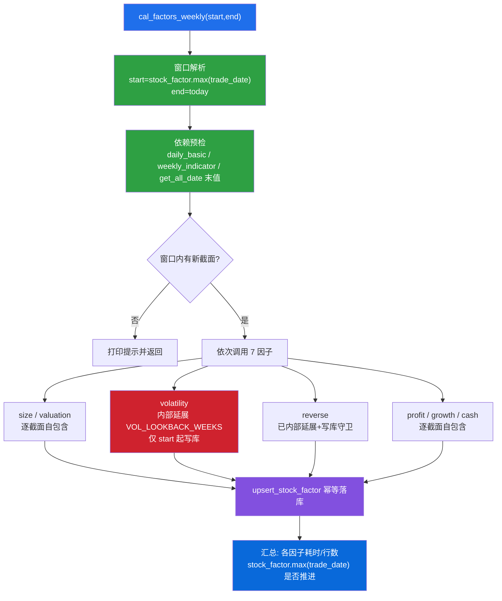

## 产品概述

在已完成基础数据更新的前提下，为因子库补齐「每周增量更新」能力：新增一个一键驱动函数，自动解析增量窗口并依次重算 7 个已实现因子，使 `stock_factor` 随每周基础数据同步推进。核心难点在于部分因子的计算依赖 T-N 日历史数据，增量更新时必须对该类因子向前延展取数窗口，同时保证最终输出与写库仍严格以 T 日为起点，避免历史存量因子被降级覆盖。

## 核心功能

- **一键周更因子**：新增 `cal_factors_weekly()` 驱动函数，自动解析窗口（`start` = `stock_factor` 现有 `max(trade_date)`，含边界；`end` = 今天），依次调用 7 个因子函数并打印各因子状态、耗时与写入行数。
- **覆盖因子**：size / valuation / volatility / reverse / profit / growth / cash；`supply` / `moat` 未实现，跳过。
- **历史依赖延展**：对存在跨截面滚动依赖的因子（波动率，需要上一截面窗口与向前连续 4 周窗口）在函数内部向前延展取数与计算范围，但**仅对 `[start, end]` 范围写库**，既补齐 warm-up、又不改写历史存量值。
- **依赖预检**：运行前检查 `stock_daily_basic`、`stock_weekly_indicator` 及 `get_all_date()` 的最新截面是否就绪，落后时给出告警并提示先执行基础数据周更。
- **结果校验**：结束后输出 `stock_factor.max(trade_date)` 是否推进到最新周，以及每个因子的增量行数。
- **幂等可重跑**：落库沿用 `upsert_stock_factor`，同一窗口重复执行结果一致。

## 边界与约束

- 仅做因子增量重算，不改动基础数据更新链路。
- 保持既有 `cal_*_factor(start_date, end_date)` 的对外签名与调用方式不变（仅修正波动率的窗口语义）。
- 不新增第三方依赖；改动集中在 `src/factor.py`。

## 技术栈

- 语言与运行环境：Python 3.11（现有 `.env`），Windows / PowerShell。
- 计算与数据访问：pandas、numpy、SQLAlchemy + SQLite（`data/raw/stock.db`）；全部沿用现有依赖，**无需新增**。
- 复用现有模块：`src/factor.py`（因子计算与 `upsert_stock_factor`）、`src/database.py`（`get_all_date` / `get_daily_basic_by_trade_date` / `StockFactor` 等）。

## 实现方案

采用「**新增统一驱动函数 + 单点改造波动率因子**」的最小侵入式方案，全部改动落在 `src/factor.py`。

### 关键决策与理由

1. **驱动函数统一入参，窗口解析内聚**：`cal_factors_weekly(start_date=None, end_date=None)` 中，缺省窗口自动解析为 `start = stock_factor 现有 max(trade_date)`、`end = 今天`；显式传参可覆盖，便于小窗口试跑。顺序固定为 size → valuation → volatility → reverse → profit → growth → cash（因子间无依赖，顺序不敏感，固定仅为日志稳定）。

2. **历史依赖只在函数内部延展，绝不在驱动层延展 `start`**：这是本方案正确性的核心。若在驱动层把 `start` 往前挪来喂 warm-up，则波动率会把延展周的（同样降级的）因子值一并 `upsert`，**覆盖掉这些历史周原本正确的存量值**。故必须遵循 `cal_reverse_factor` 的既有范式：**「取数/遍历窗口延展、写库窗口守卫」**。

3. **波动率因子对齐 reverse 范式（唯一需要改造的因子）**：

- 在**完整** `trade_date`（`get_all_date()` 结果）上定位 `start_idx` / `end_idx`，不再把遍历序列裁剪为 `[start, end]`；
- 取数/遍历起点向前延展 `lookback_idx = max(0, start_idx - VOL_LOOKBACK_WEEKS)`，`q_start` 取 `trade_date[lookback_idx - 1]`（当 `lookback_idx > 0`）以保证「上一截面, 本截面]」日频窗口有前序，`lookback_idx == 0` 时退化为 `trade_date[0]`；
- 计算范围 = `trade_date[lookback_idx : end_idx + 1]`，但**仅当 `td >= start_date` 时才 `upsert`**（写库守卫）；
- 新增模块级常量 `VOL_LOOKBACK_WEEKS = 6`（技术下限为 4 周：4 周滚动 + 上一截面窗口，取 6 留余量），与既有 `REV_*` 参数块风格一致。

4. **其余 6 个因子无需改造**（已核实为逐截面自包含）：

- `size` / `valuation`：逐 `td` 取当日 `stock_daily_basic` 后做截面归一化；
- `profit` / `growth` / `cash`：逐 `td` 取财报 `ann_date ∈ [td-1年, td]` 的窗口；
- `reverse`：**已在内部自延展**（`lookback_start = max(0, start_idx - (REV_K + 2))`，factor.py:807）并带写库守卫（docstring:769），可直接增量调用。

5. **依赖预检 + 无新周短路**：驱动函数在调用前读取 `stock_daily_basic.max(trade_date)`、`stock_weekly_indicator.max(trade_date)` 与 `get_all_date()` 末值并打印；若末值落后于期望最新周，给出告警（默认不中断，便于人工判断）；若窗口内无截面（`start > end`）则直接返回。

6. **可观测性与容错**：每个因子调用用 `try/except` 包裹，单因子失败不阻断其余因子；记录调用前后 `stock_factor` 行数差、耗时；结束统一打印汇总表与最新截面推进情况，返回结构化 summary 供上层引用。

### 性能考量

- 增量窗口通常只有 1 周，故波动率实际遍历的截面数 = `VOL_LOOKBACK_WEEKS + 窗口周数`（约 7 个截面），远小于全量重算；其余因子遍历截面数 = 窗口周数，属分钟级。
- 未引入逐股票 Python 循环放大：沿用现有 `searchsorted` + `groupby` + `rolling` 向量化实现，延展仅在序列索引层面加减，不增加量级开销。
- `stock_factor` 计数采用 `COUNT(*)` 前后差，避免全表加载。

### 防返工要点

- **窗口编号位移风险**：波动率用 `searchsorted` 把日频交易日映射到「窗口序号 `_wk`」再滚动 4 窗口求和（factor.py:559-600）。延展起点后，`_wk` 的起算位置随之变化，必须核对该编号逻辑与 `rolling(4, min_periods=4)` 的对齐关系，确保延展不引入错位（实现前先用子代理精确定位该段逻辑）。
- **写库守卫生效校验**：改造后须对比改造前后「`< start` 的历史周」`volility` 值完全一致。
- **向后兼容**：`cal_volatility_factor` 的**全量调用**（`start_date=None`）行为必须与改造前一致（此时 `lookback_idx = 0`，等价于全量）。
- **导入补充**：驱动函数需查询 `stock_factor` 现有最大日期，`factor.py` 顶部当前**未导入** `get_session`，需补充（或改用 `get_engine()` + pandas）。

## 架构设计



依赖关系说明：波动率为唯一需要「内部延展取数 + 写库守卫」的改造点；其余因子保持自包含逐截面计算，驱动层仅做窗口解析与编排，不改变任何因子的对外签名。

## 目录结构

```
buffeet/
└── src/
    └── factor.py   # [MODIFY] 本计划唯一改动文件，包含四处改动：
                    #   1) 新增模块级常量 VOL_LOOKBACK_WEEKS = 6（波动率向前延展周数），
                    #      置于 REV_* 参数块附近，保持模块级参数风格一致。
                    #   2) 改造 cal_volatility_factor(start_date, end_date)：
                    #      - 在完整 get_all_date() 序列上定位 start_idx / end_idx；
                    #      - lookback_idx = max(0, start_idx - VOL_LOOKBACK_WEEKS)；
                    #        q_start = trade_date[lookback_idx-1]（lookback_idx>0）否则 trade_date[0]；
                    #      - 计算范围 trade_date[lookback_idx : end_idx+1]，仅 td >= start_date 时 upsert；
                    #      - 同步更新 docstring，说明「取数延展 + 写库守卫」语义；
                    #      - 保证 start_date=None 全量调用行为与改造前一致。
                    #   3) 新增驱动函数 cal_factors_weekly(start_date=None, end_date=None) -> dict：
                    #      - 窗口解析（含边界，可显式覆盖）；
                    #      - 依赖预检（daily_basic / weekly_indicator / get_all_date 末值）+ 告警；
                    #      - 无新周短路；
                    #      - 依次调用 size/valuation/volatility/reverse/profit/growth/cash，
                    #        每因子 try/except + 计时 + stock_factor 行数差分；
                    #      - 汇总打印并返回 summary dict。
                    #   4) 顶部 import 补充 get_session（查询 stock_factor 现有 max(trade_date) 用）；
                    #      并改造 __main__ 新增调用 cal_factors_weekly()，既有测试块保留为注释。
```

## 关键代码结构（接口级签名，示意）

```python
# factor.py 新增模块级常量（与 REV_* 同风格）
VOL_LOOKBACK_WEEKS = 6   # 波动率增量更新向前延展周数（覆盖 4 周滚动 + 上一截面窗口）

# factor.py 驱动函数（新增）
def cal_factors_weekly(
    start_date: str | None = None,
    end_date: str | None = None,
) -> dict:
    """
    每周增量重算已实现的 7 个因子。

    窗口：start_date 缺省取 stock_factor 现有 max(trade_date)（含边界，重算无害）；
          end_date 缺省取今天。窗口内无截面时直接返回。
    顺序：size -> valuation -> volatility -> reverse -> profit -> growth -> cash。
    说明：存在跨截面历史依赖的因子（波动率）在函数内部向前延展取数，
          但写库仍以 start_date 为起点；本驱动**不**在窗口层面延展 start。
    返回：{factor_name: {"ok": bool, "elapsed": float, "rows_delta": int, "note": str}}
    """

# factor.py 改造后（窗口解析与写库守卫，示意）
def cal_volatility_factor(
    start_date: str | None = None, end_date: str | None = None
) -> None:
    trade_date = sorted(get_all_date())
    start_idx = next((i for i, t in enumerate(trade_date) if t >= start_date), len(trade_date)) \
        if start_date is not None else 0
    end_idx = len(trade_date) - 1
    if end_date is not None:
        end_idx = max((i for i, t in enumerate(trade_date) if t <= end_date),
                      default=len(trade_date) - 1)
    lookback_idx = max(0, start_idx - VOL_LOOKBACK_WEEKS)
    q_start = trade_date[lookback_idx - 1] if lookback_idx > 0 else trade_date[0]
    # ... 取数 q_start ~ q_end；遍历 trade_date[lookback_idx : end_idx + 1]
    # ... 仅当 td >= start_date 时 upsert_stock_factor(...)  # 写库守卫
```

## Agent Extensions

### SubAgent

- **code-explorer**
- Purpose：在改造波动率因子前，精确定位 `cal_volatility_factor` 中 `searchsorted` 的窗口编号逻辑（`_wk` 起算与滚动对齐，参考 factor.py:559-600）与写库点边界（factor.py:700-714），产出改造前基线；并确认全仓库无其他调用点依赖其旧窗口行为。
- Expected outcome：给出 `_wk` 窗口编号与 `rolling(4, min_periods=4)` 对齐关系的关键行号与结构摘要，明确延展起点的位移方式，确保改造为局部安全编辑、不产生错位或回归。