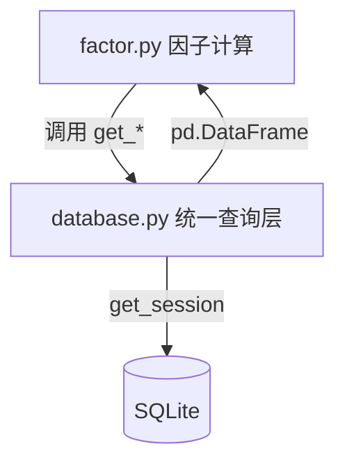

## 用户需求

在 database.py 中为因子计算涉及的 4 张 ORM 表统一新增 `get_*` 读函数，供 factor.py 等模块调用，避免在各业务文件中裸写 SQL/ORM 查询。

## 产品概述

建立统一的数据访问层（DAL）查询函数，对因子计算所需的财务、日频、周频行情及周频技术指标四类数据，提供一致、可复用的按日期截面取数能力，返回 pandas DataFrame，使 factor.py 保持纯计算、可测试。

## 核心特性

- 为 `StockFinaIndicator` 新增 `get_fina_indicator`（规模/盈利/成长/现金），按报告期 `end_date` 截面取数（该表无 trade_date 字段）。
- 为 `StockDailyBasic` 新增 `get_daily_basic`（规模/估值/波动，日频），按 `trade_date` 截面取数。
- 为 `StockWeekly` 新增 `get_weekly`（波动，周频），按 `trade_date` 截面取数。
- 为 `StockWeeklyIndicator` 新增 `get_weekly_indicator`（技术），按 `trade_date` 截面取数。
- 四个函数统一签名：支持可选 `ts_code`（单只或列表）、可选日期/区间、可选 `fields` 限制返回列，统一返回 `pd.DataFrame`（空结果返回含 ORM 列的空 DataFrame，不返回 None）。

## 技术栈

- 语言：Python 3（项目现有）
- ORM：SQLAlchemy 2.0（DeclarativeBase / Mapped / mapped_column）
- 数据处理：pandas / numpy
- 数据库：SQLite（通过 `config.DATABASE_URL` 配置）

## 实现方案

### 总体策略

在 `database.py` 末尾（`upsert_stock_factor` 函数之后，约第 2365 行后）新增一个「统一查询层」区块，为四张因子相关表各实现一个 `get_*` 读函数。所有函数复用现有 `get_session()` 上下文管理器，通过 SQLAlchemy ORM 查询后转为 `pd.DataFrame` 返回。保持与现有 `upsert_*` 函数一致的分层与风格，不改动任何原有写入逻辑。

### 关键技术决策

1. **读函数集中在 database.py（DAL 单一职责）**：`database.py` 已是所有 ORM 表与 `upsert_*` 写函数的唯一归宿，读函数放在此处可避免 factor.py 或其他模块裸写 `session.query`，保证数据访问入口唯一、可复用、可测试。
2. **统一返回 `pd.DataFrame`**：贴合 factor.py 现有「DataFrame 进、DataFrame 出」的因子计算流程；空结果返回含 ORM 列名的空 DataFrame（非 None），避免调用方做 None 判断。
3. **在 with 块内用 `pd.read_sql(query.statement, session.bind)` 取数**：由于 `get_session()` 使用 `expire_on_commit=False` 且 `finally` 中 `session.close()`，若先 `.all()` 取出 ORM 对象再在 with 块外访问属性会触发懒加载失败。最稳妥做法是在 session 未关闭前用 `pd.read_sql` 直接基于 query statement 读取，避免对象过期问题。
4. **日期维度差异处理（重要）**：`StockFinaIndicator` 无 `trade_date` 字段，联合主键为 `(ts_code, end_date)`（报告期）。因此 `get_fina_indicator` 以 `end_date` 作为截面筛选参数（支持 `end_date` 单值或 `start_end_date`/`end_end_date` 区间），而其余三张表（均含 `trade_date`）以 `trade_date` 作为截面参数，保持与各自主键一致。
5. **`fields` 参数控制返回列**：默认返回全列；传入字段名列表时用 `session.query(*[getattr(Model, f) for f in fields])` 限制查询列，减少 I/O 与内存（截面全市场查询可能数千行，限制列有实际收益）。
6. **`ts_code` 支持单值或列表**：传入列表时用 `Model.ts_code.in_(ts_code)`，便于按股票子集取数。

### 实现要点

- **database.py 顶部新增导入**：当前仅局部 `from pandas import isna`，需在文件顶部（约第 13 行后）增加 `import pandas as pd`，供查询层使用。
- **函数位置**：放在文件末尾 `upsert_stock_factor` 之后，新增注释分隔块 `# ===================== 统一查询层（供 factor.py 等调用，返回 DataFrame） =====================`。
- **空 DataFrame 构造**：用 `pd.DataFrame(columns=[c.name for c in Model.__table__.columns])` 保证列名与 ORM 一致。
- **blast radius 控制**：不修改任何 `upsert_*` 函数、不修改 ORM 表定义、不修改 factor.py（本次仅新增读函数；factor.py 的实际调用改造留待后续独立任务）。不改动 `StockFactor`/`upsert_stock_factor`（复合因子结果表，保持不变）。
- **性能**：截面查询（单 `trade_date` 全市场）通常在数千行量级，一次性 `pd.read_sql` 足够；若未来数据量膨胀，可在 `trade_date` 列上确认已有索引（现有 upsert 已按联合主键建索引，无需额外处理）。

## 架构设计

保持现有扁平模块结构，不引入新架构模式。



新增后模块职责：

- `database.py`：行情/基本面/日历等表的 ORM + `upsert_*` 写函数 + 新增 `get_*` 读函数（统一返回 DataFrame）。
- `factor.py`：纯计算模块（归一化函数 + FACTOR_REGISTRY），后续可从 database 导入 `get_*` 取数，本次不改动其调用。

## 目录结构

```
src/
└── database.py   # [MODIFY] 顶部新增 import pandas as pd；
                 #          末尾 upsert_stock_factor 之后新增统一查询层区块，
                 #          实现 get_fina_indicator / get_daily_basic /
                 #          get_weekly / get_weekly_indicator 四个读函数，
                 #          均返回 pd.DataFrame，支持 ts_code/日期/fields 过滤。
```

## 关键代码结构

四个读函数统一签名范式（以 StockDailyBasic 为例）：

```python
def get_daily_basic(
    ts_code: str | list[str] | None = None,
    trade_date: str | None = None,
    start_date: str | None = None,
    end_date: str | None = None,
    fields: list[str] | None = None,
) -> "pd.DataFrame":
    """按 trade_date 截面（或区间）查询每日指标，返回 DataFrame。"""
    ...

# get_fina_indicator 用 end_date / start_end_date / end_end_date 替代 trade_date 参数
# get_weekly / get_weekly_indicator 同 get_daily_basic 使用 trade_date 参数
```