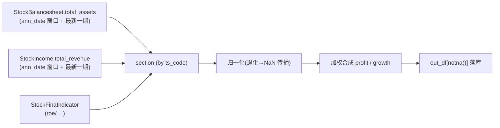

## 产品概述

调整盈利因子与成长因子的子项取数来源，并修正截面归一化函数对缺失值的处理，使因子只对"确有数据"的股票落库，消除此前的行数膨胀/塌陷问题。

## 核心功能

- 盈利因子 R6：由"派生净资产 equity"改为"总资产 total_assets"，且 `total_assets` 不再取自 `StockFinaIndicator`，改为取自 `StockBalancesheet`。
- 成长因子 R4：`total_revenue` 不再取自 `StockFinaIndicator`，改为取自 `StockIncome`。
- 归一化：`rank_to_score` 与 `robust_z_to_score` 的退化分支改为"仅对有值行给 0、缺失行保持 NaN"，不再整组填 0。

## 技术栈

- 语言/库：Python + pandas + SQLAlchemy（沿用现有项目栈，不引入新依赖）。
- 数据表：`stock_balancesheet`（StockBalancesheet，主键 ts_code+end_date，含 ann_date、total_assets）；`stock_income`（StockIncome，主键 ts_code+end_date，含 ann_date、total_revenue）。
- 变更文件：`src/database.py`（新增取数接口）、`src/factor.py`（子项数据源切换 + 归一化修复）。

## 实现方案

沿用项目既有模式（现金因子 R4 已用同一套路），核心是"把跨表数据按 `ts_code` 左连进截面"，并让归一化函数正确传播 NaN。

### A. database.py：新增两个按 ann_date 的取数接口（完全仿 `get_cashflow_by_ann_date`）

- `get_balancesheet_by_ann_date(ts_code=None, ann_date=None, start_ann_date=None, end_ann_date=None, fields=None) -> pd.DataFrame`，基于 `StockBalancesheet`。
- `get_income_by_ann_date(...)`，基于 `StockIncome`。
- 逻辑：`cols=[getattr(Model,f) for f in fields]`（无 fields 则整表）；依次按 `ts_code`（支持 str/list）、`ann_date`、`start_ann_date`、`end_ann_date` filter；`pd.read_sql(q.statement, session.bind) if q.count()>0 else _empty_df(Model)`。
- 选择理由：与现有 `get_cashflow_by_ann_date` 同构，零学习成本、易维护；避免在因子层拼 SQL，保持分层。

### B. factor.py：盈利 R6 数据源切换

- 更新导入：新增 `get_balancesheet_by_ann_date`。
- `fina_fields` 去掉 `"total_assets"`（其余 roe_yearly/roe/grossprofit_margin/netprofit_margin/ap_to_ar 保留）。
- 在财务底数之后新增"3.1b 资产负债表底数"：`bs_df = get_balancesheet_by_ann_date(start_ann_date=start_ann, end_ann_date=td, fields=["ts_code","end_date","total_assets"])`；非空时执行与 fina_df 相同的规范化：兜底列 → `sort_values("end_date").groupby("ts_code", as_index=False).tail(1)` → `isin(stock_info)` → 上市前过滤 `ld.notna() & (end_date.astype(str) >= ld.astype(str))`；为空则 `pd.DataFrame(columns=["ts_code","end_date","total_assets"])`。
- 截面合并新增：`section = section.merge(bs_df[["ts_code","total_assets"]], on="ts_code", how="left")`。
- 兜底列循环加入 `"total_assets"`。
- R6 计算体（log10 平移 + 行业内 `robust_z_to_score`）与 `weights`/`score_cols` 保持不变；docstring 注明"总资产 total_assets（取自 StockBalancesheet）"。

### C. factor.py：成长 R4 数据源切换

- 更新导入：新增 `get_income_by_ann_date`。
- `fina_fields` 去掉 `"total_revenue"`（保留 tr_yoy/op_yoy/ocf_yoy）。
- 新增"3.1b 利润表底数"：`inc_df = get_income_by_ann_date(start_ann_date=start_ann, end_ann_date=td, fields=["ts_code","end_date","total_revenue"])`；同样规范化 + 上市前过滤；空则 `pd.DataFrame(columns=["ts_code","end_date","total_revenue"])`。
- 截面新增：`section = section.merge(inc_df[["ts_code","total_revenue"]], on="ts_code", how="left")`。
- 兜底列循环加入 `"total_revenue"`；R4 计算体与 `score_cols` 不变；docstring 注明"总营收 total_revenue（取自 StockIncome）"。

### D. factor.py：归一化退化分支修复（两处，统一 `.where(x.notna())`）

- `rank_to_score`：`if lo == hi: return pd.Series(0.0, index=x.index).where(x.notna())`。
- `robust_z_to_score`：两处退化分支（`mad == 0 or pd.isna(mad)`、`pd.isna(lo) or pd.isna(hi)`）均改为 `return pd.Series(0.0, index=x.index).where(x.notna())`；docstring 步骤 2 由"mad 为 0 时整体置 0"改为"'有值行'记 0、缺失行保持 NaN（不做整组填充）"。
- 关键决策：`rank_to_score` 一并修复，避免盈利 R3/R4/R5（行业内 rank）在退化分组里再制造"假 0"。

### 关键技术决策与权衡

- 跨表对齐采用"按 `ts_code` 取窗口内最新一期"（用户已确认）：与现金 R4 合并 `cf_df` 的既有做法一致，容错性最好；代价是未强制与 fina 报告期严格对齐（可接受，且与现有约定一致）。
- 数据窗口沿用 `ann_date ∈ [td−1年, td]`、并保留上市前过滤（`end_date >= list_date`、缺失 list_date 剔除），保证三因子口径一致。

### 数据流



### 性能与可靠性

- 每交易日新增 2 次按 `ann_date` 的区间查询（走表内 ann_date 过滤），与现有 fina/cashflow 查询同量级；`tail(1)` 后数据量受股票数上限约束，无 N+1。
- 归一化用 `Series.where` 向量化，无额外遍历。
- 保持向后兼容：仅新增接口与替换数据源，不改 DB schema、不改其他因子。

## 目录结构

```
buffeet/
├── src/
│   ├── database.py   # [MODIFY] 新增 get_balancesheet_by_ann_date / get_income_by_ann_date（仿 get_cashflow_by_ann_date，含 _empty_df 空表兜底）
│   └── factor.py     # [MODIFY] 更新导入；修复 rank_to_score/robust_z_to_score 退化分支；cal_profit_factor 的 R6 改用 bs_df 的 total_assets；cal_growth_factor 的 R4 改用 inc_df 的 total_revenue；同步 docstring/兜底列
```

## 关键代码结构

新增接口签名（与 `get_cashflow_by_ann_date` 对齐）：

```python
def get_balancesheet_by_ann_date(
    ts_code: str | list[str] | None = None,
    ann_date: str | None = None,
    start_ann_date: str | None = None,
    end_ann_date: str | None = None,
    fields: list[str] | None = None,
) -> "pd.DataFrame": ...

def get_income_by_ann_date(
    ts_code: str | list[str] | None = None,
    ann_date: str | None = None,
    start_ann_date: str | None = None,
    end_ann_date: str | None = None,
    fields: list[str] | None = None,
) -> "pd.DataFrame": ...
```