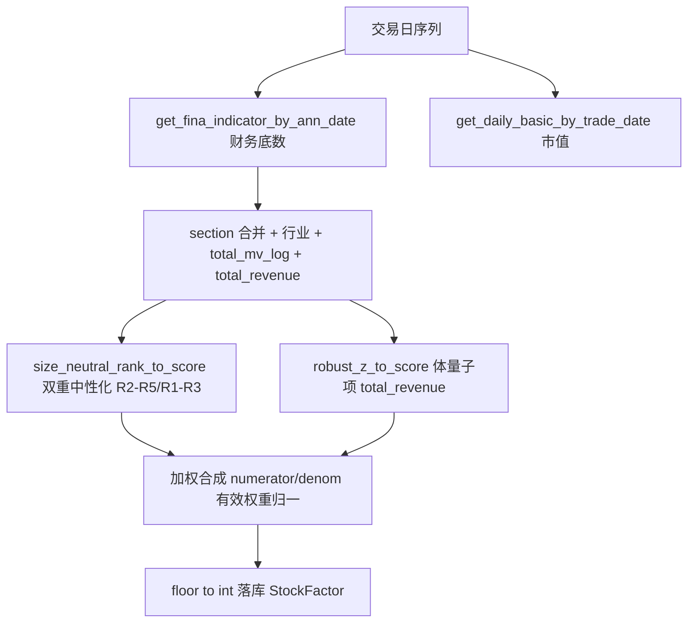

## 用户需求

盈利因子、成长因子存在与现金因子相似的规模偏差：大市值/大蓝筹因规模大、绝对基数高，相关子项在"全市场/行业内离散排名"下分数被压低，因子总分偏低；而新上市小票、高成长股因高增速与特定比率排名靠前，因子总分偏高，导致因子对龙头公司的质量与成长性区分度不足。

## 产品概述

在现有 `cal_profit_factor`、`cal_growth_factor` 基础上做规模偏差纠偏，使大蓝筹的盈利质量与成长性得到公平评价，并适度奖励规模优势。

## 核心功能

- 盈利因子：R2/R3/R4/R5 由全市场或行业内归一化改为"行业×市值分组"双重中性化，消除规模偏差；新增体量子项（总收入绝对值）奖励大蓝筹体量。
- 成长因子：R1/R2/R3 由全市场稳健标准化改为"行业×市值分组"双重中性化；新增体量子项（总收入绝对值）奖励规模优势。
- 市值缺口（停牌/无 mv）自动退化为行业内排名，因子分数仍落位 [-100,100]，缺项按有效权重归一，向下取整落库。

## 技术栈

- Python 3 + pandas（沿用现有工程，无新增依赖）
- 复用现有归一化函数 `rank_to_score`、`robust_z_to_score`（factor.py:30、67）与市值取数 `get_daily_basic_by_trade_date(td)`（参考 cal_size_factor:212、250-280）
- 复用现有财务取数 `get_fina_indicator_by_ann_date`，`total_revenue` 字段已在 `stock_fina_indicator` 表中（FACTOR_REGISTRY:113）

## 实现方案

### 总体策略

新增模块级辅助函数 `size_neutral_rank_to_score`，对目标子项先做"行业内按 log 市值分 N 组（qcut），组内 rank_to_score 映射 [-100,100]"的双重中性化；再为盈利/成长各加一个"总收入绝对值"体量子项（行业内 robust_z_to_score，天然奖励规模）。这与用户已确认的 A+B 组合（市值中性化 + 适度体量子项）、且按"市值分组 rank"（行业×市值双重分组）实现方式一致，并复用现金因子已落地的 R4 体量子项范式。

### 关键技术决策

1. **中性化用"分组 rank"而非回归**：分组 rank 无需线性假设、对右偏稳健，且与现有 `rank_to_score` 同值域 [-100,100]，可直接替换，不破坏落库契约。
2. **行业×市值双重分组**：先 `groupby("industry")[total_mv_log].transform(qcut, n_groups=5)` 得市值组，再 `groupby(["industry","_mv_group"])[value].transform(rank_to_score)`。大蓝筹只在"同行业同市值档"内比较，消除跨档规模压制。
3. **体量子项不中性化**：体量子项目的是奖励规模，故用行业内 `robust_z_to_score(total_revenue)`，使大收入龙头得高分；与中性化子项互补。
4. **市值缺失兜底**：`_mv_group` 为 NaN 时退化为"行业内 rank_to_score"，保证全股票均有分数（与现有 section 全股票 merge 口径一致）。
5. **权重（用户确认"适度"）**：

- 盈利：roe_yearly=2, roe=1, margin=1, netprofit_margin=1, ap_to_ar=1, total_revenue_scale=1（和 7）。
- 成长：tr_yoy=1, op_yoy=1, ocf_yoy=1, total_revenue_scale=1（和 4，等权）。
- 二者均数据驱动可调，回测后可用 analyze_factor_ic 微调。

### 性能与可靠性

- 每个交易日仅新增 1 次 `get_daily_basic_by_trade_date` 取市值 + 每子项 1~2 次 groupby transform，复杂度 O(截面数)，与现金因子现有开销同量级，无新增瓶颈。
- 缺项容错沿用现有 `numerator/denom` 有效权重归一模式；落库仍 `floor→int`，StockFactor 表结构不变。
- 不改变其他因子（规模/估值/波动/反转/现金）逻辑，控制改动爆炸半径。

## 实现注意事项

- `total_mv` 取自 `get_daily_basic_by_trade_date(td)`，需 `total_mv_log = np.log10(total_mv)`（<=0/NaN 置 NaN），merge 进 section；`total_revenue` 直接并入 `fina_fields`（同表，无需新查询）。
- 盈利因子金融降级逻辑沿用：`ap_to_ar` 仍对金融置 0；R6 体量子项对金融不置 0（收入口径行业可比）。
- 现金因子 R1-R3 目前仅行业中性化，如需与本次"市值分组"口径对齐可后续跟进，本次不改动以避免范围扩大。
- 验证：在 `analyze_factor_ic.py` 的 FACTORS 增加 profit/growth 子项，对比中性化前后 Rank IC/ICIR，确认规模偏差下降且龙头区分度提升。

## 架构设计

数据流向（与现状一致，仅扩展）：



## 目录结构

```
src/
├── factor.py                  # [MODIFY] 新增 size_neutral_rank_to_score 辅助函数；改造 cal_profit_factor 与 cal_growth_factor
│   └── (1) 归一化函数区新增 size_neutral_rank_to_score
│   └── (2) cal_profit_factor: 引入 total_mv/total_revenue，R2/R3/R4/R5 改双重中性化，新增 R6 体量，权重 2:1:1:1:1:1
│   └── (3) cal_growth_factor: 引入 total_mv/total_revenue，R1/R2/R3 改双重中性化，新增 R4 体量，权重 1:1:1:1
└── analyze_factor_ic.py       # [MODIFY] FACTORS 增加 profit/growth 子项，校验中性化与体量子项有效性（验证用，非必须）
```

## 关键代码结构

```python
def size_neutral_rank_to_score(
    section: pd.DataFrame,
    value_col: str,
    mv_log_col: str = "total_mv_log",
    n_groups: int = 5,
    alpha: float = 0.0,
    flip: bool = False,
) -> pd.Series:
    """行业×市值双重分组 rank 中性化：行业内按 log 市值分位分 N 组，组内 rank_to_score 映射 [-100,100]。

    - 市值缺失时退化为行业内 rank_to_score；
    - flip=True 表示方向取反（越小越好）；
    - 返回 Series 与 section 同索引，缺失 value 处为 NaN。
    """
```