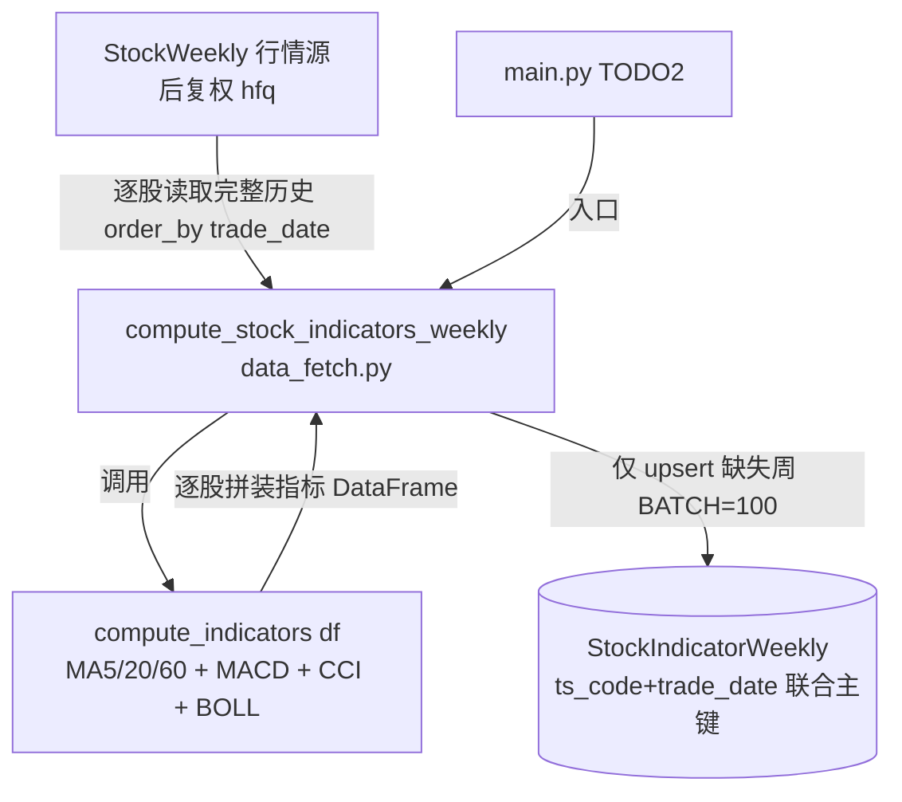

## 用户需求

基于现有周K线后复权数据（stock_weekly 表），为每只股票计算周线级别的技术指标并持久化，采用方案A（新建独立 ORM 表，不污染行情源）。

## 核心功能

- 删除项目中未被任何代码引用的 `src/indicators.py`（及其字节码缓存）。
- 新建独立 ORM 模型 `StockIndicatorWeekly`，联合主键与 `StockWeekly` 完全一致（`ts_code` + `trade_date`），存储以下周线技术指标：
- 移动均线：MA5、MA20、MA60（= 5/20/60 周）
- MACD：DIF、DEA、MACD 柱（= 2×(DIF−DEA)，快12/慢26/信号9 周）
- CCI：默认 14 周（TP=(H+L+C)/3，CCI=(TP−SMA)/(0.015×MD)）
- 布林带 BOLL：上轨、中轨、下轨（周期20周、2倍标准差）
- 在 `data_fetch.py` 新增 `compute_stock_indicators_weekly` 函数：逐股读取完整周K历史 → 计算全部指标 → 分批（BATCH=100）upsert 入库，支持细粒度断点续传。
- 计算逻辑（cci / compute_indicators / 调度函数）全部自包含于 `data_fetch.py`，不依赖已删除的 `indicators.py`。

## 关键约束

- 指标为派生数据，重算时需读取该股票完整周K历史以正确计算滚动窗口（MA60 需前59周、CCI 前13周、BOLL 前19周），再只写入缺失周。
- 前导窗口不足产生的 NaN 通过 `_has_value` 自动跳过写入，符合预期。

## 技术栈

- Python 3 + pandas + numpy（指标向量化计算）
- SQLAlchemy 2.0 ORM + SQLite（沿用现有 `database.py` 单例引擎与会话管理）
- 完全复用项目既有的 upsert 模板、`_has_value`、`_WEEKLY_FIELDS`、`_latest_week_trade_date` 模式，不引入新依赖。

## 实现方案

### 总体策略

采用"源/派生分离"的三段式：StockWeekly（源，Tushare 后复权）→ `compute_stock_indicators_weekly`（计算+调度）→ `StockIndicatorWeekly`（派生）。计算函数自包含于 `data_fetch.py`，入库函数照抄 `upsert_stock_weekly` 模板新增 `upsert_stock_weekly_indicator`。

### 关键技术决策

1. **独立表而非加列**：契合项目"每类数据一张表"约定，重抓行情不会触及指标，重算指标可全盘覆盖，耦合最小。
2. **续传窗口正确性**：续传时先 `session.query(StockWeekly).filter(ts_code==x).order_by(trade_date)` 取该股票全部历史算完指标，再仅 `df[~df.trade_date.isin(have)]` 过滤出缺失周 upsert；已追平到 `latest_week` 的整支跳过。绝不在计算前裁剪历史行，避免滚动窗口失真。
3. **MACD/EMA 用 `adjust=False`**：与现有 `indicators.py` 的 EWM 语义一致，保证结果稳定可复现。
4. **分批 flush（BATCH=100）**：与 `fetch_stock_weekly` 一致，控制单事务行数，降低内存峰值。

### 性能与可靠性

- 指标为纯 pandas 向量化计算，单只股票 O(n)；全市场约 5000 只、350 万行周K，计算可秒级完成。
- 瓶颈在逐股读取 StockWeekly 的 5000 次查询；本地 SQLite 索引为主键，开销可接受。若后续变慢可改为一次性 `query(StockWeekly).all()` 后 `groupby`，但会增加内存，当前维持与现有 fetch 一致的逐股查询以保证可读性与续传语义。
- 前导 NaN 经 `_has_value` 跳过，不会产生 IntegrityError。

## 实现注意事项

- 删除 `src/indicators.py` 前已确认无任何 `.py` 文件 import 它（仅 README/参考文档文字提及），删除安全；同步删除 `__pycache__/indicators*.pyc`。
- `data_fetch.py` 顶部 import 第14行需追加 `StockIndicatorWeekly, upsert_stock_weekly_indicator`；并新增 `import numpy as np`。
- 新增 `upsert_stock_weekly_indicator` 仅替换模型类名与 `_WEEKLY_INDICATOR_FIELDS`，逻辑与 `upsert_stock_weekly` 完全一致。
- `compute_stock_indicators_weekly` 复用 `_latest_week_trade_date`、`existing_map` 预加载、`BATCH=100`、`time.sleep(delay)` 等现有模式，保持风格统一。

## 架构设计



## 目录结构

```
buffeet/
├── src/
│   ├── indicators.py            # [DELETE] 无代码引用，删除文件与 __pycache__/indicators*.pyc
│   ├── database.py              # [MODIFY] 在 StockWeekly 模型之后新增 StockIndicatorWeekly 模型；
│   │                           #          新增 _WEEKLY_INDICATOR_FIELDS 字段映射与
│   │                           #          upsert_stock_weekly_indicator(df)（照抄 upsert_stock_weekly 模板）
│   └── data_fetch.py           # [MODIFY] 顶部 import 追加 StockIndicatorWeekly/upsert_stock_weekly_indicator，
│                               #           import numpy；新增 cci()、compute_indicators()、
│                               #           compute_stock_indicators_weekly() 三个函数（自包含，不依赖 indicators.py）
└── main.py                     # [MODIFY] 在 TODO 2 处接入 compute_stock_indicators_weekly() 调用（可选，便于验证）
```

## 关键代码结构

```python
# database.py —— 新增 ORM 模型（主键与 StockWeekly 一致）
class StockIndicatorWeekly(Base):
    __tablename__ = "stock_weekly_indicator"
    ts_code: Mapped[str]   = mapped_column(String(20), primary_key=True, comment="TS股票代码")
    trade_date: Mapped[str] = mapped_column(String(20), primary_key=True, comment="交易日期(周线当周最后交易日)")
    ma5: Mapped[float | None]  = mapped_column(Float, comment="5周均线")
    ma20: Mapped[float | None] = mapped_column(Float, comment="20周均线")
    ma60: Mapped[float | None] = mapped_column(Float, comment="60周均线")
    dif: Mapped[float | None]   = mapped_column(Float, comment="MACD DIF")
    dea: Mapped[float | None]   = mapped_column(Float, comment="MACD DEA")
    macd_bar: Mapped[float | None] = mapped_column(Float, comment="MACD 柱 2*(DIF-DEA)")
    cci: Mapped[float | None]   = mapped_column(Float, comment="CCI(14周)")
    boll_upper: Mapped[float | None] = mapped_column(Float, comment="布林带上轨")
    boll_mid: Mapped[float | None]   = mapped_column(Float, comment="布林带中轨(MA20)")
    boll_lower: Mapped[float | None] = mapped_column(Float, comment="布林带下轨")
    created_time: Mapped[datetime | None] = mapped_column(DateTime)
    updated_time: Mapped[datetime | None] = mapped_column(DateTime)

# data_fetch.py —— 单只股票指标计算（输入升序周K DataFrame，返回追加指标列）
def compute_indicators(df: pd.DataFrame) -> pd.DataFrame:
    ...  # MA5/20/60, MACD(dif/dea/macd_bar), CCI(14), BOLL(20,2σ)

# data_fetch.py —— 调度入口
def compute_stock_indicators_weekly(delay: float = 0.2, skip_existing: bool = True) -> pd.DataFrame:
    ...  # 逐股读完整历史 → compute_indicators → 仅 upsert 缺失周 → BATCH=100 flush
```