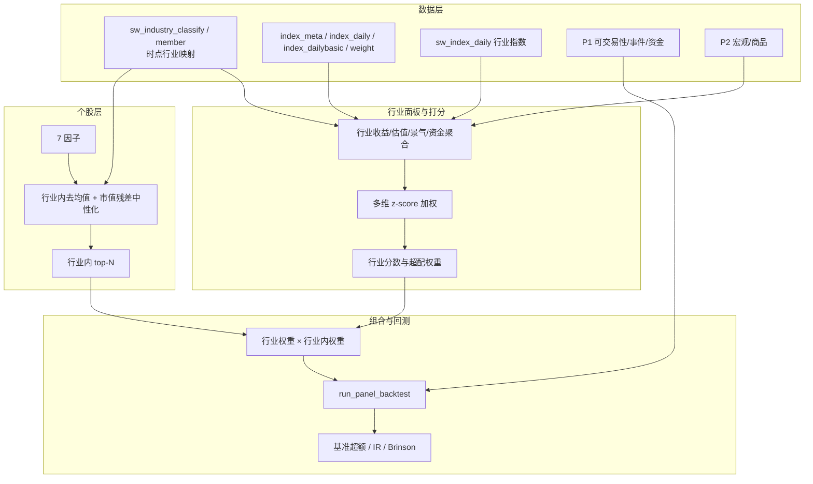

## 产品概述

在现有 7 因子（规模/估值/波动/反转/盈利/成长/现金）与个股截面回测闭环之上，补齐行业数据基础设施，构建「行业轮动 × 行业内选股」双层策略，并以宽基/行业指数为基准完成回测与归因。

## 核心功能

- **行业数据补齐**：申万行业分类与时点成分、行业指数行情与估值、宽基指数与权重、历史 ST/停牌/涨跌停、业绩预告/快报、资金流/北向/两融、股东户数、主营构成、宏观与商品期货。
- **权限探测与降级**：逐接口探测 Tushare 可用性，不可用自动跳过并在报告中标注，保证主流程不中断。
- **增量抓取**：按 trade_date / ann_date 增量，长区间分段限速，主键去重、幂等、断点续抓。
- **行业打分**：动量、反转、估值分位、景气（营收增速、PPI、商品价格）、资金流（北向、两融、成交额）多维标准化加权，输出行业分数与超配权重。
- **中性化设计**：极值缩尾、截面标准化、行业内去均值、市值残差中性化，严格 point-in-time。
- **双层策略**：行业层配置权重 × 行业内个股筛选权重，支持单行业上限、个股上限、换手约束与可交易性过滤。
- **回测与归因**：以中证 800 或对应申万行业指数为基准，计算超额收益、跟踪误差、信息比率，并做 Brinson 配置/选股效应分解。

## 边界与约束

- P0 行业基础设施优先，P1 可交易性/事件/资金、P2 宏观/商品递进实施。
- 不改动现有 7 因子计算与落库链路，复用现有回测引擎。
- 不新增外部依赖，继续使用 tushare。
- 行业归属、财务、资金等历史数据必须严格时点化，禁止前视。
- Tushare 积分档位未知，所有抓取必须具备权限探测与降级能力。

## 技术栈

- 语言与环境：Python 3.11，Windows / PowerShell；虚拟环境解释器 `.env/Scripts/python.exe`。
- 数据与计算：pandas、numpy、SQLAlchemy 2.0 + SQLite（`data/raw/stock.db`）、matplotlib、tushare；不新增依赖。
- 复用模块：`src/database.py`（ORM、`get_session`、`get_all_date`、upsert 范式）、`src/data_fetch.py`（`_pro`、`_date_windows`、delay/skip_existing）、`src/factor.py`、`src/strategies.py`、`src/backtest.py`、`src/analyze_factor_ic.py`（Rank IC 口径与中文字体）。

## 实现方案

### 总体策略

采用「数据层 → 行业面板 → 行业打分 → 中性化 → 双层组合 → 回测归因」的分层架构。先建立时点行业映射与行业指数两件基础设施，再做行业打分与个股中性化，最后复用既有 `run_panel_backtest` 完成组合回测，新增基准超额与 Brinson 归因。

### 关键决策

1. **时点行业映射是核心**：`index_member_all` 的 `in_date/out_date` 决定某股票在某截面归属哪个申万行业；若接口不可用，降级为 `stock_basic.industry` 快照并显式标注「非时点」，禁止用于行业轮动回测结论。
2. **行业指数双通道**：优先 `sw_daily`（含 PE/PB/市值）；不可用时用 `index_daily` 按申万指数代码取行情，估值用成分股聚合兜底。
3. **分层表设计而非大宽表**：行业分类、成分、指数行情、指数估值、指数权重分表存储，主键明确，便于增量与回溯。
4. **中性化在截面内完成**：先缩尾再标准化，行业内去均值消除行业 beta，再对 log 市值做截面 OLS 取残差；每期独立计算，天然时点安全。
5. **双层的权重可加性**：最终个股权重 = 行业权重 × 行业内权重，保证权重矩阵与现有引擎完全兼容，无需改动回测内核。
6. **权限自适应**：抓取脚本先跑探测矩阵，按可用接口动态组装任务清单，报告中列出跳过项与影响范围。

### 数据表设计（新增 ORM，主键与索引）

P0 行业基础设施：

- `sw_industry_classify`：`index_code`(PK)、`industry_name`、`level`、`parent_code`、`src`、时间戳。
- `sw_industry_member`：`index_code`+`con_code`(联合 PK)、`con_name`、`in_date`、`out_date`、`is_new`；索引 `(con_code, in_date)`。
- `index_meta`：`ts_code`(PK)、`name`、`market`、`publisher`、`category`、`base_date`、`base_point`、`list_date`。
- `index_daily`：`ts_code`+`trade_date`(联合 PK)、`open/high/low/close/pre_close/change/pct_chg/vol/amount`；索引 `(trade_date)`。
- `index_dailybasic`：`ts_code`+`trade_date`(联合 PK)、`total_mv/float_mv/total_share/float_share/free_share/turnover_rate/turnover_rate_f/pe/pe_ttm/pb/ps/ps_ttm/dv_ratio/dv_ttm`。
- `sw_index_daily`：`ts_code`+`trade_date`(联合 PK)、`name/open/low/high/close/change/pct_change/vol/amount/pe/pb/float_mv/total_mv`。
- `index_weight`：`index_code`+`con_code`+`trade_date`(联合 PK)、`weight`；索引 `(trade_date)`。

P1 可交易性与事件/资金：

- `stock_namechange`：`ts_code`+`start_date`+`name`(联合 PK)、`end_date`、`ann_date`、`change_reason`。
- `stock_suspend`：`ts_code`+`suspend_date`(联合 PK)、`suspend_type`、`resume_date`、`reason`。
- `limit_list_d`：`ts_code`+`trade_date`(联合 PK)、`name`、`close`、`pct_chg`、`amount`、`limit_amount`、`float_mv`、`total_mv`、`turnover_ratio`、`fd_amount`、`first_time`、`last_time`、`open_times`、`up_stat`、`limit_times`、`limit`。
- `stock_forecast`：`ts_code`+`ann_date`+`end_date`(联合 PK)、`type`、`p_change_min/max`、`net_profit_min/max`、`last_parent_net`、`first_ann_date`、`summary`、`change_reason`。
- `stock_express`：`ts_code`+`ann_date`+`end_date`(联合 PK)、`revenue`、`operate_profit`、`total_profit`、`n_income`、`total_assets`、`total_hldr_eqy_exc_min_int`、`diluted_eps`、`diluted_roe`、`yoy_net_profit`、`bps`、`yoy_sales`。
- `stock_moneyflow`：`ts_code`+`trade_date`(联合 PK)、`buy_sm/md/lg/elg_vol/amount`、`sell_sm/md/lg/elg_vol/amount`、`net_mf_vol`、`net_mf_amount`。
- `moneyflow_hsgt`：`trade_date`(PK)、`ggt_ss/ggt_sz/hgt/sgt/north_money/south_money`。
- `margin_detail`：`trade_date`+`ts_code`(联合 PK)、`name`、`rzye`、`rqye`、`rzmre`、`rqyl`、`rzche`、`rqchl`、`rqmcl`、`rzrqye`。
- `stk_holdernumber`：`ts_code`+`end_date`(联合 PK)、`ann_date`、`holder_nums`。
- `fina_mainbz`：`ts_code`+`end_date`+`bz_item`(联合 PK)、`bz_sales`、`bz_profit`、`bz_cost`、`curr_type`、`bz_type`。

P2 宏观/商品/公司行为：

- `macro_indicator`：`indicator`+`period`(联合 PK)、`value`；覆盖 ppi/cpi/pmi/m0/m1/m2。
- `fut_daily`：`ts_code`+`trade_date`(联合 PK)、`pre_close/settle/close/change1/change2/vol/amount/oi/oi_chg`。
- `dividend`：`ts_code`+`end_date`+`ann_date`+`div_proc`(联合 PK)、`stk_div`、`cash_div`、`cash_div_tax`、`record_date`、`ex_date`、`pay_date`。
- `share_float`：`ts_code`+`float_date`+`holder_name`(联合 PK)、`float_share`、`float_ratio`、`share_type`、`ann_date`。
- `stk_holdertrade`：`ts_code`+`ann_date`+`holder_name`+`begin_date`(联合 PK)、`holder_type`、`in_de`、`change_vol`、`change_ratio`、`after_share`、`after_ratio`、`avg_price`。
- `repurchase`：`ts_code`+`ann_date`(联合 PK)、`end_date`、`proc`、`exp_date`、`vol`、`amount`、`high_limit`、`low_limit`、`buy_amount`、`buy_vol`。

### 抓取脚本设计

- `src/fetch_industry.py`（P0）：
- `probe_permissions()`：对每个接口做一次最小参数调用，记录 `interface/ok/error/rows/sample_cols`，输出 `output/tushare_permission_report.csv`。
- `fetch_*` 函数：`fetch_industry_classify`、`fetch_industry_member`、`fetch_index_meta`、`fetch_index_daily`、`fetch_index_dailybasic`、`fetch_index_weight`、`fetch_sw_daily`。
- 增量：各表取 `MAX(date)` 作为起点，长区间用 `_date_windows` 分段，段间 `delay`；按主键去重后 upsert。
- 主流程按权限矩阵动态启用，缺失接口降级（行业指数→`index_daily`；行业分类→`stock_basic.industry` 并标注非时点）。
- `src/fetch_extras.py`（P1/P2）：以「接口名 → (抓取函数, 主键, 增量字段)」注册表驱动；逐接口权限门控；按 `trade_date` 或 `ann_date` 增量，按 `ts_code` 批量（每批 50/100，组间 delay）；输出覆盖度报告。
- 两个脚本均沿用 `data_fetch.py` 的 sys.path 双插入、`_pro` 初始化、`delay/skip_existing` 惯例。

### 行业打分模型

- 行业面板构建：按 `sw_industry_member` 的 `in_date/out_date` 生成每个截面的「股票 → 行业」映射；按行业聚合成分股的收益、市值、估值、成交额、财务。
- 维度与方向：
- 动量：行业指数 12/24 周收益（正向）；
- 反转：近 4 周收益（负向）；
- 估值分位：行业 PE_TTM/PB 的 3 年滚动分位（低分位正向）；
- 景气：行业营收/利润同比（PIT，按 ann_date）、PPI 同比、对应商品期货动量（正向）；
- 资金：北向净流入强度、两融余额变化、行业成交额占比变化（正向）。
- 合成：各维度截面 z-score（缩尾后），按可配置权重加权；权重缺省等权，支持按 IC 方向调整；输出 `industry_score`（行业 × 日期）。
- 权重映射：按分数排序取多头组合，行业权重上限（如基准权重的 2 倍或绝对 20%），归一化到 1；支持空仓阈值。

### 中性化设计

- 处理顺序：缩尾（1%/99%）→ 截面 z-score → 行业内去均值 → 市值残差化。
- 行业内去均值：`f_neu = f - mean(f | industry)`，缺失行业归入「未知」并单独处理。
- 市值中性：对每个截面做 `f ~ a + b·log(total_mv)` 的 OLS，取残差；用 numpy `lstsq` 批量求解。
- 稳健性：单行业样本数低于阈值（如 5）时跳过行业去均值；缺失值不填零，保留 NaN 后在选股时剔除。
- 严格时点：行业映射用 in_date/out_date，市值用当日 `total_mv`，财务用 `ann_date`。

### 双层策略

- `IndustryRotationStrategy`：由 `industry_score` 生成行业权重向量（行业 × 日期）。
- `TwoLayerStrategy`：每个截面先按行业权重分配资金，再在每个行业内按中性化后的综合因子选 top-N 等权；最终权重 = 行业权重 × 行业内权重。
- 约束：单股上限、单行业上限、行业内最少股票数、停牌/涨跌停/ST/次新过滤；权重矩阵直接兼容 `run_panel_backtest`。

### 回测与归因

- 扩展 `src/backtest.py`：新增 `load_benchmark_returns(index_code)`、`performance_vs_benchmark()`（超额年化、跟踪误差、信息比率、Beta/Alpha）、`brinson_attribution()`（配置/选股/交互效应）。
- 新增 `src/analyze_industry.py`：驱动行业打分 IC/分位检验、双层策略回测、基准对比与 Brinson 分解，输出 CSV（utf-8-sig）与中文图表。

### 性能与可靠性

- 行业维度仅数十到百余个，行业面板与打分均为小矩阵运算，开销可忽略。
- 中性化为逐截面 OLS（约 5000×2 设计矩阵），448 个截面在秒级完成；用 numpy 向量化避免逐股循环。
- 抓取按接口分段限速，单接口失败不影响整体；所有 upsert 幂等，可重复执行。
- 数据落库前统一主键去重，避免 SQLite 唯一约束冲突。

### 向后兼容

- 保留现有 7 因子、`strategies.py`、`backtest.py` 既有接口；新增能力以新表、新函数、新脚本方式扩展。
- 行业降级路径（无申万权限）仍可运行，但输出中标注「行业归属非时点，结论仅供参考」。

## 架构设计



## 目录结构

```text
buffeet/
├── src/
│   ├── database.py            # [MODIFY] 新增 P0/P1/P2 共约 20 张 ORM 表与索引；
│   │                          #   每表配套 upsert_*（沿用 drop_duplicates→主键集合→更新/新增→时间戳）；
│   │                          #   新增查询助手：get_industry_member、get_index_daily、
│   │                          #   get_index_dailybasic、get_sw_index_daily、get_index_weight、
│   │                          #   get_moneyflow、get_margin_detail、get_fina_mainbz 等。
│   ├── fetch_industry.py      # [NEW] P0 抓取与权限探测。probe_permissions 输出可用性报告；
│   │                          #   fetch_industry_classify/member/index_meta/index_daily/
│   │                          #   index_dailybasic/index_weight/sw_daily；增量+分段限速+幂等；
│   │                          #   缺权限时降级（index_daily 兜底行业指数、快照行业兜底分类）。
│   ├── fetch_extras.py        # [NEW] P1/P2 抓取。注册表驱动「接口→函数→主键→增量字段」；
│   │                          #   namechange/suspend_d/limit_list_d/forecast/express/moneyflow/
│   │                          #   moneyflow_hsgt/margin_detail/stk_holdernumber/fina_mainbz/
│   │                          #   dividend/share_float/stk_holdertrade/repurchase/cn_ppi/cn_cpi/
│   │                          #   cn_pmi/cn_m/fut_daily；逐接口门控与覆盖度报告。
│   ├── industry_factor.py     # [NEW] 时点行业映射构建、行业聚合、五维打分与行业权重；
│   │                          #   提供 build_industry_panel / compute_industry_scores /
│   │                          #   industry_weights；严格 PIT。
│   ├── neutralize.py          # [NEW] 缩尾、截面 z-score、行业内去均值、log 市值 OLS 残差；
│   │                          #   neutralize_cross_section / neutralize_panel 批量接口。
│   ├── industry_strategy.py   # [NEW] IndustryRotationStrategy 与 TwoLayerStrategy；
│   │                          #   输出与现有引擎兼容的「股票×日期」权重矩阵，含行业/个股/换手上限。
│   ├── backtest.py            # [MODIFY] 新增 load_benchmark_returns、performance_vs_benchmark、
│   │                          #   brinson_attribution；保留现有 run_panel_backtest 等接口不变。
│   └── analyze_industry.py    # [NEW] 端到端驱动：行业打分有效性、双层策略回测、基准对比、
│                              #   Brinson 归因与图表输出（utf-8-sig / 中文图）。
└── output/                    # [生成] 权限报告、行业覆盖度、行业分数、组合绩效、归因与图表。
```

## 关键代码结构

```python
# database.py：时点行业成分表（其余表同范式）
class IndustryMember(Base):
    __tablename__ = "sw_industry_member"
    index_code: Mapped[str] = mapped_column(String(20), primary_key=True)
    con_code: Mapped[str] = mapped_column(String(20), primary_key=True)
    con_name: Mapped[str | None] = mapped_column(String(50))
    in_date: Mapped[str | None] = mapped_column(String(20))
    out_date: Mapped[str | None] = mapped_column(String(20))
    is_new: Mapped[str | None] = mapped_column(String(4))
    __table_args__ = (Index("ix_member_con", "con_code", "in_date"),)
```

```python
# neutralize.py：截面中性化入口
def neutralize_cross_section(
    factor: pd.Series,
    industry: pd.Series,
    log_mv: pd.Series | None = None,
    winsor: tuple[float, float] = (0.01, 0.99),
    min_industry_n: int = 5,
) -> pd.Series:
    """缩尾 → z-score → 行业内去均值 → log 市值 OLS 残差；返回同索引因子值。"""
```

```python
# industry_strategy.py：双层权重生成
class TwoLayerStrategy:
    def generate_weights(self, factor_panel, industry_map, industry_scores,
                         trade_dates, top_n: int = 5,
                         max_industry_weight: float = 0.20,
                         max_stock_weight: float = 0.05) -> pd.DataFrame:
        """返回 ts_code × trade_date 权重矩阵，可直接传入 run_panel_backtest。"""
```

## 验证要点

- 权限探测：`output/tushare_permission_report.csv` 覆盖全部目标接口，明确可用/不可用与降级路径。
- 行业时点正确性：抽查若干股票在两个不同截面的行业归属，确认按 in_date/out_date 切换；与快照行业对比差异并记录。
- 覆盖度：`sw_index_daily`/`index_daily` 在回测区间内行业与基准无缺口；缺失日期与行业需列出。
- 中性化效果：行业内去均值后各行业均值接近 0；市值残差与 log 市值相关系数绝对值小于 0.05。
- 双层策略：相对单层选股的年化超额、信息比率、最大回撤改善可量化复现；换手率与行业集中度在约束内。
- Brinson：配置 + 选股 + 交互效应之和与总超额在容差内一致。
- 幂等性：同一区间重复抓取与回测结果一致；主键无重复。

## Agent Extensions

### SubAgent

- **code-explorer**
- Purpose：在新增 ORM 表与抓取脚本前，复核 `database.py` 的 Base/索引/upsert 精确写法、`data_fetch.py` 的 `_pro`/`_date_windows`/delay 惯例，以及现有回测与因子接口签名，避免破坏既有链路。
- Expected outcome：产出一份「可复用接口与范式清单」（文件路径、函数签名、列常量、主键与去重逻辑），确保新增表与脚本严格对齐现有架构。